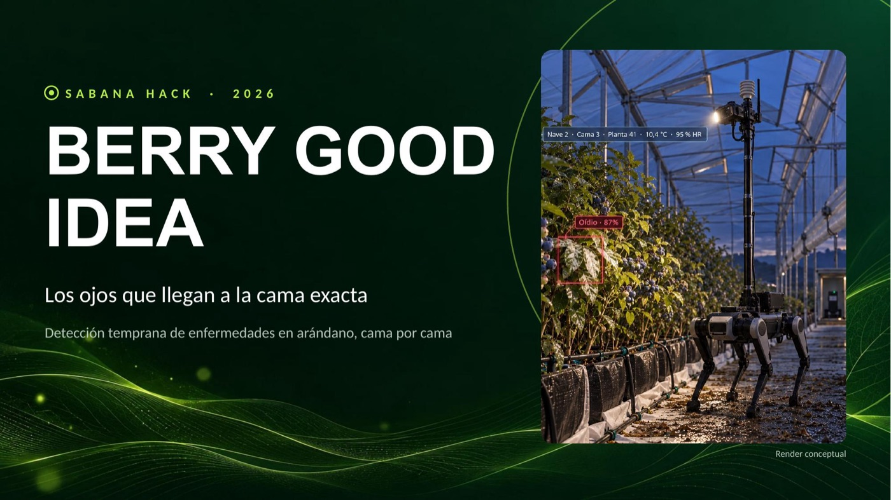
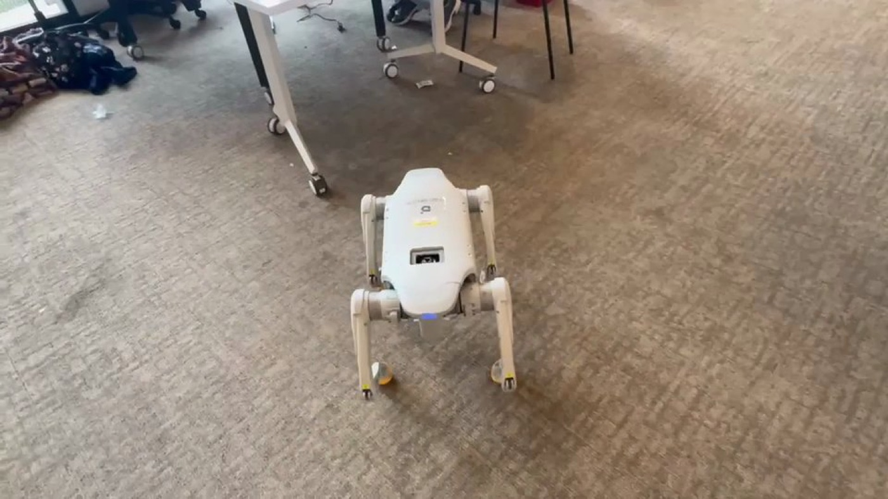
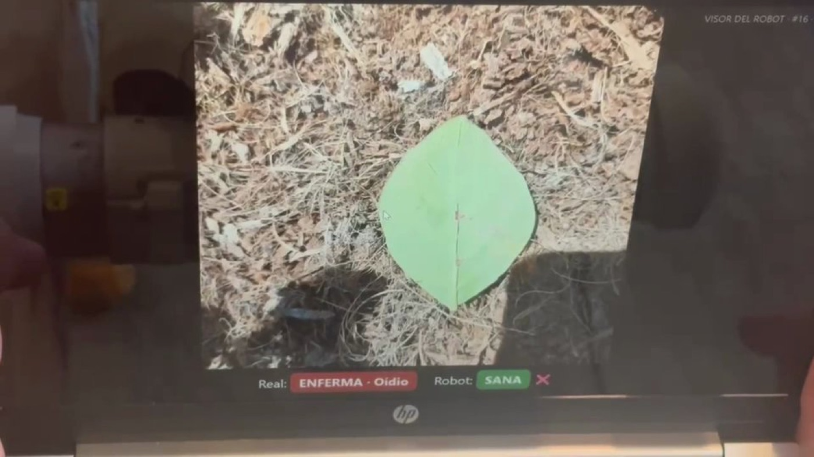
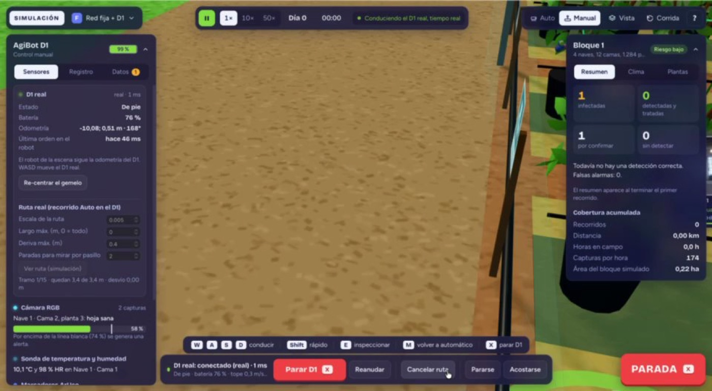
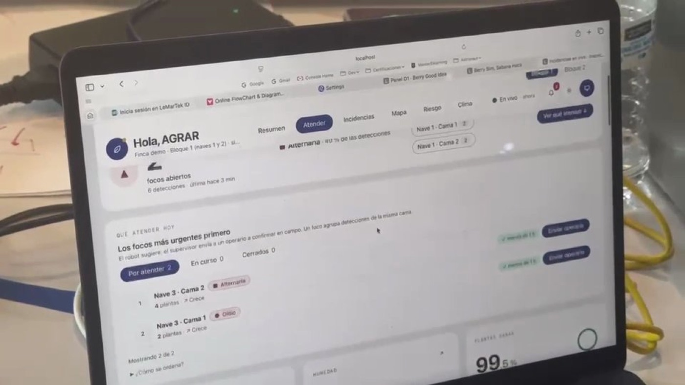
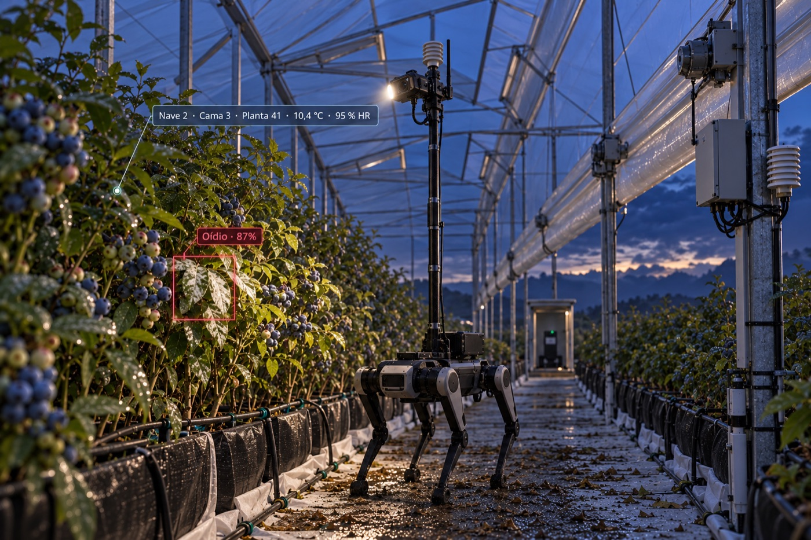
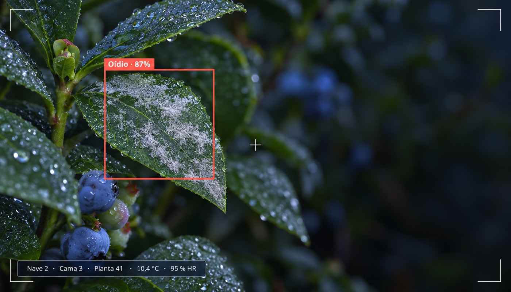
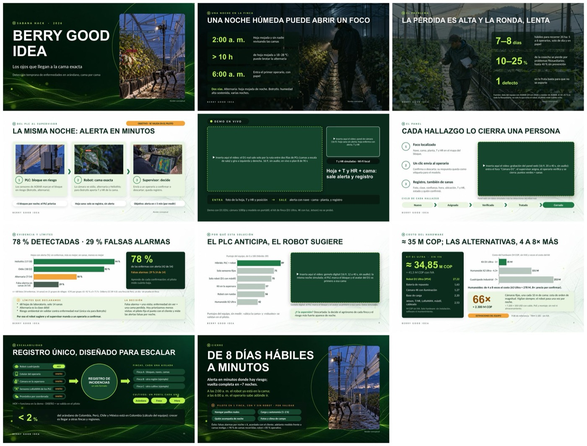

# Berry Good Idea · Sabana Hack 2026

**Detección temprana de enfermedades en arándano, cama por cama, con un robot que patrulla de noche.**
<p align="center"></p>

Reto *Berry Good Idea* (Sabana Hack 2026) · cliente de referencia: AGRAR (automatización de invernaderos).

## El problema
Hoy 5–6 operarios tardan **7–8 días hábiles** en recorrer una finca de ~20 ha, solo de día y en papel. Las enfermedades (oídio, alternaria, botrytis) avanzan de noche, con la hoja mojada.

## La solución
Híbrido: los **PLC y sensores de AGRAR** marcan qué bloque está en riesgo → un **robot cuadrúpedo AgiBot D1** patrulla de noche empezando por esas camas, mira a ambos lados y **clasifica la hoja** con su cámara → la alerta llega en minutos con **nave, cama, planta, temperatura y humedad** → en el panel el **supervisor** elige el bloque, prioriza los focos y **envía a un operario** a confirmar → todo queda registrado (también las hojas sanas).

```
Cámara D1 (RTSP) ──► datos/robot/panel_demo.py (clasificador CLIP, :8092) ──► sim/sim-core (FastAPI, :8010)
                                                                                 │  ▲
D1 real ◄── SDK ◄── robot_d1/d1_bridge.py (Docker/OrbStack) ◄── WebSocket ───────┘  │
                                                                                     │
sim/web (gemelo 3D, :5173)  ◄──── estado ────┘        dashboard/ (panel del supervisor, :5180)
```

## Así se ve
| Robot real en la demo | Cámara del D1 leyendo hojas |
|---|---|
|  |  |
| **Gemelo digital (simulador 3D)** | **Panel del supervisor** |
|  |  |
| **Concepto: el robot en campo** *(render)* | **Concepto: lo que ve la cámara** *(render)* |
|  |  |

**Pitch** (`presentacion/BerryGoodIdea_pitch.pptx`, 11 diapositivas + respaldo; los videos de la demo no se suben por tamaño):



## Estructura
| Carpeta | Qué hay |
|---|---|
| `docs/` | Rúbrica, cifras clave (fuente de verdad), respuestas del mentor, guía de conexión del robot, handoff |
| `datos/` | Pipeline del clasificador (`pipeline/`), modelos de riesgo (`riesgo/`), panel de cámara y scripts del robot (`robot/`), clima, finanzas, escalabilidad, reportes y resultados ligeros; **modelo en uso**: `datos/resultados/ml/modelo_camara/` |
| `sim/` | Simulador y gemelo digital: `sim-core` (FastAPI, motor, ruta real, dashboard API) y `web` (React + Three.js) |
| `dashboard/` | Panel del supervisor (React + Tailwind): focos, mapa cenital, registro, riesgo, selector de bloque |
| `robot_d1/` | Controlador y puente propios para el AgiBot D1 (sin el SDK del fabricante) |
| `presentacion/` | Pitch (PPTX), guion, diseño, prompts e imágenes (renders conceptuales) |

## Cómo correrlo
```bash
# 1) Simulador (backend) — :8010
cd sim/sim-core && python3 -m venv .venv && .venv/bin/pip install -r requirements.txt && .venv/bin/uvicorn server:app --host 0.0.0.0 --port 8010
# 2) Gemelo 3D — :5173
cd sim/web && npm install && npm run dev
# 3) Dashboard del supervisor — :5180
cd dashboard && npm install && npm run dev
# 4) Panel de cámara + clasificador — :8092 (necesita el robot en la misma red)
cd datos && python3 -m venv .venv && .venv/bin/pip install -r requirements.txt
HF_HUB_OFFLINE=1 .venv/bin/python -I robot/panel_demo.py --robot-ip <IP_ROBOT> --port 8092 --modelo resultados/ml/modelo_camara --sim-url http://localhost:8010
# 5) Puente con el D1 real (Docker/OrbStack + SDK de AgiBot, ver docs/GUIA_ROBOT_SIN_INTERNET.md)
MAC_IP=<IP_MAC> ROBOT_IP=<IP_ROBOT> bash datos/robot/abrir_puente.sh red
```
Visor de hojas para mostrar a la cámara: `http://<IP_MAC>:8092/hoja?robot=1`.

## Resultados (ver `docs/CIFRAS_CLAVE.md`)
- Clasificador con la cámara del robot: **78 %** de hojas enfermas con alerta y **29 %** de falsas alarmas (68 hojas de laboratorio, solo 14 sanas: intervalos anchos). Alternaria es la clase débil.
- Riesgo ambiental (botrytis, antracnosis, roya) con modelos publicados y aproximaciones marcadas; **sin validar** contra enfermedad real.
- Hardware por finca ≈ **34,85 M COP sin IVA** (≈ 41,5 M con IVA); ~66× menos que cámaras fijas por cama.

## Estado y límites
Prototipo funcional: ruta autónoma del D1 real a escala de sala, clasificación en vivo, alerta y registro en el panel, gemelo con dos bloques. Pendiente: piloto en cultivo real con fotos locales, Jetson a bordo, integración real con PLC/LoRaWAN de AGRAR, sensor T/HR a bordo (hoy simulado).

## No incluido (por tamaño o licencia)
Datasets crudos (DrBerry, PlantDoc, etc.), pesos base de modelos, el **SDK y los manuales de AgiBot** y credenciales. Cómo obtenerlos: [REFERENCIAS.md](REFERENCIAS.md).
