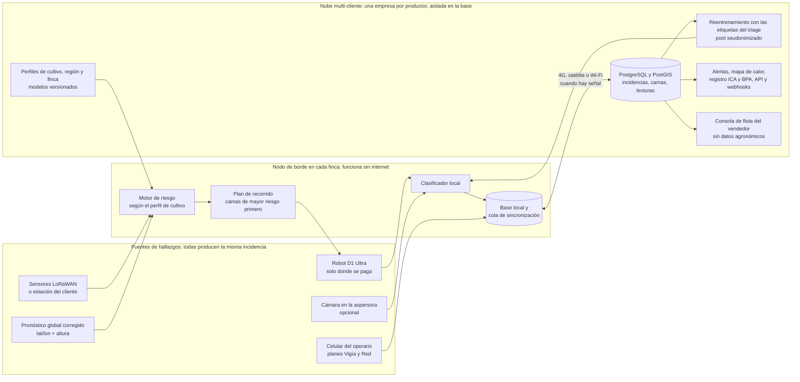
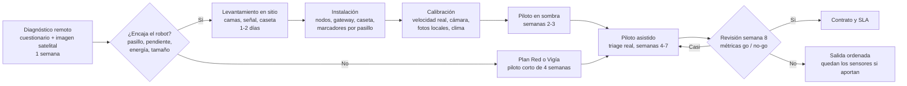

# Escalabilidad: de una finca de demo a un producto que se vende a muchos productores

Sabana Hack 2026, reto "Berry Good Idea". Rol: integrador de escalabilidad. Fecha: 2026-10-23.

**Para qué sirve este documento.** La organización que plantea el reto quiere vender la solución a muchos productores y a otros frutales, no instalarla en una sola finca. Aquí se junta en un solo lugar lo que produjeron siete roles (modelo de negocio, arquitectura, cultivos, clima global, operación, datos y mercado) y lo que corrigieron dos verificadores. **Cuando un rol y un verificador no coinciden, manda el verificador.** El clima de la Sabana de Bogotá aparece solo como ejemplo de la demo y como banco de prueba: en el producto, la región y el cultivo son parámetros.

**Cómo leer las cifras**

| Marca | Significado |
|---|---|
| URL | Cifra leída en una página abierta por el rol o por el verificador |
| CÁLCULO | Salida de un script del equipo. Se indica cuál; todos se pueden volver a correr (sección 12) |
| SUPUESTO | Valor del equipo, sin fuente. Se valida en el piloto o con el mentor |
| NO VERIFICADO | Visto solo en un resumen, en prensa o en una página que no abrió |
| PROPUESTA | Decisión de diseño o precio que proponemos |
| CONTEXTO | Dato que trajo el equipo y que nadie verificó |

Todos los montos van en USD por año, salvo que se diga otra cosa. TRM: 3.185,01 COP/USD del 2026-10-23 ([datos.gov.co](https://www.datos.gov.co/resource/32sa-8pi3.json)).

---

## 0. Antes de usar cualquier cifra: lo que cambió con la verificación

Estas correcciones vienen de `reportes/escala-verificacion-negocio.md` y `reportes/escala-verificacion-tecnica.md`. Algunas todavía no están aplicadas en el documento principal del pitch ni en los reportes de otros roles.

| Se decía | Lo correcto | Evidencia |
|---|---|---|
| "Antracnosis: Miles 2013" | Lo que corre es **Wilson 1990 (fruto de fresa) con una aproximación en arándano de Gillett y Schilder 2009**. Los coeficientes de Miles 2013 nunca se obtuvieron | `riesgo/README.md` §2.1 d |
| "Saga Thorvald trata con UV-C y no diagnostica" | Saga **sí detecta** enfermedades y plagas con cámara desde 2025 ("We can also recognize outbreaks of diseases and pests"). Nuestra diferencia es el paquete completo y la neutralidad, no "ver la enfermedad" | [AgFunderNews, 2025-08-08](https://agfundernews.com/saga-robotics-raises-11-2m-to-expand-fleet-of-bots-blasting-powdery-mildew-with-uv-c-light) |
| "El D1 EDU trae ROS 2" | La guía oficial del SDK dice "Currently, there is no ROS interface available". Hay SDK en Python y C++; la navegación por pasillo es desarrollo propio | `raw/agibot_docs/AGIQUAD_D1_Edu_Ultra_SDK_Guide_V2.0.7.pdf` §6.18 (archivo local) |
| "Híbrido ~430 USD/ha/año, equilibrio 72 kg/ha" | 430 es una **cifra de costo anterior**, no un beneficio ni un precio. Finanzas calcula hoy **722 USD/ha/año** para el híbrido en 20 ha (equilibrio 120 kg/ha solo con fruta, 1 % de la cosecha). El modelo de negocio propone **520 USD/ha** como precio con robot | CÁLCULO `finanzas/tabla_final_20ha.csv`, `escalabilidad/unit_economics.py` |
| "El RaaS se paga desde 1.071 ha" | **1.358 ha** (150 % del arándano colombiano). El híbrido sí queda en 1.071 ha | CÁLCULO `unit_economics.py` tabla 7, corregida |
| "D1 MaxPro ~60 ha como servicio" | **25–50 ha** según la velocidad. Solo como inspector deja margen de −32 % y no se paga | CÁLCULO `operacion/capacidad.csv`, `unit_economics.py` tabla 5 |
| "La empresa B no ve nada de la A" | Se probó con 11 pruebas funcionales y 11 ataques entre empresas. **10 ataques quedaron bloqueados y 2 siguen abiertos** (X1 y V5d) | `escalabilidad/verificacion_tecnica/resultado_ataques.txt` |
| "El registro ICA sale solo" | La Res. ICA 824/2022 obliga solo a quien produce o empaca **para exportar en fresco** (art. 2). Para el mercado nacional el argumento es BPA | [Res. ICA 824/2022](https://www.ica.gov.co/importacion-y-exportacion/planes-trabajo-exportacion-vegetales/documentos-relacionados/resolucion_ica_824_2022.aspx) |
| "Calibrar 14 días arregla el mojado foliar" | Corrige sobre todo el **sesgo**. Con las 4 estaciones juntas, el error de horas mojadas solo baja de 4,1 a 3,4 h/día | CÁLCULO `clima_global/resultados/calibracion_resumen.csv` |

---

## 1. Tesis en 3 líneas

1. **Lo que se vende es la plataforma, no el perro robot.** El mismo registro de incidencias cama por cama, con riesgo por clima y triage agrónomo→operario, funciona con el robot, con el celular del operario o con una cámara en la aspersora, y se configura por perfil de cultivo y región sin tocar el código.
2. **El robot va solo donde se paga.** Se ofrece un menú por tamaño de finca: plan Red (sensores y app) para fincas pequeñas y frutales de menor valor, robot como servicio para fincas medianas y compra para las grandes. El número de robots y su precio se fijan después de medir la velocidad real en la semana 1 del piloto.
3. **Colombia es la vitrina, no el volumen.** Hay 907 ha de arándano en Colombia, y el negocio solo cubre su estructura desde ~1.071 ha. Por eso nace multicultivo (25.034 ha de otros frutales en Colombia) y multipaís (26.786 ha en Perú). Además, cada finca que entra mejora el modelo de todas.

---

## 2. Modelo de negocio recomendado

### 2.1 La recomendación

El modelo **híbrido**: una sola plataforma vendida en planes según el segmento. Según `unit_economics.py`, es el único modelo que deja al productor 3 dólares o más por cada dólar pagado en los tres segmentos. Además usa la mitad del capital del RaaS puro (CÁLCULO). Pero tiene tres condiciones que la verificación hizo explícitas:

1. **El robot se cobra por robot instalado, con un mínimo.** El margen sube y baja con el tamaño de la finca, en dientes de sierra (tabla 2.4).
2. **Los frutales de menor valor llevan casi nada de hardware por finca.** Con el kit de sensores completo, la mora no se paga (sección 2.8).
3. **El precio del robot se confirma en el piloto.** La ventana de precio existe solo con los supuestos más optimistas de capacidad (sección 2.7).

### 2.2 Lista de precios propuesta

| Plan | Para quién | Incluye | Precio (PROPUESTA) | Estado |
|---|---|---|---|---|
| **Vigía** (red ligera) | Mora, uchuva, gulupa, aguacate Hass, fincas de menos de 3 ha o aisladas | Estación virtual o estación compartida por la asociación, kit itinerante de calibración de 2 a 4 semanas, app de celular para fotos, modelos de riesgo, alertas y registro | Objetivo: 60 USD/ha/año o menos, sin hardware fijo por finca (SUPUESTO de `mercado.md`) | **No cierra todavía.** Con kit por finca y 60 USD/ha, el vendedor pierde 7 % y el ROI del productor de mora es ~1,1x (CÁLCULO de la verificación de negocio) |
| **Red** (SaaS + kit) | Arándano y fresa de 3 a ~25 ha; puerta de entrada para todos | Nodos LoRaWAN de mojado foliar, T y HR, gateway, modelos por cultivo, alertas con triage, registro cama por cama y clasificador con foto de celular | 130 USD/ha/año, mínimo 450 USD por finca, más el kit (~1.314 USD en una finca de 5 ha) | CÁLCULO `unit_economics.py`. Vendido por un canal: margen de 31 % y ROI de 3,4x |
| **Red + Robot** (RaaS) | Fincas de ~25 ha o más | Todo lo del plan Red, más un D1 Ultra con mástil, técnico, baterías, repuestos y mapa de calor | 520 USD/ha/año, **con un mínimo por robot instalado** (por ejemplo, 25 ha × 520 = 13.000 USD/año; PROPUESTA de la verificación) | CÁLCULO. El número de robots se fija tras medir la velocidad en la semana 1 |
| **Compra + licencia** | Fincas de 100 ha o más con equipo técnico | Robot con mástil a 15.659 USD, kit de red, licencia y soporte con baterías | 90 USD/ha/año de licencia + 22 % del hardware al año de soporte | CÁLCULO. ROI de 3,4x en 120 ha |
| **Flota** (cuentas grandes) | Agroexportadoras de Perú, Chile y México con más de 1.000 ha | Flota de D1 Ultra repartida entre fincas y API hacia su ERP. El MaxPro no entra salvo que también aplique producto | Por ha y por contrato. Una cuenta de 1.000 ha a 520 USD/ha = 520.000 USD/año (CÁLCULO) | Etapa 3 (sección 8) |

**Referencias de precio del mercado.** Nadie publica un precio por "detección cama por cama + alerta + registro".

| Referencia | Precio | Fuente |
|---|---|---|
| METOS, licencia de modelo de enfermedad (1 cultivo, 1 año, requiere estación) | 96 EUR/año | [shop.metos.at](https://shop.metos.at/products/disease-model-license-for-1-year) |
| METOS, estación virtual (pronóstico + modelos, sin hardware) | 336 EUR/año | [shop.metos.at](https://shop.metos.at/products/imetos©-virtual-weather-station) |
| Taranis, imágenes aéreas | 15–20 USD/acre por temporada (2018) | [The Spoon](https://thespoon.tech/taranis-harvests-20m-for-aerial-imaging-tech-that-detects-crop-diseases) |
| Saga Robotics, servicio por ha | Cuota fija por ha, no publicada | [Future Farming](https://www.futurefarming.com/tech-in-focus/field-robots/robot-combats-powdery-mildew-in-strawberries-using-uv-c-treatment/) |
| AgiBot D1 Ultra | 9.600 USD de lista (sin envío ni aranceles); el equipo usa 7.499 USD FOB México (CONTEXTO) | [store.agibot.com](https://store.agibot.com/products/d1-ultra) |

### 2.3 Economía del vendedor por segmento

En régimen: muchas fincas iguales, sin la estructura fija. Fuente: CÁLCULO `unit_economics.py`, tabla 5. La verificación de negocio recalculó a mano las filas de RaaS en 30 ha y de SaaS por canal en 5 ha, y cuadran.

| Segmento y plan | Precio de lista/ha | Ingreso vendedor/ha | Costo vendedor/ha | Margen bruto | CAPEX vendedor por finca | Payback (meses) |
|---|---|---|---|---|---|---|
| **RaaS dedicado, finca de 30 ha** | 520 | 520 | 401 | **23 %** | 17.287 | 23 |
| RaaS dedicado, finca de 120 ha | 520 | 520 | 365 | 30 % | 61.048 | 19 |
| RaaS en ruta, finca de 5 ha | 620 | 620 | 608 | 2 % | 3.745 | 37 |
| **SaaS + kit por canal y autoinstalable, finca de 5 ha** | 130 | 196 | 135 | **31 %** | 250 | 8 |
| SaaS + kit, finca de 30 ha | 130 | 185 | 87 | 53 % | 800 | 3 |
| Venta + licencia, finca de 120 ha | 90 | 452 | 319 | 29 % | 800 | 1 |
| Venta + licencia, finca de 5 ha | 90 | 1.946 | 1.654 | 15 % | 800 | 6 |
| D1 MaxPro compartido, finca de 30 ha | 620 | 620 | 820 | **−32 %** | 48.354 | 145 |

En SaaS y en venta, el ingreso incluye el hardware vendido, anualizado.

**A dónde se va el costo del RaaS en 30 ha** (401 USD/ha, CÁLCULO tabla 5c):

| Rubro | USD/ha/año |
|---|---|
| Depreciación del robot (CAPEX puesto en finca 11.599 USD, vida 3 años SUPUESTO) | 129 |
| Mantenimiento, seguro y baterías del robot. Las baterías son 65 USD/ha: 4,3 por año × 450 USD (precio NO VERIFICADO) | 107 |
| Red de sensores | 61 |
| Técnicos | 64 |
| Agrónomo remoto (1 por cada 1.500 ha, SUPUESTO) | 27 |
| Instalación + costo de adquisición de cliente | 9 |
| Nube | 4 |
| **Total** | **401** |

El robot es el 59 % del costo. En la finca pequeña lo que más pesa es el técnico que traslada el robot (209 USD/ha), por eso a esa finca se le vende el plan Red.

### 2.4 El margen del robot depende del tamaño de la finca

RaaS a 520 USD/ha, robots enteros, camas a 3,0 m. Fuente: CÁLCULO `unit_economics.py`, tabla 5d (nueva, de la verificación de negocio).

| Finca (ha) | 15 | 20 | 25 | 30 | 35 | 40 | 50 | 60 | 70 | 100 |
|---|---|---|---|---|---|---|---|---|---|---|
| Robots | 1 | 1 | 1 | 1 | 1 | 2 | 2 | 2 | 2 | 3 |
| Margen del vendedor | −42 % | **−9 %** | 10 % | 23 % | 32 % | **−2 %** | 15 % | 27 % | 36 % | 35 % |

**Qué significa para vender a muchos productores.** Los proyectos de arándano en Colombia van de 5 a 30 ha ([El Colombiano, 2026](https://www.elcolombiano.com/negocios/arandanos-en-colombia-cultivos-expansion-FA33220603)). Cobrar por ha sin mínimo pierde dinero justo en la finca típica. Hay dos salidas:

| Opción | Cómo funciona | Efecto (CÁLCULO con las cifras del modelo) |
|---|---|---|
| Mínimo por robot instalado | Cada robot factura al menos el equivalente a 25 ha | Finca de 20 ha: paga 650 USD/ha efectivos; el vendedor gana 12,5 % y el productor recibe 2,4x. Finca de 15 ha: 867 USD/ha y 1,8x |
| Robot compartido entre fincas vecinas | Rotación en un clúster de fincas a menos de 45 min (`operacion.md`) | Cuesta ~276 USD/ha/año de técnico; el RaaS en ruta deja de 2 % a 14 % de margen (tabla 5b) |

Conclusión: **por debajo de ~25 ha, el plan recomendado es Red**, con visitas puntuales del robot cuando la red marca riesgo alto.

### 2.5 Economía del productor

Fuente: CÁLCULO `unit_economics.py`, tablas 4, 5 y 10.

| Concepto | Red + Robot | Solo Red |
|---|---|---|
| Cosecha salvada (USD/ha/año) | 1.440 | 720 |
| Fungicida ahorrado | 90 | 48 |
| Scouting ahorrado | 115 | 0 |
| **Valor total por ha** | **1.645** | **768** |
| Precio máximo que acepta con ROI 3x | 548 | 256 |
| Precio propuesto | 520 | 130 |
| Costo total del productor por ha, con el tiempo de su operario | 537 (finca de 30 ha) | 228 (finca de 5 ha) |
| **ROI del productor** | **3,1x** | **3,4x** |
| Equilibrio (ROI 1x) | 90 kg/ha, el 0,75 % de la cosecha | 38 kg/ha, el 0,3 % |

**Supuestos detrás de estas cifras.**

| Supuesto | Valor | Marca y contraste |
|---|---|---|
| Rendimiento | 12 t/ha | CONTEXTO. EVA 2025 da 9,07 t/ha cosechada; con ese valor el ROI baja a 2,4x |
| Precio al productor | 6 USD/kg | CÁLCULO del equipo. El Colombiano reporta ~8 USD/kg en el mercado local y Perú exportó a 6,22 USD/kg ([Portal Frutícola](https://www.portalfruticola.com/?p=610281)). Con 4 USD/kg el ROI baja a 2,2x |
| Pérdida evitada | 2 % con robot, 1 % solo con la red | SUPUESTO. Es lo que el piloto tiene que medir en camas testigo |
| Gasto en fungicida | 600 USD/ha/año | NO VERIFICADO |

**Precio máximo con ROI 3x según la pérdida evitada** (USD/ha, CÁLCULO tabla 10):

| Pérdida evitada | 4 USD/kg | 6 USD/kg |
|---|---|---|
| 0,6 % | 164 | 212 |
| 1 % | 228 | 308 |
| 2 % | 388 | 548 |
| 4 % | 708 | 1.028 |

**Dos modelos que no se mezclan.** Finanzas (`finanzas/tabla_final_20ha.csv`) calcula el híbrido **comprado por el productor** en 20 ha: 722 USD/ha/año, ROI 2,38 y equilibrio de 120 kg/ha contando solo fruta. El modelo de negocio calcula el **servicio vendido por la organización**: 520 USD/ha y ROI 3,1x. Los dos son coherentes por dentro, pero usan supuestos distintos de entrecalle, velocidad, nodos por ha y falsas alarmas. **En el pitch no se puede citar el costo de uno con el ROI del otro.**

### 2.6 Escala de la organización: cuánto hay que vender

Fuente: CÁLCULO `unit_economics.py`, tablas 6.4 y 7. Estructura fija de 72.000 USD/año (SUPUESTO: administración y una persona de ML, sin ventas ni expansión).

**Con 1.000 ha bajo contrato** (30 % pequeñas, 50 % medianas, 20 % grandes, SUPUESTO):

| Modelo | Robots | Ingreso/año | Margen bruto | EBIT tras estructura fija | CAPEX del vendedor | Payback (meses) | ROI del productor |
|---|---|---|---|---|---|---|---|
| **Híbrido** | 25 (19 propios, 2 de reserva, 6 vendidos) | 403.740 | 16 % | −7.997 | **333.675** | **24** | **3,2x** |
| RaaS puro | 37 | 550.000 | 11 % | −10.848 | 657.555 | 30 | 2,9x |
| SaaS + kit | 0 | 185.754 | 35 % | −6.118 | 63.200 | 9 | 3,6x |
| Venta pura | 83 | 913.959 | 19 % | 100.158 | 63.200 | 4 | 1,7x |
| MaxPro compartido | 21 | 620.000 | −63 % | −463.786 | 1.985.232 | — | 2,7x |

La venta pura es la única con EBIT positivo, pero es engañosa: les cobra margen de hardware a fincas de 5 ha que, con un ROI de 0,8x, no comprarían.

**Escala mínima para cubrir la estructura fija (EBIT ≥ 0):**

| Modelo | ha bajo contrato | Fincas | % del arándano de Colombia (907 ha) |
|---|---|---|---|
| Híbrido | **1.071** | 85 | **118 %** |
| SaaS + kit | 1.071 | 85 | 118 % |
| RaaS (corregido en la verificación) | 1.358 | 108 | 150 % |
| Venta (incluye fincas que no comprarían) | 439 | 45 | 48 % |
| MaxPro compartido | más de 100.000 | — | — |

Si la estructura fija fuera mayor (CÁLCULO de la verificación de negocio): con 144.000 USD/año el híbrido necesita 1.722 ha, y con 240.000 USD/año, 2.939 ha. **Entre 10 y 200 ha bajo contrato ningún modelo cubre la estructura**: es la etapa de piloto y hay que financiarla con un aliado o un fondo de innovación.

### 2.7 Qué tan frágil es el precio del robot

La capacidad de un D1 Ultra es la variable que más mueve el negocio, y los tres modelos del equipo no coinciden. Fuente: verificación de negocio, recalculado con `unit_economics.py`. RaaS dedicado a 520 USD/ha, finca de 30 ha.

| Escenario | ha por robot | Margen con robots enteros | Margen con la flota repartida | Precio que necesita el vendedor para 23 % de margen | Precio máximo del productor (ROI 3x) |
|---|---|---|---|---|---|
| Modelo de negocio (3,0 m de entrecalle, 0,8 m/s, 60 % de camas por semana) | 35,8 | 23 % | 32 % | 460 | 548 |
| Entrecalle de 2,5 m (valor de finanzas) | 29,9 | −32 % | 23 % | 523 | 548 |
| Entrecalle de 2,2 m (Peña et al. 2023, Cundinamarca) | 26,3 | −32 % | 15 % | 574 | 548 |
| Supuestos de finanzas (2,5 m, 0,5 m/s, 50 % de camas) | 21,5 | −32 % | 1 % | 668 | 548 |
| Supuestos base de `operacion.md` (0,4 m/s) | 16,4 | −29 % | −19 % | 806 | 548 |
| IVA de importación como costo | 35,8 | 18 % | 28 % | 489 | 548 |

**Lectura:** la ventana de precio del robot solo existe con los supuestos del modelo de negocio. Por eso la frase segura para el pitch es "un D1 Ultra cubre **entre 16 y 36 ha**, según la velocidad que midamos en la semana 1", y el contrato fija el número de robots después de esa medición.

Otros factores que mueven el margen (CÁLCULO, tablas 9 y 9b de `unit_economics.py` y verificación de negocio):

| Factor | Base | Si sale mal | Efecto |
|---|---|---|---|
| Precio de la batería de repuesto | 450 USD (NO VERIFICADO; AgiBot no la vende en su tienda) | 700 o 1.000 USD | Margen en 30 ha de 23 % a 15 % o 5 % |
| Vida de la batería | 300 ciclos (SUPUESTO) | 200 ciclos, lo que cubre la garantía | Margen de 17 % con robots enteros |
| Línea de vista que pide el manual | Nadie acompaña al robot | Hay que contratar a alguien para acompañarlo | ROI del productor de 1,7x |
| IVA sobre el servicio | No se cobra | Gravado al 19 % y el productor no lo recupera | ROI del productor de 2,6x (NO VERIFICADO: consultar con un contador) |
| Precio del D1 Ultra | 7.499 USD FOB (CONTEXTO) | 9.600 USD de lista | Margen de 26 % con la flota repartida (antes 32 %) |

### 2.8 Frutales de menor valor: la oferta tiene que llevar casi nada de hardware

| Cultivo | Precio en finca | Rendimiento (EVA 2025) | Equilibrio con robot a 520 USD/ha (CÁLCULO) | Plan sin robot | Fuente |
|---|---|---|---|---|---|
| Fresa | ~0,86 USD/kg (4.563 COP/kg mayorista × 60 % en finca, SUPUESTO) | 30,1 t/ha | ~605 kg/ha, el 2,0 % (con 430 USD/ha, `mercado.md` daba 1,7 %) | Red o Red + Robot en fresa tecnificada | [SIPSA semanal](https://www.dane.gov.co/files/operaciones/SIPSA/bol-SIPSASemanal-13jun19jun-2026.pdf) |
| Mora | 1,23 USD/kg (6.896 COP/kg × 57 % en finca) | 10,0 t/ha | ~421 kg/ha, el **4,2 %** (con 430 USD/ha, 3,5 %): difícil de pagar | Con el kit: SaaS a 130 da 0,75x; Vigía a 60 da ~1,1x | [SIPSA diario](https://www.dane.gov.co/files/operaciones/SIPSA/bol-SIPSADiario-19jun2026.pdf); CÁLCULO de la verificación de negocio |

En mora el margen del productor es del 18 % ([FINAGRO Huila](https://www.finagro.com.co/sites/default/files/2022-05/mora_castilla_huila.pdf)). Para que la plataforma llegue a estos cultivos, la oferta tiene que ser una **estación virtual o una estación compartida por la asociación, más el celular y un kit de calibración itinerante**. El robot, si va, se comparte entre las fincas de una asociación. Hay que rehacer el valor por ha de cada cultivo antes de ofrecer precios: el modelo usa el del arándano para mora, uchuva y aguacate.

---

## 3. Arquitectura multi-finca

### 3.1 Resumen

| Idea | Cómo se logra | Estado |
|---|---|---|
| **El robot es una fuente más** | La incidencia tiene el mismo formato si la reporta el robot, el celular del operario, una cámara en la aspersora, un sensor o un modelo de riesgo (campo `origen.tipo`). Por eso se puede vender a fincas sin robot | JSON Schema 2020-12: 20 de 20 casos con Ajv 8.20 en modo estricto |
| **Cada productor es una empresa aislada** | PostgreSQL con Row Level Security forzada, llaves foráneas compuestas (cama, bloque, finca, empresa) y un rol de aplicación que no puede saltarse la seguridad | 11 pruebas funcionales pasan. De 11 ataques entre empresas, 10 quedaron bloqueados tras la verificación; quedan 2 abiertos (sección 11) |
| **La finca funciona sin internet** | Un nodo de borde en la finca corre el riesgo y el clasificador, crea la alerta y avisa por Wi-Fi local. La nube consolida cuando hay señal | Diseño; en la demo, botón "modo sin conexión" |
| **Dirección universal "cama 7, metro 14,5, lado A"** | Marcador en la cabecera + odometría; GPS opcional | La odometría y el GPS bajo macrotúnel están NO VERIFICADOS en campo |
| **Clasificar en la finca es obligatorio** | Subir todo serían ~92 GB/día por finca; subir solo los hallazgos, ~3,5 MB/día (CÁLCULO con tamaños de imagen SUPUESTOS) | Diseño |
| **Otro cultivo o región es configuración** | Cada bloque guarda la versión de su perfil de cultivo (`arandano@0.1.0`); cada finca, su región y su calibración. Códigos EPPO verificados: VACCO, FRAAN, PHYPE ([EPPO](https://gd.eppo.int/taxon/VACCO)) | Probado en el DDL. Nota: el flujo de estados es el mismo para todos los clientes |
| **Los datos son del productor** | Exporta todo en GeoJSON y CSV; las vistas `v_ica_monitoreo_plagas` y `v_ica_aplicaciones` producen el registro de monitoreo y de aplicaciones | Vistas probadas |
| **El vendedor opera su flota sin ver datos agronómicos** | Consola de flota con permiso propio | Prueba P9 |

### 3.2 Diagrama



El detalle completo (componentes, entidades, ciclo de vida de la incidencia y flujo con y sin conexión) está en `escalabilidad/arquitectura.md`, con 4 diagramas. Los diagramas mermaid se revisaron a mano: conviene abrirlos en un visor antes de pasarlos a las diapositivas.

### 3.3 Qué se demuestra en el hackathon y qué es producción

| Capa | En la demo | En producción | Estado hoy |
|---|---|---|---|
| Multi-cliente | `modelo_datos.sql` en PostgreSQL local con 2 empresas ficticias: se muestra que la B no ve la finca de la A | PostgreSQL gestionado con PostGIS, copias de seguridad y base dedicada opcional para cuentas grandes | DDL y aislamiento probados en PostgreSQL 16.14, **sin PostGIS real** |
| Contrato de incidencia | `schema_incidencia.json` valida lo que emite la simulación | El mismo esquema versionado en la API, el nodo de borde y la app | 20 de 20 casos |
| Robot | Simulación y D1 EDU en interior | D1 Ultra con mástil, certificados por equipo, actualización remota | Por construir: sin ROS, la navegación por pasillo es propia |
| Riesgo y clima | Clima histórico en caché; la Sabana es el ejemplo | Pronóstico global por lat/lon, calibración por finca y sensores donde hacen falta | Prototipo `clima_global.py`: 7 puntos de 4 países en 2,2 s |
| Perfiles de cultivo | 3 perfiles YAML (arándano, fresa, mora) cargados y validados | Catálogo de perfiles versionados por cultivo y región | `motor_perfiles.py` corre 22 modelos y sale con código 0 |
| Clasificador | Modelo entrenado con DrBerry (Alternaria, Heliothis, oídio, sana) | Un modelo base, una cabeza por cultivo y un umbral por finca, con licencia comercial | La licencia AGPL-3.0 de ultralytics/YOLO impide venderlo cerrado sin licencia |
| Sin conexión | La confirmación queda en cola y se sincroniza al volver | App nativa con SQLite y nodo de borde | Por construir |
| Exportes | CSV del registro ICA de monitoreo y GeoJSON de camas | Paquete de auditoría ICA, BPA y GLOBALG.A.P. | Vistas probadas |

**Guion de 40 s para la demo de escalabilidad** (de `arquitectura.md`): (1) abrir el mapa de calor de la Finca Demo A con la incidencia en la cama 7; (2) cambiar a la empresa B: solo aparece su finca de fresa; (3) activar el modo sin conexión, confirmar la alerta como operario y reconectar; (4) descargar el CSV del registro ICA.

---

## 4. Extensión a otros frutales y el "perfil de cultivo"

### 4.1 Qué cambia y qué no

| Capa | ¿Cambia por cultivo? | Dónde vive |
|---|---|---|
| Plataforma: registro, triage, alertas, mapa de calor, panel | No | Código |
| Motor de riesgo: 6 motores genéricos | No | `motor_perfiles.py` |
| Modelo de visión base | No | Pesos compartidos |
| **Perfil de cultivo**: geometría, fenología, enfermedades, modelos y parámetros, clases visuales, cámaras, umbrales | **Sí** | `perfiles/<cultivo>.yaml` (unas 180 líneas) |
| Cabeza de visión por cultivo | Sí | Una por cultivo |
| Perfil de región: altitud, cultivar, fenología local | Por zona | Capa a construir |
| Perfil de finca: camas reales, sensores, umbrales calibrados | Por finca | Sale del onboarding y del triage |

Orden de precedencia: **finca > región > cultivo**. Según `cultivos.md`, cerca del 85 % del sistema no depende del cultivo (SUPUESTO de diseño).

### 4.2 Siete frutales comparados

Áreas: EVA 2025 ([datos.gov.co](https://www.datos.gov.co/resource/uejq-wxrr.json)). El resto sale de `escalabilidad/cultivos.md`, donde cada dato lleva su fuente.

| Cultivo | Área 2025 (ha) | Encaje del D1 | Modelos de riesgo con ecuación o regla publicada | Imágenes públicas | Plan probable | Prioridad (de 15, SUPUESTO) |
|---|---|---|---|---|---|---|
| **Arándano** (referencia) | 906,72 | Alto | Antracnosis: Wilson 1990 + aproximación de Gillett y Schilder 2009; Botrytis: Bulger 1987 (de fresa); roya: regla SUPUESTO | DrBerry: 410 imágenes, CC BY 4.0, una finca de Perú en un día | Red, Red + Robot, Compra | — |
| **Fresa** | 3.766,68 (43 % en Cundinamarca) | Alto en campo; medio en mesas | Strawberry Advisory System con coeficientes (Wilson y Bulger); en algunos años redujo los fungicidas a la mitad ([UF/IFAS](https://ask.ifas.ufl.edu/publication/AE450)) | Afzaal 2021: 2.500 imágenes, 7 clases, CC BY 4.0 ([PMC](https://pmc.ncbi.nlm.nih.gov/articles/PMC8513076/)). El de Mendeley k2ptxmfjhj es CC BY-NC: no sirve para un producto que se vende | Red + Robot en fresa tecnificada; Red | **14** |
| **Mora de Castilla** | 15.951,86 (305 municipios) | Medio: espinas y ladera | Reglas del ICA (antracnosis, mildeo velloso); Bulger prestado; Aegerter 2003 (en rosa) | Ninguno público: el robot generaría el primero | Vigía; robot compartido por asociación | 10 |
| **Uva de mesa** | 3.015,02 | Medio-alto: cámara mirando hacia arriba bajo el parral | Gubler-Thomas (oídio); Broome 1995 (Botrytis), validado 2 temporadas en Chile con ~50 % menos fungicida ([UC IPM](https://ipm.ucanr.edu/DISEASE/DATABASE/grapebotrytis.html)) | HERMOS y NGLD, CC BY 4.0 | Red + Robot | 10 |
| **Gulupa** | 2.289,69 | Medio | Ninguno publicado; regla SUPUESTO | Ninguno | Vigía | 8 |
| **Frambuesa** | 11,00 | Medio | Los de mora y GIM | Solo hoja sana | Vigía, con el perfil de *Rubus* de la mora | 8 |
| **Aguacate Hass** | 72.443,58 | Bajo: árboles a 6 × 6 m en ladera | Ninguno de campo; GIM como proxy | 435 imágenes sin nombre de enfermedad | Vigía con dron o celular; sensores de suelo | 7 |

Fuera del arándano y sin contar el Hass hay **25.034 ha, 27,6 veces más** (CÁLCULO). Con el Hass, 97.478 ha. También hay 1.810 ha de uchuva (EVA 2025).

**Ningún modelo está validado en el trópico andino.** Todos vienen de Florida, Ohio, California o Chile y llevan `estado_local: no_calibrado`. Por eso se usan para **priorizar camas, no para decidir dosis**, y el piloto calibra los umbrales con las confirmaciones del triage.

### 4.3 Cómo funciona el perfil de cultivo

| Bloque del YAML (`perfil_cultivo/v0.1`) | Para qué lo usa el sistema |
|---|---|
| `id`, `version`, `estado_perfil`, `hereda_de` | Identidad y madurez: `borrador_demo`, `piloto` o `validado` |
| `fuentes` | Cada cifra cita un id de fuente, y cada número lleva su estado: VERIFICADO, CALCULO, SUPUESTO o NO_VERIFICADO |
| `geometria` | Ruta del robot, aptitud de los pasillos, unidad de inspección (cama, hilera, árbol) |
| `fenologia` | Qué órganos son susceptibles hoy; reloj por lote (por ejemplo, fecha de poda en uva) |
| `sensores_ambientales` | Variables requeridas y definición de evento de mojado |
| `modelos_riesgo` | Motor, parámetros, umbrales y `estado_local` |
| `clases_visuales` | Clases del clasificador, mapeo a datasets públicos y clase `desconocido` |
| `captura` | Plataforma (robot, celular, dron, aspersora), alturas y ángulos de cámara, velocidad |
| `alertas` y `registro_incidencia` | Matriz riesgo × hallazgo → prioridad, destino y plazo; campos comunes a todos los cultivos |

**Qué está probado** (CÁLCULO `motor_perfiles.py`, `validacion_perfiles.json`):

- Seis motores genéricos cubren todos los modelos encontrados: logit de mojado y temperatura (Wilson, Bulger, Broome), GIM de Magarey 2005, Gubler-Thomas, acumulado en ventana, reglas de umbral y referencia externa. Los parámetros GIM de la Tabla 2 de Magarey 2005 los verificó la verificación técnica ([PDF](https://www.suddenoakdeath.org/wp-content/uploads/pdf/PHYTO-95-0092%20Magarey%20nappfast.pdf)).
- El motor carga 3 perfiles y un catálogo, corre **22 modelos** en dos escenarios sintéticos y reproduce a mano las ecuaciones publicadas.
- La herencia trae **solo lo operativo** (fuentes, sensores, captura, alertas y registro). Con herencia total, la fresa recibía la altura de dosel del arándano: error encontrado y corregido.
- El validador revisa si el robot cabe. En arándano y fresa avisa que un pasillo de 0,5 m es menor que los 0,56 m que necesita el D1 Ultra (360 mm de ancho + 10 cm por lado, según la ficha). También avisa con pendiente mayor de 30° o con la cámara más alta por debajo del 60 % del dosel.
- El mástil y las cámaras van como **kit modular con soportes en 3 alturas**, dentro de los 5 kg de carga útil del D1 Ultra. No se fabrica un robot por frutal.

**Agregar un cultivo nuevo** (esfuerzos SUPUESTOS): llenar geometría y fenología con fuentes (1–2 días); llevar los modelos publicados a un motor, o usar un GIM o las reglas del ICA si no hay (2–3 días); mapear clases visuales a datasets y declarar huecos (1 día); elegir soportes de cámara y correr el validador (1 día); piloto de un ciclo de cultivo. El código no cambia, salvo que aparezca un modelo que no encaje en los 6 motores.

---

## 5. Clima y riesgo en cualquier ubicación desde el día 1

### 5.1 Arranque con la coordenada y el cultivo

```
Alta de finca (5 min, desde el celular): lat/lon, cultivo, sistema (campo, macrotúnel, invernadero), riego
   → altura con DEM GLO-90 y zona horaria automática
   → pronóstico global cada 6 h (Open-Meteo best_match; en Colombia 2025 sirvió ECMWF IFS a 9 km)
   → corrección de la finca, si ya está calibrada
   → motor de riesgo del perfil de cultivo
   → riesgo por enfermedad + nivel de confianza → qué bloques recorre primero el robot
```

Prototipo: `escalabilidad/clima_global/clima_global.py` (comandos `dia1`, `lote` y `calibrar`). Corrió 7 puntos de Colombia, Perú, Chile y México en una sola petición y en 2,2 s, y resolvió solo las zonas horarias y alturas de 73 a 2.997 m (CÁLCULO). Fuera de Colombia esto solo prueba que el código corre: no hay validación.

### 5.2 Qué tan bien funciona sin sensor

Validación contra 6 estaciones IDEAM con datos horarios de 2025 (CÁLCULO `clima_global/resultados/validacion_fuentes.csv`; mediana entre estaciones y rango):

| Fuente | Error medio absoluto de T | Error de horas mojadas (proxy HR ≥ 90 %) | Uso propuesto |
|---|---|---|---|
| IFS 9 km con corrección por altura | 1,33 °C (1,15 a 1,58) | 4,1 h/día (3,0 a 4,8) | Riesgo diario |
| ERA5-Land 0,1° con corrección por altura | 1,25 °C (1,12 a 2,12) | 3,6 h/día (3,0 a 6,6) | Climatología del día 1 |
| NASA POWER ½° | 1,82 °C (1,41 a 4,51) | 4,7 h/día (2,4 a 5,8) | Solo respaldo: marca 2,5 veces más días favorables que los observados |

**La variable que decide es el mojado foliar, y ningún producto global la mide.** La "probabilidad de hoja mojada" horaria de Open-Meteo no está documentada y, con umbral de 50 %, detecta entre 7 % y 71 % de las horas mojadas (CÁLCULO).

**Ojo con los datos de IDEAM:** en 5 de 6 estaciones el campo `fechaobservacion` viene en UTC; la de la CAR (Salitre) viene en hora local. Sin corregirlo, el error de T se multiplica por ~3. Lo confirmaron por separado el rol de clima y la verificación técnica.

### 5.3 Calibración por finca

| Paso | Qué se hace |
|---|---|
| 1. Kit itinerante | Sensor de T y HR a la altura del dosel, sensor de hoja mojada, pluviómetro y datalogger. Se instala de 2 a 4 semanas y pasa a la siguiente finca |
| 2. Control de calidad automático | Detecta desfase de zona horaria, duplicados, valores congelados y HR truncada |
| 3. Ajuste | 49 parámetros por finca: corrección de T y de punto de rocío por hora del día y un umbral de HR equivalente ajustado por cuantiles |
| 4. Aceptación | Se valida con el último 30 % del periodo y se acepta solo si mejora |
| 5. Vigencia | Se recalibra por temporada o se deja un sensor barato fijo. En Duitama, el umbral equivalente varió de 63 % a 91 % según el mes |

**Resultados** (CÁLCULO `calibracion_por_estacion.csv` y `calibracion_resumen.csv`):

| Resultado | Cifra |
|---|---|
| Duitama, 14 días de sensor | El sesgo de mojado pasa de −4,25 a −0,62 h/día y el error de 4,80 a 2,89 h/día; la detección de días favorables sube de 50 % a 75 % |
| 7 días de sensor | No alcanzan: queda un sesgo de −3,05 h/día en Duitama |
| 28 o 42 días | Mejoran poco frente a 14. Recomendación: 14 días como mínimo y 28 como estándar |
| Corrección promedio de las estaciones vecinas aplicada a Duitama | Empeora el sesgo a −5,66 h/día. **La calibración no se regionaliza: es por finca** |
| Las 4 estaciones juntas (verificación técnica) | El error de horas mojadas solo baja de 4,1 a 3,4 h/día y las falsas alarmas de día favorable siguen en ~0,42. **La calibración corrige el sesgo, no el error hora a hora** |

### 5.4 Niveles de confianza y cuándo hace falta sensor fijo

| Situación | Confianza | Qué se permite | Qué hace falta |
|---|---|---|---|
| Bajo macrotúnel o invernadero, sin sensor | Muy baja | Solo "vigilar"; nunca alerta alta automática | **Sensor fijo dentro de la cubierta.** Bajo túnel, la máxima sube 10 a 12 °C y la mínima 2 a 5 °C ([Retamal-Salgado 2015](https://revistaschilenas.uchile.cl/handle/2250/56061)) |
| Campo abierto, sin calibrar | Baja | Alertas con umbral conservador; la visión confirma | Kit itinerante |
| Calibrado con 14 días o más | Media | Alertas normales | Recalibrar por temporada |
| Sensor en vivo en la finca (T, HR y mojado) | Alta | Alertas en tiempo real con mojado medido | — |
| Modelos que cambian de nivel con pocas horas de mojado (Botrytis, antracnosis) | — | — | Sensor de hoja mojada: en Bulger 1987, unas 2,7 h más de mojado a 20,5 °C llevan el índice de 0,50 a 0,70 (`riesgo/README.md`) |

**Consecuencia para escalar.** El arándano colombiano va bajo invernadero antigranizo ([Agronegocios, 2026](https://www.agronegocios.co/agricultura/el-arandano-crece-pero-lejos-de-su-potencial-exportador-4321623)), así que en arándano la red fija sigue siendo necesaria. El arranque solo con pronóstico sirve sobre todo para los frutales de campo abierto (mora, gulupa, uva, aguacate). Ahí la estación permanente deja de ser obligatoria, y eso es lo que permite llegar a muchos productores.

### 5.5 Licencias y costo de datos al vender

| Opción | Condición | Fuente |
|---|---|---|
| API gratuita de Open-Meteo | **Solo uso no comercial**: un producto con suscripción no puede usarla | [Términos](https://open-meteo.com/en/terms) |
| Plan comercial de Open-Meteo | 1 M, 5 M o más de 50 M llamadas por mes; precios no publicados (NO VERIFICADO) | [Precios](https://open-meteo.com/en/pricing) |
| Servidor propio | Código AGPLv3; datos CC BY 4.0 con atribución | [Precios](https://open-meteo.com/en/pricing) |
| IDEAM | CC BY-SA 4.0 | `clima_global.md` |

Con 4 refrescos al día, 1.000 fincas son unas 120.000 llamadas al mes, que caben en el plan más pequeño (CÁLCULO). El kit itinerante cuesta ~155 AUD por finca si rota por ~30 fincas en 3 años (CÁLCULO con rotación SUPUESTA), frente a ~4.600 AUD de una estación permanente ([NSW DPIRD](https://www.agtech.dpird.nsw.gov.au/collections/vendor-metos-anz)).

---

## 6. Operación y onboarding

### 6.1 Tres modelos operativos

El cultivo está fragmentado: 906,7 ha de arándano en 65 municipios, 34 de ellos con menos de 5 ha. Solo 8 municipios tienen 20 ha o más y suman el 64 % del área ([EVA 2025](https://www.datos.gov.co/resource/uejq-wxrr.json)). Por eso no sirve un único modelo operativo.

| Situación de la finca | Modelo | Regla (SUPUESTO) | Quién opera en el día a día | Costo del técnico (CÁLCULO `operacion/costo_tecnico_ha.csv`) |
|---|---|---|---|---|
| 10 ha o más (usa al menos ~60 % de un robot) | **Robot fijo** | Robots = ha ÷ capacidad por robot, redondeado hacia arriba | Operario de la finca: cambia baterías, limpia y confirma alertas | 72–101 USD/ha/año |
| 3–10 ha, en un clúster a ≤ 45 min | **Rotación** | El robot pasa 3 días por finca y atiende ~3 fincas | Operario capacitado; el técnico solo traslada | ~276 USD/ha/año |
| Menos de 3 ha, o aislada | **Solo sensores + app** | Mapa de riesgo y alertas; visita del robot solo con alerta alta | Monitor de la finca | — |
| Pilotos y demostraciones | Cuadrilla del técnico | 1 técnico, vehículo y 2 robots | Técnico del proveedor | 768–846 USD/ha/año: **no escala**; solo para pilotos |

La regla de la tabla 2.4 (margen) empuja el umbral del robot fijo hacia ~25 ha. Para el plan comercial conviene: robot fijo desde ~25 ha, Red entre 3 y 25 ha y Vigía en lo más pequeño.

### 6.2 Capacidad de un D1 Ultra

Fuente: CÁLCULO `operacion/capacidad.csv`. La velocidad efectiva de inspección es SUPUESTO en todos los escenarios.

| Escenario | Velocidad | ha por semana, cada cama 1 vez | ha atendidas si la red prioriza (0,65 visitas/semana) | Robots para 20 ha |
|---|---|---|---|---|
| Conservador | 0,25 m/s | 2,0 | 3,1 | 7 |
| **Base de operación** | 0,40 m/s | 10,8 | **16,6** | **2** |
| Optimista | 0,50 m/s | 18,6 | 28,6 | 1 |
| Supuestos del modelo de negocio | 0,80 m/s | 21,5 | 33,1 | 1 |
| D1 MaxPro, base / optimista | 0,6 / 0,8 m/s | 17,2 / 34,5 | 26,4 / 53,1 | 1 |

La red de sensores multiplica la capacidad del robot por ~1,5, porque le dice qué camas no hace falta visitar esta semana. Ese es el argumento operativo del híbrido.

### 6.3 Límites del fabricante y de la operación

| Límite | Dato | Qué cambia | Fuente |
|---|---|---|---|
| Línea de vista | El manual dice "Keep the robot within your line of sight" | Si exige un operario cerca: medio operario cada 2 robots en 20 ha cuesta ~250 USD/ha/año, y uno completo ~500, frente a ~21 USD/ha/año de los 20 min diarios supuestos | [Manual D1 Ultra](https://www.agibot.com/file/ueditor/php/upload/file/20260911/1789114774395970.pdf); CÁLCULO `verificacion_rutas.py` |
| Batería | Extraíble, carga ~1 h del 10 al 90 %, 1–2 h de autonomía. Garantía de "6 months / 200 cycles" | Con la reserva del 20 %, cada robot hace ~1.510 ciclos al año; ~1.970 con el mástil alimentado por la batería; ~3.050 si la autonomía cae con carga. Las baterías son un insumo | Manual; CÁLCULO `verificacion_rutas.csv` |
| Ir delante del aspersor (versión anterior: la patrulla principal hoy es nocturna por riesgo y AGRAR no asperja) | 2 D1 Ultra inspeccionan ~3,6 ha/día | Si la finca asperja 20 ha en 1 día, solo ~18 % queda inspeccionado antes. Hay que escalonar la aspersión en 6 días o más, o inspeccionar antes solo las camas de riesgo alto | CÁLCULO `verificacion_rutas.py` |
| Caseta de carga | A 150 m por pasillos se alcanzan ~4,5 ha | Una caseta o punto de cambio cada 5–10 ha | CÁLCULO `verificacion_rutas.csv` |
| Limpieza | El manual prohíbe líquidos y alcohol | Bioseguridad en seco entre fincas, con almohadillas propias de cada finca; debe validarla un fitopatólogo | Manual D1 Edu |
| Reparaciones | Van al centro de AgiBot: 7 días hábiles más la logística a cargo del cliente | Pool de reserva del 6–20 % de la flota | Manual; CÁLCULO `repuestos.csv` |
| Transporte | Cada batería tiene ~199 Wh; por encima de 160 Wh solo viaja como carga peligrosa | Para abrir otra región, baterías por tierra o como carga | [IATA](https://www.iata.org/contentassets/6fea26dd84d24b26a7a1fd5788561d6e/passenger-lithium-battery.pdf) |
| Clima | IP54, 0–40 °C, no opera en suelo resbaloso | No sale con lluvia fuerte; en zonas cálidas opera temprano y al final de la tarde | [Ficha D1 Ultra](https://www.agibot.com/file/ueditor/php/upload/file/20260825/1787637425866968.pdf) |
| Conectividad | Solo el 56,9 % de los hogares rurales tiene internet | Primero sin conexión: clasificación a bordo, LoRaWAN para sensores, sincronización en la caseta | [MinTIC](https://mintic.gov.co/portal/inicio/Sala-de-prensa/Noticias/437305:Gobierno-Petro-conecto-3-5-millones-de-hogares-en-tres-anos-y-por-primera-vez-mas-de-la-mitad-de-los-hogares-rurales-tienen-internet) |

### 6.4 Personal por N robots

| Rol | Empleador | Proporción (SUPUESTO salvo que se diga) |
|---|---|---|
| Operario de la finca | Productor | ~20 min/día por robot. La verificación calcula ~31 min solo en cambios de batería; con 40 min el ROI baja de 3,06x a 2,97x |
| Técnico de campo | Proveedor | 1 por cada 12 robots fijos si incorpora 1 finca al mes; 1 por cada 17 en régimen; 1 por cada 4–5 en rotación (CÁLCULO `tecnicos.csv`) |
| Soporte remoto L1/L2 | Proveedor | 1 por cada ~50 robots |
| Agrónomo de éxito del cliente | Proveedor | 1 por cada ~1.500 ha + ~12 h por finca nueva |
| Reparación (L3) | AgiBot | Según el manual |

Cada finca nueva consume ~40 h de técnico en 8 semanas. Con 2 técnicos de onboarding entran ~70 fincas al año, más que los 28 productores de Asocolblue: **el cuello de botella será vender, no instalar** (CÁLCULO con SUPUESTOS).

### 6.5 Onboarding de un productor nuevo



**Métricas para firmar** (metas SUPUESTAS, se pactan en el diagnóstico; `operacion.md` §10.4):

| Métrica | Meta |
|---|---|
| Cobertura de camas programadas | ≥ 95 % |
| Camas inspeccionadas ≤ 24 h antes de su aspersión | ≥ 90 % (ver el límite de la sección 6.3) |
| Sensibilidad por foco, con auditoría ciega del 10 % de las camas | ≥ 80 % en las clases que cubre el modelo |
| Adelanto frente al monitoreo habitual (fase en sombra) | Mediana ≥ 3 días |
| Falsas alarmas | ≤ lo que la finca dijo tolerar (pregunta 28 del mentor); 5 por semana si no hay respuesta |
| Disponibilidad del robot | ≥ 90 % |
| Registro con bloque, cama, fecha y acción | 100 % |

**SLA propuesto** (SUPUESTO): alerta en ≤ 15 min con señal y ≤ 2 h sin señal; primera respuesta de soporte en ≤ 30 min en horario; técnico en finca en ≤ 1 día hábil dentro del clúster; robot de reserva operando en ≤ 2 días hábiles; nube disponible ≥ 99,5 % (el nodo de la finca sigue operando si la nube cae); crédito del 5 % de la cuota por indicador incumplido, con tope del 25 %.

---

## 7. Efecto de red de los datos

### 7.1 Por qué el modelo inicial no es la ventaja

| Evidencia | Dato | Fuente |
|---|---|---|
| DrBerry | Una finca de Perú, a mediodía, con cámaras de consumo. Las 410 imágenes públicas son de un solo día y hay fuga entre los conjuntos de entrenamiento y prueba | `datos/resultados/ficha_drberry.md` |
| Generalización | Un modelo de PlantVillage pasa de 99,35 % en su propio test a 31,4 % con imágenes de otras fuentes | [Mohanty 2016](https://pmc.ncbi.nlm.nih.gov/articles/PMC5032846/) |
| Datos públicos | No hay dataset público de enfermedades de arándano tomado desde un robot ni en los Andes; tampoco hay de mora ni de gulupa | `datos_aprendizaje.md`, `cultivos.md` |

Cualquiera puede descargar DrBerry. **La ventaja es el flujo continuo de etiquetas de campo atadas a una cama, una fecha y un resultado**, que solo se consigue operando en muchas fincas.

### 7.2 El ciclo

| Pieza | Cómo funciona | Cifra |
|---|---|---|
| Cada decisión del triage es una etiqueta | Confirmar o descartar no cuesta trabajo extra | ~70 etiquetas útiles por semana y por finca (30 del triage, 20 de aprendizaje activo y 20 de auditoría): ~3.150 al año (SUPUESTO) |
| Aprendizaje activo | Cada semana el agrónomo revisa 20 imágenes elegidas: inciertas, nuevas, de pre-síntoma y al azar | ~10 min por semana (SUPUESTO) |
| Inferencia en el borde | Solo suben los hallazgos y las colas de revisión | ~60 MB por semana y por finca frente a ~12,6 GB brutos: el costo de nube crece con las etiquetas, no con las hectáreas (CÁLCULO) |
| Jerarquía de modelos | Modelo base compartido + una cabeza por cultivo + adaptador por zona o variedad solo si hay ≥ 300 etiquetas por clase + **umbral por finca** | No hay un modelo por finca: eso fragmentaría los datos |
| Alerta por tramo, no por foto | Con decenas de miles de fotos por semana, una tasa de error por foto que cumpla 5 falsas alarmas semanales no es realista. La alerta se emite con 2 o más detecciones en un tramo de 5 m o persistencia en 2 pases | 42.000 a ~136.500 fotos por semana según la política de recorrido; error por foto menor de 1,2 en 10.000 o de 3,7 en 100.000 (CÁLCULO) |
| Reentrenamiento | Centralizado en el piloto (1–5 fincas); pool seudonimizado con evaluación federada (5–50); federado opcional con Flower como servicio premium (50+) | Publicación mensual con modo sombra, canario y reversión automática |

### 7.3 Cuatro ruedas que mejoran con cada finca

| Rueda | Cómo gira | Qué gana el productor N+1 |
|---|---|---|
| 1. Visual | Más fincas → más etiquetas de más condiciones → menos falsas alarmas con la misma sensibilidad | Un modelo que ya vio su zona y su variedad |
| 2. Riesgo calibrado | Las confirmaciones de campo recalibran por zona los modelos de clima | Una ruta que empieza por las camas correctas desde la primera semana |
| 3. Medición | Solo una red junta suficientes focos para conocer la sensibilidad | Un desempeño medido, no prometido |
| 4. Alerta regional | Si suben las confirmaciones de una enfermedad en una zona, se avisa a las fincas vecinas (solo con 5 o más fincas en la zona) | Días de ventaja antes de que el brote llegue |

**La rueda 3 en números** (intervalo de Wilson al 95 %, CÁLCULO):

| Escenario | Focos detectados / totales | Intervalo de la sensibilidad |
|---|---|---|
| 1 finca, 1 mes | 8 / 9 | **57 % a 98 %**: no sirve para decidir |
| 1 finca, 1 temporada | 46 / 52 | 77 % a 95 % |
| Red de 30 fincas, 1 mes (corregido por la verificación técnica: 30 × 9 = 270 focos) | 240 / 270 | **85 % a 92 %** |

Para conocer la sensibilidad con ±10 puntos hacen falta unos 62 a 96 focos. Una finca sola tarda una temporada en juntarlos; la red, semanas.

### 7.4 Gobierno de los datos

| Regla | Contenido |
|---|---|
| Principio | **Los datos son del productor, el modelo es de la red y el productor decide si su dato entra a la red** |
| Tres niveles | Privado (nada sale de su espacio; tarifa completa), Red (imágenes y etiquetas seudonimizadas al pool; descuento) y Federado (entrena en su infraestructura; premium) |
| Lo que nunca entra al pool | Ubicación exacta, rendimientos, costos y pérdidas. Comparativos solo con 5 o más fincas |
| Personas en las fotos | Se difuminan en el robot. No hay reconocimiento facial: los datos biométricos son sensibles (Ley 1581, art. 5) |
| Salida del cliente | Se borran sus datos del pool y no entran al siguiente reentrenamiento. Lo que ya está en los pesos de versiones anteriores no se "desaprende" de inmediato |
| Marco legal | Ley 1581/2012 y Decreto 1377/2013 (contrato de transmisión si la nube está fuera del país, arts. 24-25); secreto empresarial (Decisión 486, art. 260), que exige medidas razonables de protección ([Ley 1581](https://www.alcaldiabogota.gov.co/sisjur/normas/Norma1.jsp?i=49981), [Decreto 1377](https://www.alcaldiabogota.gov.co/sisjurMantenimiento/normas/Norma1.jsp?i=53646)) |

### 7.5 Límites honestos

- **Rendimientos decrecientes.** Pasar de 1 a 10 fincas vale más que pasar de 50 a 200 ([Hestness 2017](https://arxiv.org/abs/1712.00409); [a16z 2019](https://a16z.com/2019/05/09/data-network-effects-moats/)). El volumen solo no es un foso. El foso es la combinación de etiquetas por cama, riesgo calibrado por zona, el historial por cama que cuesta abandonar y varios cultivos con un modelo base compartido.
- **La etiqueta retroactiva de "pre-síntoma" es una hipótesis.** Cuando un tramo se confirma enfermo, las fotos de pases anteriores van a revisión. Pero antracnosis y Botrytis tienen infección latente, y la foto de una semana antes puede no tener señal: el modelo podría aprender la cama o la luz en lugar del síntoma. Hay que validarla dividiendo por tramo y por finca.
- **Licencias de datos y modelos.** PlantVillage es CC BY-SA 3.0, el dataset de fresa de Mendeley es CC BY-NC 4.0 y ultralytics/YOLO es AGPL-3.0. Hay que resolverlas antes de vender.
- **Competidores que también aprenden.** Saga ya detecta con cámara. Nuestra diferencia frente a Saga y frente a las estaciones (METOS) es que juntamos riesgo por clima, confirmación cama por cama, triage, registro y neutralidad de marca.

---

## 8. Mercado y estrategia en 3 etapas

### 8.1 Tamaño del mercado

| Mercado | Superficie (ha) | Fuente |
|---|---|---|
| Arándano, Colombia | 906,7 (EVA 2025); ~1.000 según el gremio | [EVA](https://www.datos.gov.co/resource/uejq-wxrr.json); [El Colombiano](https://www.elcolombiano.com/negocios/arandanos-en-colombia-cultivos-expansion-FA33220603) |
| Arándano, Perú | 26.786 cultivadas; 23.344 certificadas por SENASA | [Agraria.pe](https://agraria.pe/noticias/peru-cuenta-con-23-344-hectareas-certificadas-de-arandanos-p-41924) |
| Arándano, Chile | 14.000 (Odepa) a 15.700 (Comité, 2025); 18.071 en 2023 | [Revista Economía](https://www.revistaeconomia.com/?p=111222) |
| Arándano, México | ~11.000 plantadas | [FreshPlaza](https://www.freshplaza.com/latin-america/article/9788676/mexico-targets-91-700-ton-blueberry-output-for-2025-2026/) |
| Fresa / mora / uchuva / aguacate Hass, Colombia | 3.767 / 15.952 / 1.810 / 72.444 | [EVA](https://www.datos.gov.co/resource/uejq-wxrr.json) |

Colombia es menos del 2 % del área de arándano de los cuatro países (~1.000 de ~54.500 ha, CÁLCULO). El 94 % del arándano colombiano está en Boyacá y Cundinamarca y 10 municipios suman el 68 %: un piloto y un técnico en el altiplano cubren casi todo el mercado nacional. En Perú, los productores de 5–50 ha dan el 30 % de la producción y el resto sale de empresas medianas y grandes, algunas de más de 1.000 ha ([Agraria.pe](https://agraria.pe/noticias/el-30-de-la-produccion-de-arandanos-de-peru-proviene-de-pequ-37145)).

**TAM, SAM y SOM** (CÁLCULO `mercado/calc_mercado.py`; los porcentajes de SAM y SOM son SUPUESTOS):

| Versión | TAM | SAM | SOM a 5 años | Robots en el SOM |
|---|---|---|---|---|
| Versión anterior: original de `mercado.md` (Centinela a 430 USD/ha, obsoleta; Vigía a 60) | ~26,0 M USD/año (74.205 ha) | ~7,9 M (20.415 ha) | ~0,45 M (1.242 ha) | ~50 (a 20 ha por robot) |
| **Recalculada por la verificación de negocio** (520 USD/ha con robot, 130 sin robot, 35,8 ha por robot) | **~32,4 M** | **~9,7 M** | **~0,55 M** | **~28** |

Usar la versión recalculada, porque 430 USD/ha no cubre el costo del vendedor (con 20 ha por robot pierde 60 %). Aun así, la mora a 130 USD/ha no se paga para el productor (sección 2.8), así que la parte de mora del TAM es optimista. **El SOM base es pequeño**, y eso es honesto: una sola cuenta de 1.000 ha en Perú vale casi lo mismo que todo el SOM.

### 8.2 Tres etapas

| | Etapa 1: piloto que demuestra | Etapa 2: Colombia comercial y otros berries | Etapa 3: exportar el modelo |
|---|---|---|---|
| **Cuándo** | Meses 0–9 | Meses 9–30 | Meses 24–60 |
| **Dónde** | Altiplano cundiboyacense: 2 fincas de arándano (una en Cundinamarca y otra en Boyacá) y 1 de fresa | Boyacá y Cundinamarca (arándano, fresa); mora en Cundinamarca y Santander; Antioquia | 1.º Perú (La Libertad, Lambayeque); 2.º Chile (Ñuble, Maule, Biobío); 3.º México (Jalisco, Michoacán) |
| **Qué se instala** | D1 EDU y luego 1–2 D1 Ultra, red de sensores y plataforma | 15–25 fincas con robot (~380 ha de arándano y fresa) y Vigía en ~240 ha de mora | Socio local por país y 1 piloto Flota con una agroexportadora grande |
| **Precio** | Gratis o con costo compartido, a cambio de datos etiquetados y una carta de intención | Lista de la sección 2.2 | Por ha; contrato Flota anual |
| **Canal** | Asocolblue (28 productores) y la feria Nación Berries | Asocolblue, Asohofrucol y un distribuidor de insumos como revendedor e instalador | ProArándanos, Comité de Arándanos, Aneberries, integradoras y viveros |
| **Qué se aprende** | Velocidad real, precisión de las alertas, días de adelanto y costo por ha | Kit de instalación estándar, informe ICA/BPA, piloto de datos con aseguradora | Recalibrar modelos a la costa desértica de Perú y a las lluvias del sur de Chile; imágenes locales |
| **Se pasa a la siguiente si** (SUPUESTO) | ≥ 70 % de alertas confirmadas; adelanto ≥ 3 días en ≥ 50 % de los focos; ≥ 90 % de camas recorridas; robot operativo ≥ 85 %; ≥ 2 cartas de intención | ≥ 600 ha pagando; retención anual ≥ 80 %; soporte ≤ 20 % del ingreso | Piloto Flota convertido en contrato; margen bruto positivo por país |

Fuente: `escalabilidad/mercado.md` §6. **Por qué Perú primero:** es el área más grande, suma ~3.000 ha nuevas al año y su gremio advierte de un "elevado nivel de incertidumbre" climático para 2026-27 ([ProArándanos](https://cdn.freshfruitportal.com/2026/06/Proarandanos-statement-on-2026-season-projections.pdf)). El riesgo de enfermedad en la costa desértica es distinto al de la Sabana, así que el paquete de Perú hay que validarlo antes de venderlo.

### 8.3 Competencia

| Alternativa | Qué hace | Límite frente a la propuesta | Fuente |
|---|---|---|---|
| Monitoreo manual | Recorre y anota | Ve tarde, cubre poco y el registro es irregular; la mano de obra pesa el 70 % del costo en arándano | [Agronegocios](https://www.agronegocios.co/agricultura/el-arandano-crece-pero-lejos-de-su-potencial-exportador-4321623) |
| Estaciones con modelos (METOS/Pessl) | Riesgo por clima, 96 EUR por cultivo y año | No ubica focos cama por cama. **Es complementaria**: su estación se usa como sensor de calibración | [shop.metos.at](https://shop.metos.at/products/disease-model-license-for-1-year) |
| Saga Robotics Thorvald | Trata oídio con UV-C como servicio por ha y, desde 2025, detecta con cámara; más de 150 robots en ~1.300 acres en EE. UU. | Su negocio es el tratamiento; no se encontró que haga riesgo por clima, triage ni registro exportable. Competidor directo si entra a berries en Latinoamérica | [AgFunderNews](https://agfundernews.com/saga-robotics-raises-11-2m-to-expand-fleet-of-bots-blasting-powdery-mildew-with-uv-c-light); [AgNavigator](https://www.agnavigator.com/Article/2025/08/14/saga-robotics-on-why-its-the-chasing-the-american-dream/) |
| Syngenta "Robodog" | Perro robot con visión para malezas, plagas y enfermedades; en desarrollo desde marzo de 2026 | Amenaza directa y posible socio. Atado a una marca de agroquímicos: nuestra ventaja es la neutralidad | [FertilizerDaily](https://www.fertilizerdaily.com/20260304-syngenta-introduces-robotic-dog-to-support-agronomists-in-the-field/) |
| Drones y satélite | Imagen aérea, 37–49 USD/ha por temporada (Taranis, 2018) | No ven el envés de la hoja ni bajo plástico; el arándano colombiano va bajo invernadero (razonamiento propio, NO VERIFICADO en campo) | [The Spoon](https://thespoon.tech/taranis-harvests-20m-for-aerial-imaging-tech-that-detects-crop-diseases) |

---

## 9. Diapositiva de escalabilidad (lista para el pitch)

**Título: "Una plataforma, muchas fincas, muchos frutales"**

1. **Tres planes sobre el mismo software:** Red (sensores + app) desde 130 USD/ha/año, Red + Robot como servicio a 520 USD/ha/año con mínimo por robot, y Compra para fincas grandes. El robot va solo donde se paga.
2. **Un frutal nuevo es un archivo, no un robot nuevo:** perfiles de arándano, fresa y mora ya cargan y validan 22 modelos de riesgo con 6 motores genéricos. Fuera del arándano hay 27 veces más hectáreas en Colombia.
3. **El día 1 basta con la coordenada:** pronóstico global corregido por altura (error de 1,2 a 1,6 °C), 14 días de un kit itinerante para calibrar el mojado foliar y sensor fijo solo bajo cubierta.
4. **Cada productor ve solo lo suyo y funciona sin internet:** base multi-cliente probada con 11 pruebas funcionales y 11 ataques entre empresas (quedan 2 casos documentados), nodo en la finca y registro de monitoreo exportable para ICA y BPA.
5. **Cada finca mejora a todas:** una finca sola mide su sensibilidad entre 57 % y 98 %; 30 fincas, entre 85 % y 92 %. Ruta: piloto en el altiplano, Colombia con fresa y mora, y Perú (26.786 ha).

**Tres frases**

1. "No vendemos un perro robot: vendemos un registro cama por cama que funciona con el robot, con el celular del operario o con la cámara del aspersor, en arándano, fresa o mora."
2. "Un D1 Ultra cubre entre 16 y 36 ha según la velocidad que midamos en la semana 1; por eso el contrato fija los robots después de medir y cobra un mínimo por robot."
3. "El negocio se paga desde unas 1.100 ha, más que todo el arándano de Colombia: por eso nace para fresa, mora y Perú, y cada finca nueva hace mejor el modelo de todas."

---

## 10. Criterio nuevo para la matriz de alternativas: "Escalabilidad"

### 10.1 Definición

**Escalabilidad (1–5): ¿puede la organización vender y operar esta alternativa en muchas fincas, de distintos tamaños, cultivos y regiones, sin que el costo y el esfuerzo crezcan finca por finca?**

Se mira en cinco preguntas:

| Sub-criterio | Pregunta | Evidencia que se usa |
|---|---|---|
| Tamaño de finca | ¿Sirve igual en 5 ha que en 100 ha? | Costo por ha en 5 y 100 ha (`finanzas/costo_ha_anio.csv`) |
| Cultivo y geometría | ¿Funciona en fresa, mora, uva o aguacate sin rediseñar? | Encaje por cultivo (`cultivos.md`) |
| Costo marginal | ¿Cuánto hardware, capital y horas de técnico pide cada finca nueva? | CAPEX y costo de técnico |
| Logística a distancia | ¿Baterías, reparaciones, transporte y soporte se pueden operar en otra región o país? | `operacion.md` |
| Aprendizaje de red | ¿Genera etiquetas cama por cama que mejoran el producto para todos? | `datos_aprendizaje.md` |

Escala: **5** = se vende casi igual a cualquier finca y cultivo con costo marginal bajo; **3** = escala en un segmento claro con límites conocidos; **1** = solo sirve a pocas fincas grandes de un cultivo, con costo prohibitivo.

### 10.2 Puntajes propuestos

Costos por ha de `finanzas/costo_ha_anio.csv` (CÁLCULO con los supuestos de finanzas; precios de D, E y del kit de aspersora NO VERIFICADOS o SUPUESTOS).

| Alternativa | Puntaje | Justificación |
|---|---|---|
| **A. D1 Ultra + mástil** (robot sin red) | **2** | Un robot cubre entre 16 y 36 ha según la velocidad, y sin la red recorre todas las camas: pierde el multiplicador de ~1,5. Cuesta 820 USD/ha/año en 20 ha (2 robots) y 1.532 en 5 ha. Solo sirve en camas con pasillo ≥ 0,56 m y pendiente ≤ 30°: alto en arándano y fresa, bajo en aguacate. La logística pesa: baterías como insumo (1.510–3.050 ciclos/año frente a una garantía de 200), reparación en fábrica y baterías que no viajan en avión de pasajeros. A favor: genera etiquetas cama por cama |
| **B. Red fija de sensores** | **4** | Sirve a cualquier tamaño y cultivo, incluido el aguacate, y es la que menos se encarece en fincas pequeñas: 343 USD/ha en 5 ha frente a 222 en 100 ha. Su logística es simple (LoRaWAN, sin robot). No llega a 5 por dos razones: el kit denso por finca no se paga en cultivos de bajo valor (en mora, SaaS + kit da 0,75x) y no ubica la cama, así que casi no genera etiquetas visuales y compite de frente con METOS. En su versión ligera (estación virtual + kit itinerante) sería 5 |
| **C. Kit de cámara en la aspersora** | **3** | Bajo CAPEX (5.679 USD para 20 ha) y sin logística de robot: sin baterías, sin línea de vista, sin reparación de cuadrúpedo. La arquitectura ya acepta la cámara de la aspersora como fuente. Pero depende del equipo de aspersión de cada finca (un soporte por tipo de aspersora; no aplica a bomba de espalda, NO VERIFICADO qué usa cada finca). Solo ve cuando se asperja, así que no anticipa, y en 5 ha cuesta 690 USD/ha, 2,4 veces más que en 20 ha |
| **D. Humanoide (X2 Ultra)** | **1** | 157.972 USD de CAPEX y 3.716 USD/ha/año en 20 ha; 4.969 en 5 ha. ROI base de −0,60. Plataforma de propósito general sin historial en campo y con precio NO VERIFICADO. No se puede vender a muchos productores |
| **E. Ruedas (Amiga + cámara; Genie G1)** | **2** | La Amiga cuesta 1.461 USD/ha/año en 20 ha y 2.819 en 5 ha, pesa ~250 kg con embalaje y necesita terreno firme y pasillos anchos. No sirve en ladera (mora, gulupa) ni en pasillos estrechos de invernadero. Precio NO VERIFICADO. La Genie G1 (4.340 USD/ha) sería 1 |
| **F. Híbrido red + D1 Ultra** | **4** *(solo si se vende como menú)* | La misma plataforma se vende como Red en fincas pequeñas y frutales de menor valor, y con robot solo donde se paga. En 1.000 ha usa la mitad del capital del RaaS puro (333.675 frente a 657.555 USD) y deja ≥ 3x al productor en todos los segmentos (CÁLCULO). Tiene el efecto de red más fuerte: etiquetas por cama más riesgo calibrado. No llega a 5: el robot necesita ~1.071 ha para cubrir la estructura, el margen sube y baja con el tamaño de finca y la capacidad está sin medir. **Si se vende como "un robot en cada finca", baja a 2** |

### 10.3 Efecto en la matriz

Matriz actual (verificada en `reportes/verificacion-finanzas-robots-documento.md` §6): criterios anticipa, ubica, costo, encaje, robustez y registro, con pesos 20/20/20/15/15/10. Para agregar Escalabilidad con peso 15, los seis pesos actuales se multiplican por 0,85. Fuente: CÁLCULO `escalabilidad/matriz_escalabilidad.py` (salida en `matriz_escalabilidad_salida.txt`).

| Alternativa | Escalabilidad | Total actual | Escalabilidad al 10 % | **Escalabilidad al 15 %** | Escalabilidad al 20 % | Al 15 %, si B = 5 | Al 15 %, si F = 2 (robot en cada finca) |
|---|---|---|---|---|---|---|---|
| A. D1 Ultra + mástil | 2 | 73 | 69,7 | **68,0** | 66,4 | 68,0 | 68,0 |
| B. Red fija | 4 | 75 | 75,5 | **75,8** | 76,0 | 78,8 | 75,8 |
| C. Kit aspersora | 3 | 68 | 67,2 | **66,8** | 66,4 | 66,8 | 66,8 |
| D. Humanoide | 1 | 42 | 39,8 | **38,7** | 37,6 | 38,7 | 38,7 |
| E. Ruedas | 2 | 69 | 66,1 | **64,7** | 63,2 | 64,7 | 64,7 |
| F. Híbrido | 4 | 83 | 82,7 | **82,5** | 82,4 | 82,5 | **76,5** |

**Barrido de pesos** (múltiplos de 5, mínimo 5, que suman 100):

| Matriz | Combinaciones | F queda primero | B queda por encima de F |
|---|---|---|---|
| 6 criterios, sin escalabilidad | 11.628 | 74 % | 25 % |
| 7 criterios, con escalabilidad (puntajes propuestos) | 27.132 | 76 % | 24 % |
| 7 criterios, si B = 5 en escalabilidad | 27.132 | 65 % | 34 % |

**Cómo leerlo:**
- El híbrido sigue primero con el criterio nuevo, pero su ventaja sobre la red fija baja de 8 a ~7 puntos.
- El criterio castiga a las plataformas caras por finca: A, D y E pierden entre 3 y 5 puntos.
- **La conclusión útil para el pitch:** F gana en escalabilidad *solo* si se vende como menú. Vendido como "un robot por finca" empata con la red fija (76,5 frente a 75,8). Es el mismo mensaje del modelo de negocio, ahora dentro de la matriz.
- El barrido usa una malla de pesos algo más amplia que la de la verificación (que limitaba cada peso a 65), por eso da 11.628 combinaciones y no 11.598; el 25 % coincide.

---

## 11. Riesgos abiertos y supuestos clave

### 11.1 Supuestos que más mueven el resultado

| # | Supuesto | Valor usado | Por qué importa | Cómo se cierra |
|---|---|---|---|---|
| 1 | Velocidad efectiva de inspección con fotos útiles | 0,4 m/s (operación) a 0,8 m/s (negocio), SUPUESTO | Mueve la capacidad de 16 a 36 ha por robot y decide si el RaaS gana o pierde (sección 2.7) | Medir en la semana 1 del piloto; fijar robots y precio después |
| 2 | Línea de vista del manual | Nadie acompaña al robot | Si hace falta una persona: +250 a 500 USD/ha/año y ROI de 1,7x | Preguntar a AgiBot y hacer una evaluación de riesgos antes de vender "sin supervisión" |
| 3 | Batería de repuesto | 450 USD (NO VERIFICADO), 300 ciclos (SUPUESTO) | Es ~27 % del costo anual del robot; con 1.000 USD el margen cae a 5 % | Cotizar con AgiBot; registrar ciclos reales |
| 4 | Pérdida evitada | 2 % con robot, 1 % solo con la red (SUPUESTO) | Con 0,6 % el productor paga como máximo 212 USD/ha | Camas testigo en el piloto |
| 5 | Entrecalle | 3,0 m en el negocio; 2,5 m en finanzas; 2,2 m en Peña et al. 2023 | Con 2,5 m la finca de 30 ha necesita 2 robots y el margen con robots enteros cae a −32 % | Medir en el levantamiento de cada finca |
| 6 | Rendimiento y precio | 12 t/ha (CONTEXTO) y 6 USD/kg | Con 9,07 t/ha (EVA) el ROI baja a 2,4x; con 4 USD/kg, a 2,2x | Datos de la finca piloto |
| 7 | Estructura fija | 72.000 USD/año (SUPUESTO) | Con 144.000 la escala mínima del híbrido sube a 1.722 ha | Presupuesto real de la organización |
| 8 | IVA | No incluido | Margen de 18 % o ROI del productor de 2,6x, según el régimen (NO VERIFICADO) | Consultar con un contador antes de publicar precios |
| 9 | Precio del D1 Ultra | 7.499 USD FOB (CONTEXTO) | La lista oficial es 9.600 USD | Cotización formal con el distribuidor |

### 11.2 Riesgos técnicos y de producto

| Riesgo | Estado | Mitigación |
|---|---|---|
| Huecos de aislamiento entre clientes: X1 (un cliente puede reservar por un año el robot compartido del proveedor) y V5d (B puede citar el robot o el modelo calibrado de A) | Abiertos | Revocar a la app el permiso de asignar robots (solo el planificador de flota) y un disparador que exija asignación vigente. Además, fijar el contexto de empresa en un solo módulo de la API, probado y auditado |
| PostGIS real nunca se ejecutó | Abierto | Correr una vez el DDL con una imagen de PostGIS |
| El D1 no tiene ROS: navegación por pasillo, lectura de marcadores y odometría por cama son propias | Abierto; la odometría y el GPS bajo macrotúnel están NO VERIFICADOS | Prototipo en D1 EDU antes de comprometer fechas |
| Modelos de riesgo no validados en el trópico andino; la roya del perfil (regla) y la de `riesgo/risk.py` (GIM) son modelos distintos con el mismo nombre | Abierto | Usarlos para priorizar camas, no para dosis; calibrar con el triage; que el perfil delegue en `risk.py` |
| Mojado foliar: la calibración corrige el sesgo, no el error hora a hora | Confirmado | Sensor de hoja mojada donde el modelo cambia de nivel con pocas horas |
| Clasificador entrenado en una finca y un día | Confirmado | Fotos locales en cada piloto; reportar métricas por región y variedad |
| Licencias: ultralytics AGPL-3.0, PlantVillage CC BY-SA 3.0, fresa de Mendeley CC BY-NC 4.0, Open-Meteo gratis solo no comercial | Confirmado | Licencia comercial o modelo con licencia permisiva; plan comercial o servidor propio de clima |
| Ritmo de aspersión y casetas de carga | Confirmado por cálculo | Aspersión escalonada o inspección previa solo de camas de riesgo alto; una caseta cada 5–10 ha |
| Bioseguridad entre fincas sin líquidos | Abierto | Limpieza en seco y almohadillas por finca; validación de un fitopatólogo |

### 11.3 Riesgos de mercado

| Riesgo | Señal | Mitigación |
|---|---|---|
| Mercado colombiano pequeño | 907 ha y 28 productores en Asocolblue | Colombia como vitrina; salida a Perú desde el mes 24 |
| Frutales de menor valor no pagan el hardware | Mora: 0,75x con SaaS + kit | Plan Vigía casi sin hardware por finca; robot compartido por asociación |
| Competidores grandes ya detectan con cámara | Saga (2025), Syngenta Robodog (2026) | Paquete completo + neutralidad de marca + integración por API |
| Desconfianza por falsas alarmas | No se conoce cuántas tolera el productor (pregunta 28 del mentor) | Triage obligatorio, alerta por tramo, umbral por finca y reporte del par falsas alarmas / sensibilidad |
| Canal institucional inestable | Disputa por la administración del FNFH (NO VERIFICADO) | No depender de un solo canal público |

### 11.4 Cifras que el equipo debe unificar antes del pitch

(Resuelto el 24-oct en `CIFRAS_CLAVE.md`; la tabla conserva los valores que circulaban y la columna final dice cuál usar.)

| Tema | Valores que circulan | Qué decir |
|---|---|---|
| ha por robot | 20 (heredado), 35,8 (negocio, 0,8 m/s), 24,9 (finanzas F, con red), 12,5 (finanzas A, de día sin red), 16,6 (operación, 0,4 m/s con red), **19 (AGRAR: patrulla nocturna de riesgo, 0,5 m/s, `finanzas/agrar/RESUMEN.md` §4)** | "Entre 16 y 36 ha, según la velocidad medida"; para AGRAR, ~19 ha/semana de noche. Fuente única: `CIFRAS_CLAVE.md` §4 |
| Costo o precio del híbrido | 430 (obsoleta), 520 (precio RaaS), 722 (productor que compra todo, 20 ha), 820 (opción A, 2 robots sin red), **867 (AGRAR, 22,5 ha, vigente)** | Para AGRAR: ~867 USD/ha/año (`finanzas/agrar/RESUMEN.md` §6). 520 solo como precio de servicio RaaS (otro modelo); 722 solo si se habla de compra por un productor sin infraestructura |
| Plan sin robot | Vigía a 60 USD/ha; SaaS a 130 USD/ha | 130 en arándano y fresa; menos de 60 y casi sin hardware en mora |
| Perú | 26.786 ha (ProArándanos) o ~30.000 (prensa sin fuente primaria) | 26.786 ha |
| Antracnosis | "Miles 2013" (incorrecto) | "Wilson 1990 + aproximación de Gillett y Schilder 2009" (no Miles 2013). Botrytis: Bulger 1987 (fresa, proxy), la principal según el mentor |
| Saga | "No diagnostica" | "Trata con UV-C y desde 2025 también detecta" |
| MaxPro | "~60 ha" | "25–50 ha; solo si además aplica producto" |
| Registro ICA | "Sale solo para todos" | "Para exportadores, el registro ICA; para el mercado nacional, BPA" |

---

## 12. Archivos fuente y cómo reproducir

| Tema | Archivos en `datos/escalabilidad/` | Verificación |
|---|---|---|
| Modelo de negocio | `modelo_negocio.md`, `unit_economics.py`, `unit_economics_parametros.yaml`, `unit_economics_salida.txt` | `reportes/escala-verificacion-negocio.md` |
| Mercado | `mercado.md`, `mercado/calc_mercado.py` | Misma |
| Arquitectura | `arquitectura.md`, `modelo_datos.sql`, `schema_incidencia.json`, `pruebas_arquitectura/`, `verificacion_tecnica/` | `reportes/escala-verificacion-tecnica.md` |
| Cultivos | `cultivos.md`, `perfiles/*.yaml`, `motor_perfiles.py`, `validacion_perfiles.json`, `fuentes_cultivos/` | Misma |
| Clima global | `clima_global.md`, `clima_global/` | Misma |
| Operación | `operacion.md`, `operacion/capacidad.py` y sus CSV, `verificacion_tecnica/verificacion_rutas.py` | Misma |
| Datos y aprendizaje | `datos_aprendizaje.md` | Misma |
| Matriz con escalabilidad | `matriz_escalabilidad.py`, `matriz_escalabilidad_salida.txt` (de este documento) | — |

```bash
cd /Users/santiagosantafe/Downloads/SabanaHack/datos/escalabilidad
python3 -I unit_economics.py --fuentes         # economía unitaria y escala
python3 -I mercado/calc_mercado.py             # TAM, SAM y SOM
python3 -I operacion/capacidad.py              # capacidad, flota, técnicos
python3 -I verificacion_tecnica/verificacion_rutas.py
python3 -I matriz_escalabilidad.py             # matriz con el criterio Escalabilidad
../.venv/bin/python -I motor_perfiles.py       # perfiles de cultivo (PyYAML)
```
