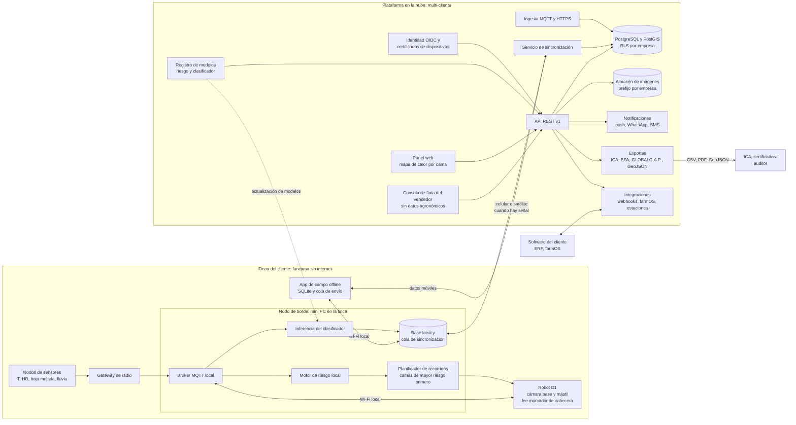
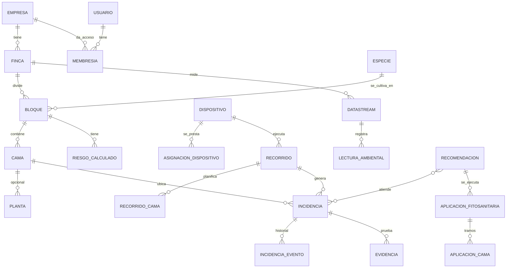
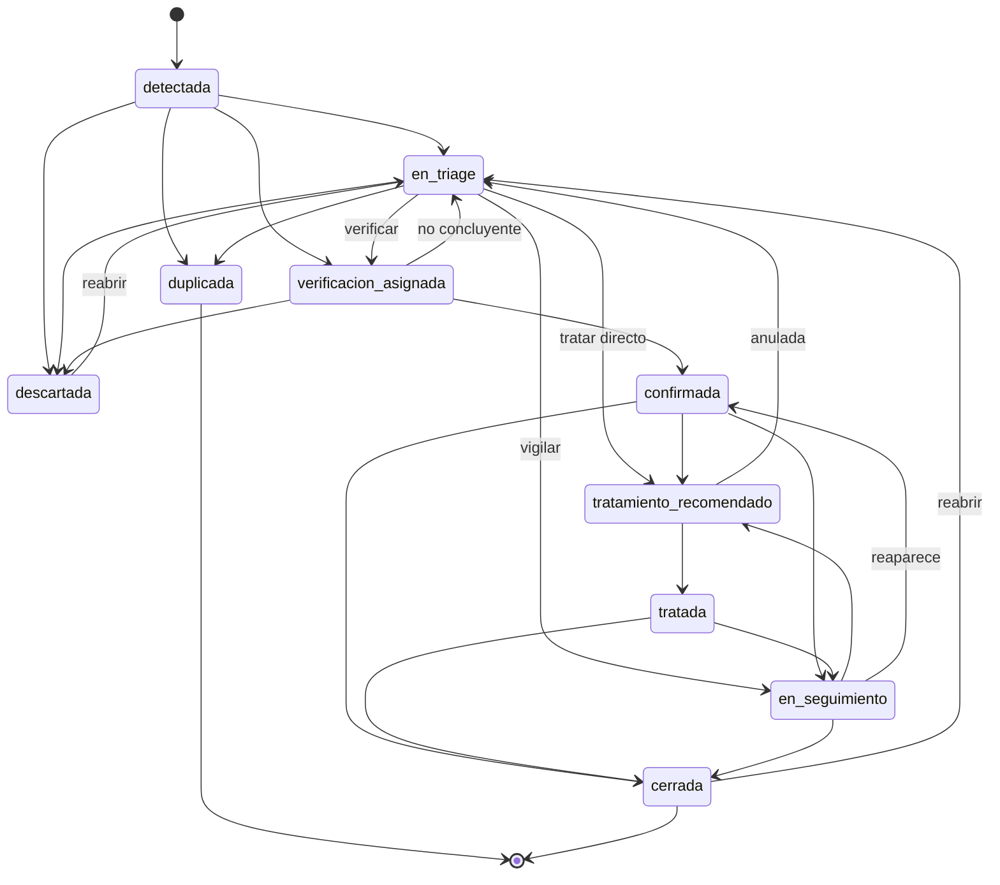
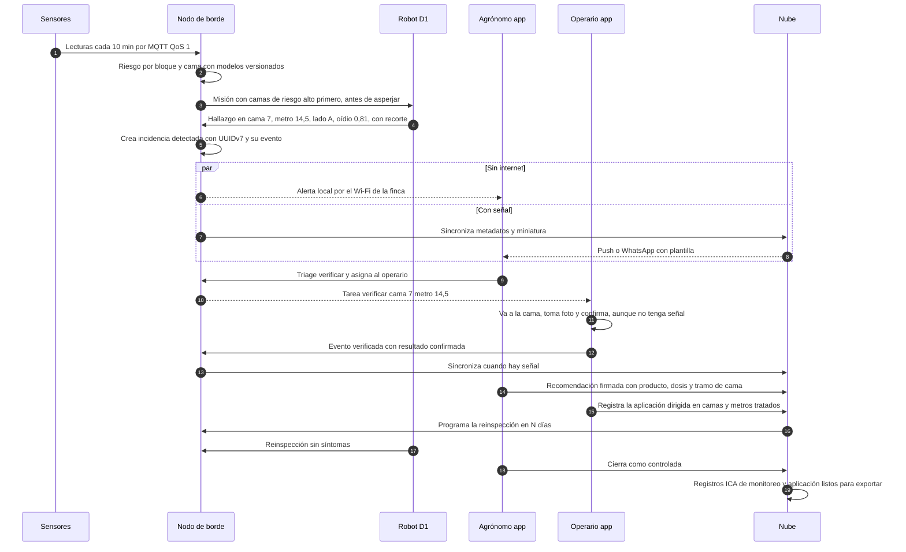

# Arquitectura multi-cliente (multi-finca) · Berry Good Idea

Sabana Hack 2026 · rol: arquitectura-multifinca · 23 de octubre de 2026

Archivos de esta entrega:

| Archivo | Qué es |
|---|---|
| `escalabilidad/arquitectura.md` | Este documento |
| `escalabilidad/modelo_datos.sql` | DDL PostgreSQL/PostGIS: 38 tablas (más 4 particiones y 2 vistas), aislamiento por cliente, vistas de exporte ICA y semillas ficticias |
| `escalabilidad/schema_incidencia.json` | JSON Schema 2020-12 de la incidencia, el contrato entre robot, nodo de borde, app, nube e integraciones |
| `escalabilidad/pruebas_arquitectura/` | Pruebas reproducibles del DDL (11 grupos) y del esquema (20 casos), con sus resultados |

Convención de cifras: cada número trae una URL abierta en esta sesión o lleva la marca **SUPUESTO** o **NO VERIFICADO**. El clima de la Sabana de Bogotá solo se usa en el ejemplo. En la arquitectura, la región es un parámetro.

---

## 0. La idea en seis líneas

1. **Lo que escala es la plataforma de datos, no el robot.** Una incidencia tiene el mismo formato si la reporta el robot, un operario con el celular, una cámara en la aspersora o un modelo de riesgo. Así se le puede vender a fincas que no tienen robot y a otros frutales.
2. **Cada cliente es una empresa aislada en la base de datos.** El aislamiento lo hace PostgreSQL con Row Level Security y llaves compuestas, no la buena voluntad del código. Lo probamos: la empresa B no ve ni puede tocar nada de la empresa A. [Verificación técnica 2026-10-23: las pruebas adversarias encontraron 12 huecos que P1-P11 no cubrían: auditoría sin RLS, robot prestado y catálogos globales modificables por un cliente, llaves simples hacia `cama` e `incidencia`, edición del agrónomo compartido, alcance por finca incompleto, robot ajeno citable y reserva del robot compartido por un cliente. 10 están corregidos en `modelo_datos.sql` (ver `verificacion_tecnica/resultado_ataques.txt`) y 2 siguen abiertos (sección 13, límite 8). El aislamiento también depende de que la API fije bien `app.empresas` desde el token.]
3. **La finca funciona sin internet.** Un nodo de borde en la finca calcula el riesgo, corre el clasificador, crea la alerta y avisa por Wi-Fi local. La nube consolida cuando hay señal.
4. **La dirección universal es "cama 7, metro 14,5, lado A".** No depende del GPS bajo el macrotúnel y el operario la entiende.
5. **El registro regulatorio sale solo.** Los campos que pide la Res. ICA 824/2022 para el monitoreo de plagas y las aplicaciones salen del flujo normal de trabajo y se exportan.
6. **Los datos son del productor.** Puede exportarlo todo en formatos abiertos (GeoJSON, CSV) cuando quiera. El vendedor solo usa imágenes para mejorar modelos si el productor lo autoriza.

---

## 1. Qué se demuestra en el hackathon y qué es producción

| Capa | Hackathon (demo) | Producción (lo que se vende) | Estado hoy |
|---|---|---|---|
| Multi-cliente | `modelo_datos.sql` en PostgreSQL local con 2 empresas **ficticias**. Se muestra en vivo que la empresa B no ve nada de la A | PostgreSQL gestionado con PostGIS, RLS, copias de seguridad y réplica. Opción de base dedicada para clientes grandes | DDL y aislamiento **probados** en PostgreSQL 16 (sin PostGIS real) |
| Contrato de incidencia | `schema_incidencia.json` valida lo que emite la simulación | El mismo esquema versionado (1.x), validado en la API, el nodo de borde y la app | **Probado**: 20/20 casos |
| Robot | Simulación (`sim-core`) y D1 EDU en interior | D1 Ultra con mástil (IP54), o D1 MaxPro como servicio compartido. Certificados por equipo y actualización remota | Por construir |
| Sensores y riesgo | Clima histórico en caché, con la Sabana como ejemplo | Nodos propios, la estación que ya tenga el cliente o una API externa. Modelos versionados por especie y región | Otros roles |
| Clasificador | Modelo entrenado con DrBerry (4 clases: Alternaria, Heliothis, Oídio, Sana) | Un modelo por cultivo, registro de modelos, umbral por cliente y licencia comercial | Otro rol |
| Sin conexión | App web con botón "modo sin conexión": la confirmación queda en cola y se sincroniza al volver | App nativa con SQLite, nodo de borde en la finca y resolución de conflictos | Por construir |
| Alertas | En pantalla: panel del agrónomo y tarea del operario | Push, WhatsApp con plantillas, SMS de respaldo y alerta local del nodo | Por construir |
| Exportes | CSV del registro ICA de monitoreo (vista `v_ica_monitoreo_plagas`) y GeoJSON de camas (`geojson_camas`) | Paquete de auditoría, informe trimestral ICA, BPA, GLOBALG.A.P. e ISOXML | Vistas **probadas** |
| Seguridad | Usuarios de demo, sin SSO | OIDC con MFA, mTLS en dispositivos, auditoría y contrato de encargado del tratamiento (Ley 1581) | Diseño; políticas de BD probadas |
| Integraciones | Un webhook de ejemplo | farmOS, ERP del cliente, estaciones meteorológicas y SFTP | Diseño |
| Flota del vendedor | No aplica | Consola de flota que ve robots y sensores, pero no datos agronómicos | Permiso **probado** (P9) |

Guion sugerido de 40 s para la demo de escalabilidad:
1. Abrir el mapa de calor de la Finca Demo A con la incidencia en la cama 7.
2. Cambiar a la empresa B: solo aparece su finca de fresa, sin rastro de la A.
3. Activar el modo sin conexión, confirmar la alerta como operario y reconectar: el agrónomo ve el cambio.
4. Descargar el CSV del registro ICA.

---

## 2. Principios de diseño

| # | Principio | Consecuencia en el diseño |
|---|---|---|
| 1 | Cliente = empresa | Toda tabla de cliente lleva `empresa_id`. RLS con `FORCE` y llaves foráneas compuestas `(id, …, empresa_id)` |
| 2 | La finca no depende de la nube | El nodo de borde calcula el riesgo, corre el clasificador, crea la incidencia y alerta. La nube recibe después |
| 3 | El robot es una fuente más | `origen.tipo` admite robot, operario, sensor fijo, modelo de riesgo, cámara de aspersora o sistema externo |
| 4 | Cama + metro antes que GPS | `posicion_m` desde la cabecera, más `lado` y `altura_dosel`. El punto GNSS es opcional |
| 5 | Lo que cambia entre clientes es configuración, no código | Catálogos de especie y problema, modelos versionados, umbral por cliente y transiciones de estado guardadas como datos |
| 6 | El historial no se borra | `incidencia_evento` y `auditoria` son de solo inserción, incluso para el superusuario (probado en P6) |
| 7 | Formatos abiertos | GeoJSON (RFC 7946), JSON Schema 2020-12, OpenAPI 3.1, CSV y modelo de sensores alineado a OGC SensorThings |

---

## 3. Componentes



| Componente | Responsabilidad | Dónde corre | Hackathon / producción |
|---|---|---|---|
| Nodo de borde | Broker MQTT local, inferencia, riesgo local, planificador, base local y cola de sincronización | Mini PC en la finca (una por finca o por grupo de bloques) | En la demo, el mismo portátil. En producción, un equipo por finca |
| Robot D1 | Recorre los pasillos, lee el marcador ArUco/QR de la cabecera, captura y reporta hallazgos | Finca | Simulación o D1 EDU; en producción D1 Ultra o MaxPro |
| App de campo | Tareas del operario, verificación con foto, registro de aplicaciones. Funciona sin señal | Celular | Web en la demo; nativa con SQLite en producción |
| Ingesta | Recibe lecturas y telemetría (MQTT) y lotes de sincronización (HTTPS) | Nube | Producción |
| API REST v1 | Recursos de negocio. Fija `app.empresas` en cada transacción | Nube | La demo usa una API mínima |
| Registro de modelos | Versiones de los modelos de riesgo y del clasificador, matriz de confusión, umbral por cliente y licencia | Nube y nodo | Producción |
| Exportes | Genera los registros ICA, BPA y GLOBALG.A.P., GeoJSON, CSV e ISOXML, cada uno con hash | Nube | Demo: CSV ICA y GeoJSON |
| Consola de flota | Salud de baterías, firmware y errores de los equipos del vendedor | Nube | Producción |

El software del robot es independiente de la plataforma. Un adaptador traduce lo que reporta el robot al contrato `schema_incidencia.json`. La guía oficial de desarrollo del D1 (AGIQUAD D1 Edu & Ultra Secondary Development Guide, copia local `raw/agibot_docs/AGIQUAD_D1_Edu_Ultra_SDK_Guide_V2.0.7.pdf`) ofrece SDK en Python y C++: comandos de velocidad (vx, vy, giro), posición en el marco de encendido, IMU y video de la cámara frontal. En la sección 6.18 responde que **"Currently, there is no ROS interface available"**. [Verificación técnica 2026-10-23: antes decía, citando a un distribuidor, que el D1 EDU traía ROS 2.] La navegación por pasillo, la lectura de marcadores y los giros de cabecera hay que desarrollarlos encima del SDK. Si mañana se usa otro robot o una cámara en la aspersora, solo cambia el adaptador.

---

## 4. Modelo de datos

### 4.1 Jerarquía y entidades



| Grupo | Tablas | Nota |
|---|---|---|
| Cliente y acceso | `empresa`, `usuario`, `membresia`, `personal_proveedor`, `concesion_soporte` | Una persona puede tener roles en varias empresas. Es el caso del asistente técnico que asesora a varios productores |
| Geografía | `finca`, `bloque`, `cama`, `planta` | Geometrías en EPSG:4326, igual que GeoJSON. `bloque.codigo` se exporta como "lote" ICA |
| Catálogos | `especie`, `problema_sanitario`, `especie_problema`, `transicion_estado` | Globales. Un cliente puede añadir sus propios problemas (`problema_sanitario`) y modelos (`modelo_version`), pero no puede modificar los globales. `especie`, `especie_problema` y `transicion_estado` solo los cambia el vendedor (`bgi_admin`) [verificación técnica 2026-10-23] |
| Dispositivos | `dispositivo`, `asignacion_dispositivo`, `telemetria_dispositivo` | Un robot del vendedor (`empresa_id` NULL) se presta por periodos. Una restricción `EXCLUDE` impide asignarlo a dos fincas a la vez (probado en P5h) |
| Ambiente | `datastream`, `lectura_ambiental` (particionada por mes), `riesgo_calculado` | Nomenclatura de OGC SensorThings: Thing, Datastream, Observation |
| Inspección | `recorrido`, `recorrido_cama` | Plan priorizado por riesgo y cobertura real por cama |
| Incidencias | `incidencia`, `incidencia_evento`, `evidencia` | Ver la sección 5 |
| Tratamiento | `producto_fitosanitario`, `recomendacion`, `recomendacion_incidencia`, `tarea`, `aplicacion_fitosanitaria`, `aplicacion_cama` | Campos de los §8.2.6 y §8.2.7 del manual de la Res. ICA 824/2022 |
| Operación | `notificacion`, `exporte`, `integracion`, `consumo`, `auditoria`, `registro_cambios`, `sync_lote` | `consumo` mide uso (ha, horas de robot) para facturar por plan |

### 4.2 Cómo se ubica un hallazgo

| Campo | Ejemplo | Por qué |
|---|---|---|
| `cama_id` | cama 7 del bloque B03 | Es la unidad que maneja la finca y la que recorre el aspersor |
| `posicion_m` | 14,5 | Metros desde la cabecera. El robot los mide desde el marcador de la cabecera con odometría |
| `lado` | A | Mirando de la cabecera al final: A es la izquierda y B la derecha. El eje de la cama (`cama.eje`, LineString) fija el sentido |
| `altura_dosel` | media | La cámara a ras de suelo y la del mástil ven partes distintas del arbusto. Sirve para medir dónde se escapan los síntomas |
| `punto` | GeoJSON Point [-74.06, 4.86013] | Opcional. RFC 7946 exige el orden [longitud, latitud] |

Que el GPS se degrade bajo el macrotúnel es **NO VERIFICADO** en campo. Por eso el diseño no depende de él.

### 4.3 Otros frutales sin cambiar código

| Especie | Código EPPO | Unidad lineal | Ciclo (Res. ICA 824/2022, art. 3) | Fuente del código |
|---|---|---|---|---|
| Arándano (*Vaccinium corymbosum*) | VACCO | cama | largo (**SUPUESTO**: la norma no nombra el arándano) | https://gd.eppo.int/taxon/VACCO |
| Fresa (*Fragaria x ananassa*) | FRAAN | cama | corto (**SUPUESTO**) | https://gd.eppo.int/taxon/FRAAN |
| Uchuva (*Physalis peruviana*) | PHYPE | hilera | corto (la norma la nombra en el art. 3.3) | https://gd.eppo.int/taxon/PHYPE |

Añadir un cultivo requiere cuatro cosas:
1. Una fila en `especie`.
2. Sus problemas en `especie_problema`.
3. Sus modelos de riesgo y su clasificador en `modelo_version`.
4. Si hace falta, un esquema de campos propios para `extra` (por ejemplo, el estado fenológico).

El motor, la API, la app y los exportes no cambian. La vista ICA de monitoreo lista los problemas de la especie del bloque, así que una finca de fresa recibe su propio registro.

**Encaje con los perfiles de cultivo** (`escalabilidad/cultivos.md` y `escalabilidad/perfiles/*.yaml`, del rol generalización-cultivos). El perfil YAML es la fuente de configuración, y la base de datos guarda qué versión usa cada bloque. Se mantiene la precedencia que propone ese rol: finca > región > cultivo.

| Capa del perfil | Dónde queda en el modelo de datos |
|---|---|
| Cultivo (`arandano@0.1.0`) | `bloque.perfil_cultivo`, fijado por versión para que un cambio de perfil no altere bloques en curso |
| Región (`sabana_bogota`) | `finca.region_perfil`. La Sabana es una región más, no un supuesto del código |
| Modelos de riesgo y clases visuales del perfil | Filas de `modelo_version` con `perfil_origen`, más `especie_problema` |
| Calibración de una finca (umbrales tras el piloto) | `modelo_version` con `empresa_id` y `finca_id`, firmada por el agrónomo |
| `registro_incidencia` del perfil | `schema_incidencia.json`: los campos comunes son iguales en todos los cultivos y lo propio va en `extra` |

Códigos EPPO de los problemas del catálogo inicial: Botrytis cinerea `BOTRCI`, roya del arándano `THEKMI` (*Pucciniastrum minimum*, sinónimo *Thekopsora minima*) y *Colletotrichum acutatum* s.l. `COLLAC`. El de *Erysiphe vaccinii* es `MCRSVA`, pero en el catálogo el oídio queda sin código EPPO hasta que un laboratorio confirme el agente en cada zona. La clase "Heliothis" de DrBerry tampoco lleva código, porque la especie no está confirmada. Fuentes: https://gd.eppo.int/taxon/BOTRCI, https://gd.eppo.int/taxon/THEKMI, https://gd.eppo.int/taxon/COLLAC, https://gd.eppo.int/taxon/MCRSVA.

---

## 5. La incidencia: campos y ciclo de vida

### 5.1 Campos (JSON Schema ↔ SQL)

| Grupo (JSON) | Campos principales | Columna(s) en `bgi.incidencia` | Obligatorio |
|---|---|---|---|
| Identidad | `id` (UUID, recomendado v7), `codigo_corto`, `schema_version` | `id`, `codigo_corto` | `id`, `schema_version` |
| Jerarquía | `empresa_id`, `finca_id`, `bloque_id`, `cama_id`, `planta_id`, `especie` | Mismas columnas; FK compuesta a `cama` | Todos salvo `planta_id` y `especie` |
| Estado | `estado` (10 valores), `prioridad` P1-P3 | `estado`, `prioridad` | `estado` |
| `ubicacion` | `posicion_m`, `lado`, `altura_dosel`, `punto`, `precision_m`, `metodo` | `posicion_m`, `lado`, `altura_dosel`, `punto`, `precision_m`, `metodo_ubicacion` | `posicion_m` o `punto` |
| `origen` | `tipo`, `dispositivo_id`, `recorrido_id`, `reportado_por` | `fuente_tipo`, `dispositivo_id`, `recorrido_id`, `reportado_por` | Robot: equipo y recorrido. Operario: `reportado_por` |
| `deteccion` | `problema`, `problema_confirmado`, `eppo_code`, `modelo{nombre,version,umbral}`, `confianza`, `clases_top`, `organo`, `severidad`, `plantas_afectadas_est`, `longitud_afectada_m`, `descripcion` | Columnas homónimas y `modelo_version_id` | Robot: modelo y confianza |
| `contexto_ambiental` | T, HR, horas de mojadura en 24 h, `hoja_mojada_captura`, riesgos del día con modelo y versión | `hoja_mojada_captura`, `contexto_ambiental` (jsonb) | No |
| `evidencias[]` | `uri`, `sha256`, `camara`, `bbox` normalizada, `capturada_en`, `subida_estado` | Tabla `evidencia` | Robot o cámara: al menos 1 |
| `triage` | `decision`, `por`, `en`, `asignado_a`, `nota` | `triage_*`, `asignado_a` | Si `verificacion_asignada` |
| `verificacion` | `resultado`, `por`, `en`, `evidencia_ids` | `verificacion_resultado`, `verificado_*` | Si `confirmada` |
| `descarte` | `motivo` (hoja mojada, sombra, daño mecánico…) | `motivo_descarte` | Si `descartada` |
| `tratamiento` | `recomendacion_ids`, `aplicacion_ids`, `reinspeccion_programada_en` | `recomendacion_incidencia`, `aplicacion_fitosanitaria` | Si `tratamiento_recomendado` o `tratada` |
| `cierre` | `resultado`, `por`, `en` | `resultado_cierre`, `cerrada_en` | Si `cerrada` |
| `tiempos` | `detectada_en`, `creada_en`, `recibida_en`, `actualizada_en` (RFC 3339 con zona horaria) | Columnas homónimas | `detectada_en`, `creada_en` |
| `sync` | `version`, `origen_registro`, `lote_id`, `pendiente_subida` | `version`, `origen_registro`, `sync_lote` | `version`, `origen_registro` |
| `privacidad` | `rostros_difuminados`, `uso_entrenamiento_autorizado` | `privacidad_rostros_difuminados`; `evidencia.uso_entrenamiento_autorizado` | No |
| `extra` | Campos propios de un cultivo | `extra` (jsonb) | No |

Las mismas reglas se aplican en tres sitios:
- El JSON Schema, en el borde y en la API.
- Los `CHECK` de PostgreSQL.
- La tabla de transiciones.

Un ejemplo de lo que vale tener las tres: en las pruebas encontramos que un `CHECK` con `NULL` dejaba pasar una incidencia "confirmada" sin verificación. Lo corregimos con `COALESCE` (prueba P5c2).

### 5.2 Ciclo de vida



Las 24 transiciones están en la tabla `transicion_estado`. Un disparador rechaza cualquier otra; por ejemplo, `detectada -> cerrada` falla (prueba P5b). Como son datos, cambiar el flujo no obliga a cambiar código. [Verificación técnica 2026-10-23: la tabla no tiene `empresa_id`, así que el flujo es el mismo para todos los clientes. Un flujo distinto por cliente requiere agregar `empresa_id` a `transicion_estado` y al disparador.]

### 5.3 Flujo de una incidencia, con y sin conexión



Quién hace qué está pendiente de las preguntas 12, 15 y 17 del mentor (roles, quién decide tratar, quién confirma). El flujo no cambia si el triage lo hace el supervisor en vez del agrónomo, porque los permisos son configuración.

---

## 6. Usuarios y roles

| Acción | Productor | Agrónomo / asistente técnico | Supervisor | Operario | Auditor (temporal) | Técnico del vendedor |
|---|---|---|---|---|---|---|
| Ver mapa, riesgo e incidencias | Sí | Sí | Sí | Sus fincas | Lectura | Solo con concesión |
| Reportar incidencia manual | Sí | Sí | Sí | Sí | No | No |
| Triage (verificar, tratar, vigilar, descartar) | Sí | Sí | Configurable | No | No | No |
| Verificar en campo (confirmar o descartar) | Sí | Sí | Sí | Sí | No | No |
| Emitir y firmar recomendación | No | Sí | No | No | No | No |
| Registrar aplicación | Sí | Sí | Sí | Sí | No | No |
| Configurar fincas, bloques y camas (GeoJSON) | Sí | Sí | No | No | No | Durante instalación, con concesión |
| Gestionar usuarios y roles | Sí | No | No | No | No | No |
| Exportar ICA, BPA, GLOBALG.A.P. | Sí | Sí | Sí | No | Sí | No |
| Ajustar umbrales del clasificador por finca | Aprueba | Propone | No | No | No | No |
| Ver salud de robots y sensores | Sí | Sí | Sí | Batería y estado | No | Sí (consola de flota) |
| Actualizar firmware y modelos | No | No | No | No | No | Sí |
| Aprobar acceso de soporte a datos agronómicos | Sí | No | No | No | No | Lo solicita |

Cómo se implementa:
- `membresia.rol` y `membresia.fincas` (NULL = todas).
- El token OIDC lleva las empresas y fincas permitidas. La API las fija con `SET LOCAL app.empresas` y `app.fincas`.
- La política restrictiva `alcance_finca` impide que un operario vea otra finca de la misma empresa (prueba P8).
- El técnico del vendedor no tiene membresía. Entra con `concesion_soporte`, que tiene motivo, aprobador y fecha de fin (como máximo 30 días, **SUPUESTO**), y queda auditada.
- El auditor tiene membresía con `vigente_hasta` obligatoria.

---

## 7. Operación sin conexión (offline-first) y sincronización

### 7.1 Tres niveles

| Enlace | Medio | Qué viaja | Si se cae |
|---|---|---|---|
| Robot ↔ nodo de borde | Wi-Fi local de la finca | Misión, telemetría, hallazgos y recortes | El robot guarda en su disco y entrega al volver a la base |
| App ↔ nodo de borde o nube | Wi-Fi local o datos móviles | Tareas, verificaciones, fotos y aplicaciones | La app guarda en SQLite y deja la cola pendiente |
| Nodo de borde ↔ nube | Celular, satélite o fibra, lo que tenga la finca | Lotes de cambios, metadatos, miniaturas y, por Wi-Fi o de noche, originales | El nodo sigue alertando en local y acumula. Capacidad: **SUPUESTO** de 30 días de búfer |

La conectividad real de los bloques está por confirmar (pregunta 6 del mentor). `finca.conectividad` guarda ese dato y el sistema decide los canales de alerta según él.

### 7.2 Reglas de sincronización

1. **Identificadores generados en el dispositivo.** Se usa UUIDv7, que es ordenable por tiempo (RFC 9562, §5.7). PostgreSQL 18 trae `uuidv7()`; el DDL usa `gen_random_uuid()` solo como valor por defecto del servidor.
2. **Hechos inmutables.** Cada acción es un evento en `incidencia_evento`. El estado de la incidencia es la proyección de esos eventos. Ningún evento se pierde, ni siquiera si llega tarde.
3. **Concurrencia optimista.** Cada fila lleva `version`, que un disparador incrementa (P5e). Una actualización basada en una versión vieja se convierte en evento `conflicto` en vez de pisar el dato.
4. **Lotes idempotentes.** `POST /v1/sync/push` lleva `lote_id`; reenviar el mismo lote no duplica nada (`sync_lote`).
5. **Pull por cursor.** `GET /v1/sync/pull?cursor=<seq>` devuelve lo de `registro_cambios` con `seq` mayor. RLS filtra por empresa: B solo ve sus 3 cambios (P2).
6. **Prioridad de subida.** Primero metadatos (unos KB), luego miniaturas y recortes, y al final los originales por Wi-Fi.

| Conflicto | Regla |
|---|---|
| Dos operarios, sin señal, confirman y descartan la misma alerta | Se guardan ambos eventos. El estado no cambia, se crea la tarea `resolver_conflicto` para el agrónomo y la alerta queda visible |
| El agrónomo descartó en la nube y el operario confirma después sin conexión | `descartada -> confirmada` no es una transición válida. Se guarda como conflicto y el agrónomo decide; puede reabrir con `descartada -> en_triage` |
| Notas de texto editadas en dos sitios | Gana el último por campo, y el historial conserva ambas |
| Geometría de camas | Solo la editan el productor y el agrónomo. Una versión vieja recibe 409 |
| Reloj del dispositivo desajustado | Se guardan `ocurrido_en` (dispositivo) y `recibido_en` (servidor). Si el desfase supera 5 minutos (**SUPUESTO**), se avisa |

### 7.3 Por qué la IA corre en la finca: dimensionamiento

| Concepto | Valor | Origen |
|---|---|---|
| Metros de cama por hectárea | 4.252 | `escalabilidad/operacion/capacidad.csv` (supuesto de ese rol) |
| ha inspeccionadas por día por un D1 Ultra, escenario base | 1,8 | ídem |
| Robots para 20 ha, recorrido por riesgo | 2 | ídem |
| Metros inspeccionados por día en una finca de 20 ha | 15.307 | Cálculo: 1,8 × 2 × 4.252 |
| Cuadros por día (2 por metro y por lado) | 61.228 | **SUPUESTO** 2 cuadros/m/lado |
| Volumen si se subiera todo, a 1,5 MB por cuadro | 91,8 GB/día | **SUPUESTO** de tamaño |
| Por celular: 20 hallazgos × (5 KB metadatos + 150 KB recorte + 20 KB miniatura) | 3,5 MB/día | **SUPUESTO** |
| Por Wi-Fi en la base: originales de hallazgos y muestra de control del 0,1 % | unos 122 MB/día, unos 44,5 GB/año por finca | **SUPUESTO** |
| Lecturas ambientales: 1 nodo cada 2 ha, 5 variables, cada 10 min | 7.200/día por finca de 20 ha | **SUPUESTO** |
| Lecturas con 1.000 ha bajo contrato | 131 M/año, unos 16 GB/año a 120 B por fila | Cálculo; escalas de 10 a 1.000 ha tomadas de `unit_economics_parametros.yaml` |

Clasificar en el borde reduce lo que viaja por celular unas 26.000 veces: de 91,8 GB a 3,5 MB al día. Sin eso no hay operación en fincas con mala señal. Las lecturas caben en PostgreSQL con particiones mensuales, sin una base de series de tiempo aparte.

### 7.4 Alertas según la conectividad

| Situación | Canal |
|---|---|
| Sin internet en la finca | Alerta local del nodo a la app por Wi-Fi. SMS por módem del nodo si lo hay (**SUPUESTO**: hardware opcional) |
| Con internet | Push en la app y WhatsApp |
| WhatsApp | Fuera de la ventana de 24 h de atención solo se pueden enviar mensajes de plantilla, y se necesita el opt-in de la persona (documentación de 360dialog, proveedor de la API: https://docs.360dialog.com/docs/messaging/overview). Las plantillas ("Alerta P1: cama 7, metro 14,5…") se aprueban una vez y sirven para todos los clientes |

Qué canal usan de verdad lo responde la pregunta 18 del mentor. La tabla `notificacion` admite todos.

---

## 8. APIs

### 8.1 REST (OpenAPI 3.1, versionada en `/v1`)

| Método | Ruta | Uso |
|---|---|---|
| GET | `/v1/fincas/{id}/bloques?formato=geojson` | Bloques como FeatureCollection |
| PUT | `/v1/bloques/{id}/camas` | Importa camas desde un GeoJSON (plano, dron o levantamiento) |
| GET | `/v1/bloques/{id}/mapa?fecha=` | Mapa de calor por cama (función `geojson_camas`) |
| GET | `/v1/incidencias?finca=&estado=&problema=&desde=&bbox=` | Lista; con `Accept: application/geo+json` devuelve GeoJSON |
| POST | `/v1/incidencias` | Crea una incidencia validada con `schema_incidencia.json`. `Idempotency-Key` = id |
| POST | `/v1/incidencias/{id}/eventos` | Triage, verificación, descarte, cierre. `If-Match: <version>` |
| POST | `/v1/evidencias` | Devuelve una URL prefirmada para subir la imagen al prefijo de la empresa |
| POST | `/v1/lecturas:lote` | Ingesta HTTP de lecturas, para quien no use MQTT |
| GET | `/v1/riesgo?bloque=&fecha=` | Riesgo por bloque y cama, con modelo y versión |
| POST / GET | `/v1/recorridos`, `/v1/recorridos/{id}` | Plan de misión priorizado y su cobertura |
| POST | `/v1/recomendaciones`, `/v1/aplicaciones` | Registro regulatorio |
| POST | `/v1/exportes` | `{tipo, desde, hasta}`: trabajo asíncrono que devuelve URL y hash |
| POST / GET | `/v1/sync/push`, `/v1/sync/pull?cursor=` | Sincronización de la app y del nodo de borde |
| POST | `/v1/webhooks` | Suscripción a eventos |
| GET | `/v1/sta/...` | Producción: lecturas compatibles con OGC SensorThings (Things, Datastreams, Observations) |

OpenAPI 3.1 usa un Schema Object que es superconjunto de JSON Schema 2020-12 (https://spec.openapis.org/oas/v3.1.0.html). Por eso el mismo `schema_incidencia.json` se referencia directamente desde la especificación de la API.

### 8.2 MQTT (dispositivos)

| Tema | Dirección | QoS | Nota |
|---|---|---|---|
| `bgi/{empresa}/{finca}/sensor/{disp}/obs` | Sensor → nodo/nube | 1 | Lecturas |
| `bgi/{empresa}/{finca}/robot/{disp}/telemetria` | Robot → nodo/nube | 0 | Batería, posición, estado |
| `bgi/{empresa}/{finca}/robot/{disp}/hallazgo` | Robot → nodo | 1 | Cuerpo = incidencia según el esquema |
| `bgi/{empresa}/{finca}/robot/{disp}/mision` | Nodo → robot | 1 | Con caducidad: una misión vieja no se ejecuta tarde |

MQTT 5.0 ofrece QoS 0, 1 y 2, sesiones con caducidad (§3.1.2.11.2) y caducidad por mensaje (Message Expiry Interval). Fuente: https://docs.oasis-open.org/mqtt/mqtt/v5.0/mqtt-v5.0.html. Cada dispositivo se conecta con su certificado (mTLS) y una lista de control que solo le deja publicar bajo su propio prefijo `bgi/{empresa}/{finca}/…/{disp}`.

### 8.3 Webhooks

Eventos disponibles:
- `incidencia.creada`
- `incidencia.estado_cambiado`
- `riesgo.alto`
- `aplicacion.registrada`
- `exporte.listo`

Cada envío va firmado con HMAC-SHA256 y lleva un id de evento para que el receptor descarte duplicados. Se reintenta con espera creciente.

### 8.4 Autenticación

| Quién | Mecanismo |
|---|---|
| Personas | OIDC. MFA para productor, agrónomo y vendedor |
| Integraciones | OAuth 2.0 con credenciales de cliente, limitadas a una empresa y a lectura o escritura |
| Robots, nodos y sensores | Certificado por equipo (mTLS) con huella guardada en `dispositivo.certificado_huella` |

---

## 9. Formatos abiertos y trazabilidad regulatoria

### 9.1 Geometría

- Fincas, bloques y camas se intercambian en **GeoJSON (RFC 7946)**: WGS 84, orden [longitud, latitud], anillos exteriores en sentido antihorario y `properties` obligatorio en cada Feature. Fuente: https://datatracker.ietf.org/doc/html/rfc7946.
- Una cama se guarda como el **LineString de su eje** más el ancho. Eso da el sentido del metraje y el lado A/B. El polígono es opcional.
- En PostGIS, las columnas son `geometry(Polygon,4326)`, `geometry(LineString,4326)` y `geometry(Point,4326)` (https://postgis.net/docs/manual-3.5/using_postgis_dbmanagement.html). La longitud de la cama se calcula en metros con `ST_Length(eje::geography)`.

### 9.2 Exportes regulatorios

| Exporte | Campos que exige la fuente | De dónde salen | Fuente |
|---|---|---|---|
| Registro de monitoreo de plagas (ICA) | Fecha de monitoreo, cultivo, lote, plaga monitoreada, resultado cuantitativo, nombre de quien realiza la actividad | Vista `v_ica_monitoreo_plagas`. Lote = `bloque.codigo`. Resultado = camas inspeccionadas, camas con hallazgo confirmado y % de incidencia. Responsable = `recorrido.responsable_id` (el ICA pide el nombre de una persona; el robot figura como método) | Res. ICA 824/2022, Manual §8.2.4 |
| Registro de aplicación de plaguicidas (ICA) | Lugar de producción, cultivo, blanco biológico, nombre comercial, ingrediente activo, fecha, dosis aplicada, método, periodo de carencia, periodo de reentrada, nombre y firma del responsable | Vista `v_ica_aplicaciones` | Res. ICA 824/2022, Manual §8.2.7 |
| Visitas del asistente técnico | Fecha, estado fitosanitario, recomendaciones, firma | Tabla `recomendacion` (`estado_fitosanitario`, `justificacion`, `firma`) | Res. ICA 824/2022, Manual §8.2.6 |
| Informe trimestral al ICA | Informe fitosanitario, estado fenológico, volúmenes de producción y monitoreo de plagas de control oficial, en la primera semana de febrero, mayo, agosto y noviembre | Exporte `ica_informe_trimestral`. Agrega `v_ica_monitoreo_plagas` filtrando `problema_sanitario.control_oficial_ica` | Res. ICA 824/2022, art. 13.1.6 |
| BPA | Además: lote del producto, n.º de registro ICA, quién recomendó | `aplicacion_fitosanitaria.lote_producto`, `producto_fitosanitario.registro_ica`, `recomendado_por` | Res. ICA 30021/2017, Anexo I §10.1.2 (el normograma indica que la Res. 82394/2020 subrogó ese anexo; **NO VERIFICADO** si el texto cambió) |
| GLOBALG.A.P. (IFA v6) | Producto, objetivo, fecha, operario, dosis, intervalo antes de cosecha, justificación | `aplicacion_fitosanitaria` y `recomendacion.justificacion` | Resumen de un proveedor de software (https://ascfoodsafety.com/globalgap-ifa-v6-records-farm-paperless/). **NO VERIFICADO** contra la lista oficial de puntos de control |
| Prescripción de aspersión dirigida | Zonas o tramos y dosis | `aplicacion_cama` (cama, desde_m, hasta_m). Para equipos ISOBUS, ISOXML (ISO 11783-10) | **NO VERIFICADO**: la norma es de pago y no sabemos si los equipos de las fincas la soportan. La pregunta 3 del mentor indica que pueden ser bombas de espalda; entonces basta una lista impresa o en la app |
| Dataset de entrenamiento | Imágenes y anotaciones | `evidencia` con `uso_entrenamiento_autorizado` y `problema_confirmado_codigo` → COCO/YOLO | DrBerry usa YOLOv8 y licencia CC BY 4.0 (`datos/raw/drberry/_export_meta.json`) |

**Alcance de la Res. ICA 824/2022** [verificación técnica 2026-10-23, texto releído]: su art. 2 la aplica a las personas "productoras, exportadoras y/o empacadoras de vegetales para la exportación en fresco". Obliga a las fincas registradas como lugar de producción para exportación, que es el caso de buena parte del arándano. Una finca de mora o de fresa que vende en el mercado nacional no está obligada. Para ella el exporte ICA es opcional, y lo que suele pedir el comprador es el registro BPA (Res. 30021/2017) o GLOBALG.A.P. El argumento de venta "el registro regulatorio sale solo" vale para exportadores; para el resto es "el registro BPA sale solo".

Reglas transversales verificadas en la Res. ICA 824/2022:
- Los registros fitosanitarios se conservan **por lo menos 2 años**. `empresa.retencion_anios` no acepta menos.
- Si la documentación es digital, debe tener **copia de seguridad** (Manual, §8).
- El productor debe tener los registros de monitoreo y control de plagas y de aplicaciones de plaguicidas (art. 13.1.19).

No conocemos una API del sistema en línea del ICA (**NO VERIFICADO**). Por eso el exporte produce el CSV o PDF que el asistente técnico carga o adjunta.

Cada exporte guarda su hash SHA-256 en `exporte.sha256` y cada evidencia el suyo en `evidencia.sha256`. Ante un auditor se puede demostrar que el registro no cambió después de generarse.

---

## 10. Integración con software de gestión agrícola

| Patrón | Para qué | Ejemplo |
|---|---|---|
| Webhooks salientes | El ERP o el software de la finca reacciona a una incidencia o aplicación | `incidencia.estado_cambiado` → crea una orden de trabajo en el ERP |
| API entrante (OAuth 2.0) | Otro sistema consulta o crea incidencias | Un software de monitoreo manual que ya usa la finca envía sus hallazgos con `origen.tipo = externo` |
| Conector farmOS | Fincas que usan farmOS (código abierto) | farmOS expone una API JSON:API en `/api/[tipo]/[bundle]`, por ejemplo `/api/log/activity` (https://farmos.org/development/api/). Se mapean incidencias a registros de observación y aplicaciones a registros de actividad; el mapeo exacto está **NO VERIFICADO** |
| Estación meteorológica del cliente | No obligar a comprar sensores si ya hay estación | Pessl/METOS FieldClimate publica una API v2; su documentación redirige a SwaggerHub (https://api.fieldclimate.com/v2/docs/). La autenticación (HMAC u OAuth) es **NO VERIFICADA**: solo apareció en resultados de búsqueda. Se guarda como `datastream.origen = 'estacion_cliente'` |
| Clima de respaldo | Fincas sin estación | Open-Meteo, que ya usa la simulación. `datastream.origen = 'api_externa'` |
| Archivos | Clientes sin API | CSV/XLSX por SFTP o descarga: camas, productos, aplicaciones |
| Sensores de terceros | Interoperabilidad | El modelo `datastream`/`lectura_ambiental` sigue OGC SensorThings 1.1, que define Thing, Location, Datastream, Sensor, ObservedProperty, Observation y FeatureOfInterest (§8.2) e incluye extensión MQTT (§14). Fuente: https://docs.ogc.org/is/18-088/18-088.html |

Credenciales de integraciones: `integracion.secreto_ref` apunta a un gestor de secretos. El secreto nunca se guarda en la base.

---

## 11. Seguridad y propiedad de los datos

### 11.1 Quién es dueño de qué (propuesta de contrato)

| Dato | Dueño | Qué puede hacer el vendedor |
|---|---|---|
| Geometría, incidencias, aplicaciones, lecturas e imágenes de una finca | El productor (empresa) | Tratarlos solo para prestar el servicio |
| Datos personales de trabajadores (nombre, teléfono) | El productor es **Responsable del Tratamiento**; el vendedor es **Encargado** | Ley 1581 de 2012, art. 3 d) y e): el Encargado trata datos "por cuenta del Responsable" |
| Datos que genera un robot compartido en la finca X | El dueño de la finca X, no el dueño del robot | `asignacion_dispositivo` fija en qué finca estaba el robot en cada momento |
| Imágenes para mejorar el clasificador | El productor | Solo con `empresa.consentimiento_mejora_modelos = true`, sin geolocalización y con rostros difuminados |
| Telemetría técnica de equipos del vendedor | El vendedor | Consola de flota, sin acceso agronómico |
| Al terminar el contrato | El productor | Exporte total (`exporte_total_cliente`: GeoJSON, CSV, imágenes) y borrado posterior. Plazo de borrado **SUPUESTO**: 90 días |

Si la nube está fuera de Colombia, aplica el **art. 26 de la Ley 1581**: se prohíbe transferir datos personales a países sin un nivel adecuado de protección, según los estándares de la SIC, salvo las excepciones del mismo artículo (por ejemplo, autorización expresa del titular). Por eso `empresa.region_datos` es un campo del contrato y existe la modalidad de base dedicada. [Verificación técnica 2026-10-23: el art. 26 regula las **transferencias** (a otro responsable). Cuando el vendedor y su nube actúan como **encargados** del productor, lo que hay es una **transmisión**, que el Decreto 1377 de 2013, arts. 24 y 25, permite sin consentimiento del titular si hay un contrato de transmisión. Así lo trata `datos_aprendizaje.md` §12. Por prudencia se mantiene la región de nube en un país de la lista de la SIC, pero la regla que manda es el contrato de transmisión.] Texto leído en https://www.saludcapital.gov.co/Normo/gsp/ley_1581_de_2012.pdf.

### 11.2 Controles

| Control | Implementación | Evidencia |
|---|---|---|
| Aislamiento por cliente | RLS con `FORCE` en todas las tablas de cliente. El rol `bgi_app` no tiene `BYPASSRLS`. Las políticas usan `app_empresas()` y `app_fincas()` | Pruebas P1-P3, P8 y P11 |
| Integridad entre clientes | FK compuestas `(cama_id, bloque_id, finca_id, empresa_id)` | P4b: la empresa B no puede apuntar a una cama de la A |
| Escritura en otra empresa | `WITH CHECK` en cada política | P4a |
| Vistas y funciones | Vistas `security_invoker` y funciones `SECURITY INVOKER`: respetan RLS | P2 (la vista ICA de B está vacía) y P10b (B pide el GeoJSON de A y recibe una colección vacía) |
| Historial inmutable | Disparador `tg_solo_insercion` y `REVOKE UPDATE, DELETE` | P5g y P6 |
| Particiones | La app solo toca la tabla padre; leer una partición directamente es denegado | P7b |
| Vendedor sin datos agronómicos | Rol `bgi_flota` con permisos solo sobre dispositivos y telemetría | P9 |
| Dispositivos | mTLS por equipo, ACL MQTT por prefijo y revocación por certificado | Diseño |
| Personas | OIDC con MFA, sesiones cortas, membresía con fecha de fin para auditores | Diseño |
| Imágenes | Almacén con prefijo por empresa, URL prefirmadas de corta vida, cifrado y, en producción, una llave por cliente | Diseño |
| Privacidad de trabajadores | Difuminado de rostros en el borde antes de subir. No se rastrea la ubicación continua del operario, solo la del hallazgo | Diseño |
| Auditoría | Tabla `auditoria` de solo inserción: lecturas sensibles, exportes y concesiones de soporte | Diseño |
| Copias de seguridad | Diarias con restauración probada. La Res. ICA 824/2022 exige copia si los registros son digitales | Diseño |

---

## 12. Escalar de una finca a cientos

| Fase | Alcance | Qué cambia |
|---|---|---|
| 0. Hackathon | 1 finca simulada y 1 ficticia para mostrar el aislamiento | PostgreSQL local, API mínima, simulación y app web |
| 1. Piloto | 1 a 3 fincas de un cliente | Nube gestionada, nodo de borde, app móvil, OIDC y copias de seguridad |
| 2. Comercial | 10 a 50 clientes, hasta unas 1.000 ha (**SUPUESTO**: escala tomada del modelo de negocio) | Multi-cliente con tabla compartida, consola de flota, actualización remota de modelos, facturación por `consumo` y conectores |
| 3. Otros frutales y países | Fresa, uchuva y otros; otros países | Catálogos por especie, modelos por región, `region_datos`, base dedicada para clientes grandes, idiomas |

Qué hace que escale:
- **Alta de un cliente nuevo en horas.** Se importa el GeoJSON de bloques y camas desde un plano o un vuelo de dron, se cargan los productos, se invitan usuarios y se asignan dispositivos. El código no cambia.
- **Una sola base que operar.** Con muchos productores pequeños, una base por cliente multiplica costos. Los clientes grandes o con requisitos de residencia pueden tener base dedicada con el mismo DDL.
- **Particiones mensuales y almacén de objetos.** Las lecturas de 1.000 ha (unos 131 M/año, **SUPUESTO**) caben en PostgreSQL. Las imágenes van al almacén, no a la base.
- **Cómputo pesado en la finca.** El nodo de borde absorbe la inferencia, así que la nube no crece con el número de cuadros.
- **Modelos y umbrales por cliente.** La tolerancia a falsas alarmas (pregunta 28 del mentor) se ajusta con una calibración por cliente en `modelo_version`, sin tocar a los demás.
- **Medición de uso.** `consumo` registra ha monitoreadas, metros inspeccionados, horas de robot y GB de imágenes, para cobrar por plan.

---

## 13. Alternativas consideradas y límites

| Decisión | Alternativas | Elegida | Por qué | Límite o riesgo |
|---|---|---|---|---|
| Aislamiento entre clientes | Base por cliente; esquema por cliente; tablas compartidas con RLS | Tablas compartidas con RLS, y base dedicada como opción | Muchos productores pequeños: una base que operar y migrar. El aislamiento se aplica en la base y se puede probar | Un error en una política afecta a todos. Mitigación: las pruebas P1-P11 corren en cada despliegue |
| Dónde corre el clasificador | Nube; celular; robot o nodo de borde | Nodo de borde o robot | 91,8 GB/día frente a 3,5 MB por celular. Funciona sin señal | Hay que actualizar modelos en cada finca, con control de versiones |
| Sincronización | CouchDB/PouchDB; PowerSync o ElectricSQL; propia con eventos | Propia en la demo (eventos, lotes idempotentes y cursor). PowerSync se evalúa para producción | PostgreSQL queda como única fuente. PowerSync replica Postgres a SQLite en el cliente y funciona sin conexión (https://docs.powersync.com/intro/powersync-overview) | Licencia y costo de PowerSync **NO VERIFICADOS** |
| Series de tiempo | InfluxDB; TimescaleDB; particiones nativas | Particiones nativas | Una sola base. PostgreSQL exige que la PK incluya la columna de partición, y el DDL lo cumple (https://www.postgresql.org/docs/current/ddl-partitioning.html) | Revisar por encima de unas 10.000 ha (**SUPUESTO**) |
| Ubicación | Solo GPS; RTK; cama + metro con marcador | Cama + metro, con GPS opcional | La entiende el operario y no depende del cielo abierto | Requiere marcadores en las cabeceras y odometría confiable (**NO VERIFICADO** en campo) |
| Protocolo de dispositivos | HTTP; MQTT | MQTT 5 para mensajes y HTTPS para imágenes | Tolera redes inestables y deja poner caducidad a las órdenes | Hay un broker más que operar |
| Canal de alerta | App; WhatsApp; SMS | App, WhatsApp con plantillas y SMS de respaldo | Depende de lo que usa la finca | WhatsApp exige opt-in y plantillas fuera de 24 h |
| Vocabularios | ENUM de PostgreSQL; texto con CHECK | Texto con CHECK | El mismo vocabulario sirve en SQLite (app) y en el JSON Schema | Cambiar un vocabulario requiere migración, aunque es simple |

Límites abiertos, dichos sin rodeos:
1. **PostGIS real no se ejecutó.** El DDL se probó en PostgreSQL 16 con un sustituto que reemplaza `geometry` por texto. RLS, llaves, particiones, disparadores, vistas y semillas sí corrieron. Las columnas espaciales y los índices GiST quedan **NO VERIFICADOS** en ejecución.
2. **Licencia del clasificador de la demo.** El reporte `preparacion-entorno.md` registra que ultralytics y los pesos YOLO11 son AGPL-3.0. Para vender un producto cerrado hay que licenciarlo o cambiar de modelo. Que exista una licencia Enterprise está **NO VERIFICADO** en ese reporte.
3. **ICA y certificadoras.** No hay una API del ICA conocida. Los puntos de control de GLOBALG.A.P. IFA v6 no se verificaron en la fuente oficial. La validez de la firma electrónica para estos registros está **NO VERIFICADA**.
4. **Escala de severidad 0-5, umbrales y búfer de 30 días** son **SUPUESTOS** hasta hablar con el mentor.
5. **Conectividad y roles reales** dependen de las preguntas 6, 12, 15, 17 y 18 del mentor. El diseño los deja como configuración.
6. **El software del robot.** La guía oficial del SDK del D1 dice que no hay interfaz ROS; hay SDK en Python y C++ [verificación técnica 2026-10-23]. La navegación autónoma por pasillo no viene hecha y es trabajo propio.
7. **Los diagramas mermaid** se revisaron a mano. No se renderizaron en esta sesión, así que conviene abrirlos en un visor antes de pasarlos a las diapositivas.
8. **Huecos de aislamiento que siguen abiertos** [verificación técnica 2026-10-23]:
   - Un cliente puede crear filas en `asignacion_dispositivo` y reservarse un robot del proveedor para fechas futuras. Con la restricción `EXCLUDE`, eso bloquea el robot compartido para los demás (prueba X1). Propuesta: `REVOKE INSERT, UPDATE, DELETE ON asignacion_dispositivo FROM bgi_app` y que solo el planificador de flota asigne. La prueba P5h tendría que pasar a `bgi_admin`.
   - Las referencias a `dispositivo` (recorrido, incidencia, evento, datastream, aplicación) son llaves simples, porque el robot del proveedor tiene `empresa_id` NULL. B puede citar en sus recorridos el robot que hoy está asignado a A (prueba V5d). Propuesta: un disparador que exija una asignación vigente a la empresa en la fecha del registro.
   - Lo mismo pasa con `modelo_version_id`: B puede citar el modelo calibrado privado de A si conoce su UUID.

---

## 14. Cómo se probó

Entorno: contenedor desechable `postgres:16-alpine` (PostgreSQL 16.14, imagen que ya estaba en la máquina, sin descargas), creado y eliminado en esta sesión. Esquema JSON validado con Ajv 8.20 (modo estricto, draft 2020-12, `ajv-formats`), ya instalado en la caché local de npm.

| Prueba | Qué comprueba | Resultado |
|---|---|---|
| DDL + semillas | Las 38 tablas, 4 particiones, disparadores, políticas, vistas y datos de referencia se crean sin error | OK |
| P1 | La empresa A ve 1 incidencia, 1 finca, el robot prestado y 3 usuarios; la vista ICA da 6 filas, una por problema del arándano, con 0 incluidos | OK |
| P2 | La empresa B ve 0 incidencias de A, 0 dispositivos y la vista ICA vacía | OK |
| P3 | Sin contexto de empresa no se ve nada | OK |
| P4a / P4b / P4c | B no puede escribir con `empresa_id` de A (RLS) ni apuntar a una cama de A (FK compuesta); sí puede crear la suya | OK |
| P5a | Hallazgo de robot sin modelo: rechazado | OK |
| P5b | Transición `detectada -> cerrada`: rechazada | OK |
| P5c2 | "Confirmada" sin verificación: rechazada (tras corregir el `CHECK` con `COALESCE`) | OK |
| P5d-P5f | Confirmar con verificación sube la versión, y la vista ICA muestra 1 cama de 2 (50 %) con oídio confirmado | OK |
| P5g / P6 | Editar el historial: denegado a la app y también al superusuario | OK |
| P5h | El mismo robot asignado a dos fincas a la vez: rechazado (EXCLUDE) | OK |
| P7 | Las lecturas caen en su partición; leer una partición directa está denegado; B no ve lecturas de A | OK |
| P8 | Un usuario limitado a otra finca no ve las incidencias | OK |
| P9 | La consola de flota ve el robot y no puede leer incidencias | OK |
| P10 | `geojson_camas` devuelve una FeatureCollection RFC 7946 con riesgo e incidencias abiertas; para B, vacía | OK |
| P11 | Un agrónomo con dos empresas ve las 2 fincas | OK |
| JSON Schema | 3 casos válidos (robot, ciclo completo cerrado, reporte manual sin robot) y 17 inválidos (sin modelo, sin evidencias, latitud 95, fecha sin zona, estado inventado…) | 20/20 |
| V1-V6, W1 (verificación técnica) | Ataques entre empresas que P1-P11 no probaban: leer la auditoría de otra, apropiarse del robot prestado, secuestrar o borrar filas de catálogos globales, referenciar camas e incidencias ajenas, renombrar al agrónomo compartido, y ver fotos y eventos de otra finca | Antes: los 11 ataques pasaban. Después de corregir el DDL: 10 bloqueados y 1 abierto (V5d); X1 (reserva del robot compartido) también sigue abierto. P1-P11 siguen igual. `verificacion_tecnica/ataques_multiempresa.sql` y `resultado_ataques.txt` |

Para repetir:

```bash
cd /Users/santiagosantafe/Downloads/SabanaHack/datos/escalabilidad/pruebas_arquitectura
python3 -I transformar.py ../modelo_datos.sql /tmp/modelo_shim.sql     # sustituto de PostGIS
docker run -d --pull never --name bgi-prueba -e POSTGRES_PASSWORD=local postgres:16-alpine
docker exec -i bgi-prueba psql -v ON_ERROR_STOP=1 -U postgres < /tmp/modelo_shim.sql
docker exec -i bgi-prueba psql -U postgres < pruebas.sql
docker rm -f bgi-prueba
node validar.js <carpeta node_modules con ajv 8 y ajv-formats> ../schema_incidencia.json
```

Con PostGIS real se ejecuta `modelo_datos.sql` tal cual: no hace falta `transformar.py`.

---

## 15. Fuentes abiertas en esta sesión

| Tema | URL |
|---|---|
| GeoJSON | https://datatracker.ietf.org/doc/html/rfc7946 |
| UUIDv7 | https://www.rfc-editor.org/rfc/rfc9562.html |
| JSON Schema 2020-12 | https://json-schema.org/draft/2020-12 |
| OpenAPI 3.1.0 | https://spec.openapis.org/oas/v3.1.0.html |
| OGC SensorThings API 1.1 | https://docs.ogc.org/is/18-088/18-088.html · https://www.ogc.org/standards/sensorthings/ |
| MQTT 5.0 | https://docs.oasis-open.org/mqtt/mqtt/v5.0/mqtt-v5.0.html |
| PostgreSQL: RLS, políticas, particiones, UUID (docs v18) | https://www.postgresql.org/docs/current/ddl-rowsecurity.html · https://www.postgresql.org/docs/current/sql-createpolicy.html · https://www.postgresql.org/docs/current/ddl-partitioning.html · https://www.postgresql.org/docs/current/functions-uuid.html |
| PostGIS, tipos geometry | https://postgis.net/docs/manual-3.5/using_postgis_dbmanagement.html |
| PowerSync | https://docs.powersync.com/intro/powersync-overview |
| farmOS API | https://farmos.org/development/api/ |
| METOS FieldClimate API v2 (redirige a SwaggerHub) | https://api.fieldclimate.com/v2/docs/ |
| WhatsApp: ventana de 24 h, plantillas y opt-in (proveedor 360dialog) | https://docs.360dialog.com/docs/messaging/overview |
| Res. ICA 824/2022 (texto y manual, leídos completos) | https://www.ica.gov.co/importacion-y-exportacion/planes-trabajo-exportacion-vegetales/documentos-relacionados/resolucion_ica_824_2022.aspx |
| Res. ICA 30021/2017 (BPA) | https://normograma.invima.gov.co/compilacion/docs/resolucion_ica_30021_2017.htm |
| Ley 1581 de 2012 | https://www.saludcapital.gov.co/Normo/gsp/ley_1581_de_2012.pdf |
| GLOBALG.A.P. IFA v6 (resumen de proveedor) | https://ascfoodsafety.com/globalgap-ifa-v6-records-farm-paperless/ |
| Códigos EPPO | https://gd.eppo.int/taxon/VACCO · /FRAAN · /PHYPE · /BOTRCI · /THEKMI · /MCRSVA · /COLLAC · /HELIZE |
| DrBerry (local) | `datos/raw/drberry/_export_meta.json`: 410 imágenes, 4 clases, CC BY 4.0 |
| Capacidad del robot (otro rol) | `datos/escalabilidad/operacion/capacidad.csv` |

`HELIZE` (*Helicoverpa zea*) existe en EPPO, pero no se asigna a la clase "Heliothis" de DrBerry porque la especie no está confirmada.
