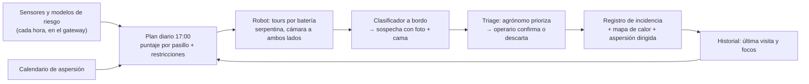
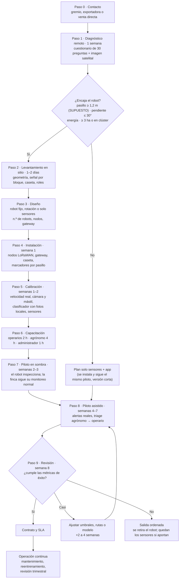

# Operación a escala: cómo se despliega, se mueve y se mantiene el sistema en muchas fincas

Rol: operacion-escala · Sabana Hack 2026, reto "Berry Good Idea" · 23-oct-2026

**Pregunta que responde:** si la organización vende la solución (red de sensores + cuadrúpedo D1 + clasificador + alertas + registro) a muchos productores, ¿cómo opera en el día a día? Cubre cuándo poner un robot fijo y cuándo una flota, la carga de baterías, el transporte, el mantenimiento, los técnicos, la incorporación de una finca nueva y el soporte. La Sabana de Bogotá es solo el ejemplo. Todo lo que depende del clima o del cultivo queda como parámetro del onboarding.

**Convención de fuentes.** Cada cifra lleva una URL que se abrió en esta sesión o una marca: **SUPUESTO** (valor nuestro, sin fuente) o **NO VERIFICADO** (apareció en un resumen o en prensa, sin documento primario). Los cálculos están en `escalabilidad/operacion/capacidad.py`, que genera `capacidad.csv`, `flota.csv`, `repuestos.csv`, `tecnicos.csv` y `costo_tecnico_ha.csv`. Para rehacerlos: `python3 -I capacidad.py`.

---

## Resumen en 7 puntos

1. **El mercado está fragmentado.** En 2025 había 906,7 ha de arándano repartidas en 65 municipios. 34 municipios tienen menos de 5 ha, y solo 8 municipios con 20 ha o más reúnen el 64 % del área ([EVA 2019-2025, datos.gov.co](https://www.datos.gov.co/d/uejq-wxrr)). Por eso **no sirve un único modelo operativo**. Proponemos tres: robot fijo, robot en rotación entre fincas vecinas y solo sensores + app.
2. **Lo que limita la capacidad es la batería, no la velocidad del robot.** El D1 Ultra tiene 1–2 h de autonomía y carga en ~1 h, del 10 al 90 % ([manual D1 Ultra](https://www.agibot.com/file/ueditor/php/upload/file/20260911/1789114774395970.pdf)). La batería es extraíble y carga fuera del robot, en su base ([manual D1 Edu](https://www.agibot.com/file/ueditor/php/upload/file/20260825/1787630185233501.pdf)). La operación entonces gira en torno a **rotar 3 baterías**, con un operario de la finca que hace el cambio.
3. **Capacidad por robot D1 Ultra (escenario base, supuestos marcados):** ~10,8 ha por semana si cada cama se visita una vez por semana, y **~16,6 ha si los sensores priorizan las camas** (las de riesgo alto cada semana, el resto cada 14 días). El rango completo va de 2 a 33 ha según la velocidad real de inspección, **que es el número que el piloto tiene que medir primero**.
4. **Consecuencia para el ROI de la finca de 20 ha:** en el escenario base hacen falta **2 D1 Ultra**, no 1. Uno solo alcanza si se confirma una velocidad de ~0,8 m/s, la que supone el modelo de negocio. El MaxPro cubre "~60 ha" solo en el escenario optimista con priorización (53 ha).
5. **El técnico de campo pesa en el costo por hectárea.** Con robot fijo, el técnico cuesta ~72–101 USD/ha/año. En rotación cuesta ~276 USD/ha/año. Con una cuadrilla operada por el técnico cuesta ~770–850 USD/ha/año, casi el doble de los ~430 USD/ha/año que la propuesta usa como **costo total** del híbrido (430 USD ÷ 6 USD/kg ≈ 72 kg/ha de equilibrio; no es un beneficio) [verificación técnica 2026-10-23: antes decía "beneficio"]. **Conclusión:** el operario de la finca hace lo diario, el técnico hace lo preventivo, y la cuadrilla itinerante queda solo para pilotos.
6. **Conectividad: primero sin conexión.** El robot clasifica a bordo. Las alertas salen por WiFi en la caseta, con un peor caso de 1 ciclo de batería (≤ 2 h). Los sensores usan LoRaWAN, que pasa de 5–7 km en zona rural ([Electronic Design](https://www.electronicdesign.com/markets/automation/article/21806072/11-myths-about-lorawan)). La finca sale a internet por 4G o satélite cuando hay. Un 56,9 % de los hogares rurales tiene internet ([Blu Radio, ECV DANE](https://www.bluradio.com/tecnologia/mas-de-3-5-millones-de-nuevos-hogares-rurales-cuentan-con-internet-segun-el-dane-rg10)), así que no se puede contar con señal en los bloques.
7. **Hay tres límites del fabricante que cambian la operación.** El manual pide mantener el robot **en línea de vista**. Prohíbe **limpiarlo con líquidos o alcohol**, lo que complica la bioseguridad entre fincas. Y la batería tiene garantía de **6 meses o 200 ciclos**, mientras que en el escenario base cada robot gasta ~1.230 ciclos al año ([manual D1 Ultra](https://www.agibot.com/file/ueditor/php/upload/file/20260911/1789114774395970.pdf)). Las reparaciones van al centro del fabricante: 7 días hábiles más la logística a cargo del cliente. Por eso hace falta un **pool de reserva** del 6–20 % de la flota.

---

## 1. De dónde partimos: cómo está repartido el cultivo

| Dato (EVA 2025, área sembrada) | Valor | Fuente |
|---|---|---|
| Área total de arándano en Colombia | 906,72 ha en 65 municipios | [datos.gov.co uejq-wxrr](https://www.datos.gov.co/d/uejq-wxrr), consulta SODA del 23-oct-2026 |
| Municipios con < 5 ha | 34 de 65 (mediana: 4,6 ha por municipio) | misma |
| Municipios con 5–20 ha | 23 | misma |
| Municipios con ≥ 20 ha | 8, con 581 ha (64 % del área): Sotaquirá 182, Tausa 121, Cómbita 85, Ventaquemada 59, Guasca 57, Sopó 31, Chocontá 25, Guatavita 21 | misma |
| Departamentos | Boyacá 437,4 ha y Cundinamarca 419,7 ha; Antioquia 41,4 ha | misma |
| Productores agremiados | Asocolblue agrupa 28 productores; el gremio habla de ~1.000 ha | [Agronegocios, 11-feb-2026](https://www.agronegocios.co/agricultura/el-arandano-crece-pero-lejos-de-su-potencial-exportador-4321623) |
| Densidad de siembra | 5.000–5.500 plantas/ha (Asocolblue) | [Agronegocios](https://www.agronegocios.co/agricultura/las-exportaciones-de-arandanos-superaron-us-1-millon-durante-el-primer-semestre-3446716) |
| Infraestructura típica | invernadero con techo antigranizo y antipájaros (~$400 millones), riego tecnificado ($70–100 millones) | [Agronegocios, 11-feb-2026](https://www.agronegocios.co/agricultura/el-arandano-crece-pero-lejos-de-su-potencial-exportador-4321623) |

**Lectura operativa.**
- La EVA mide municipios, no fincas. Una finca nunca es más grande que su municipio, así que las fincas son iguales o más pequeñas que estas cifras.
- Los 8 municipios grandes son el mercado del **robot fijo**. La cola larga de 57 municipios con menos de 20 ha es el mercado de la **rotación** o de **solo sensores**.
- Muchas fincas tienen techo y riego. Eso da **energía eléctrica en la finca**, que es lo que necesita la caseta de carga, y **pasillos protegidos de la lluvia**, que importa porque el D1 Ultra es IP54.
- Los municipios productores son vecinos entre sí y forman clústeres: Tausa–Cogua–Nemocón–Zipaquirá, Guasca–Guatavita–Sesquilé–Sopó y Sotaquirá–Cómbita–Tuta–Ventaquemada. Eso permite rutas compartidas. Las distancias y los tiempos por carretera están **NO VERIFICADOS**; se miden en el diseño de cada ruta.

---

## 2. Capacidad: hectáreas por robot por semana

### 2.1 Cómo se calcula

Recorrido por hectárea = densidad × distancia entre plantas × (1 + giros de cabecera) = 5.250 × 0,75 m × 1,08 = **~4.250 m/ha**. Una sola pasada por pasillo ve las caras de las dos camas vecinas, con cámara a ambos lados.

Horas de inspección por día = ventana con hoja seca × fracción del ciclo de batería en que el robot camina × disponibilidad × (1 − tránsito).

ha por semana = velocidad × 3.600 × horas por día ÷ 4.250 × días por semana.

### 2.2 Tabla de capacidad (supuestos marcados)

| Robot y escenario | Velocidad efectiva de inspección | Batería: autonomía / carga / n.º de baterías | Ventana × días | Horas de inspección/día | ha/día | **ha por semana (pasadas)** | **ha atendidas, 1 visita/semana** | **ha atendidas, por riesgo (0,65 visitas/semana)** | Robots para 20 ha (semanal / por riesgo) |
|---|---|---|---|---|---|---|---|---|---|
| D1 Ultra, conservador | 0,25 m/s | 1,0 h / 1 h / 1 | 5 h × 5 | 1,9 | 0,40 | **2,0** | 2,0 | 3,1 | 10 / 7 |
| D1 Ultra, **base** | 0,40 m/s | 1,5 h / 1 h / 3 | 7 h × 6 | 5,3 | 1,80 | **10,8** | 10,8 | **16,6** | **2 / 2** |
| D1 Ultra, optimista | 0,50 m/s | 2,0 h / 1 h / 3 | 9 h × 6 | 7,3 | 3,10 | **18,6** | 18,6 | 28,6 | 2 / 1 |
| D1 Ultra, mismos supuestos que el modelo de negocio | 0,80 m/s | 1,25 h / 1 h / 3 | 7 h × 6 (disp. 0,80) | 5,2 | 3,58 | **21,5** | 21,5 | 33,1 | 1 / 1 |
| D1 MaxPro, base | 0,60 m/s | 4,0 h / 2 h (carga rápida) / 2, cambio en caliente | 7 h × 6 | 5,6 | 2,86 | **17,2** | 17,2 | 26,4 | 2 / 1 |
| D1 MaxPro, optimista | 0,80 m/s | 4,0 h / 2 h / 2 | 10 h × 6 | 8,5 | 5,75 | **34,5** | 34,5 | 53,1 | 1 / 1 |

### 2.3 Supuestos de la tabla

| Parámetro | Valor | Fuente o marca |
|---|---|---|
| Autonomía D1 Ultra | 1–2 h | [store.agibot.com/products/d1-ultra](https://store.agibot.com/products/d1-ultra) y [manual D1 Ultra](https://www.agibot.com/file/ueditor/php/upload/file/20260911/1789114774395970.pdf) |
| Carga D1 Ultra | ~1 h (10–90 %) | mismas |
| Alcance por carga del D1 Ultra | 6 ± 1 km. Con 5 kg de carga, "4 km" (**NO VERIFICADO**: aparece en un comentario oculto del HTML de https://agibot.com/products/D1Ultra). Cada batería recorre 2,2 km en el escenario base y como mucho 3,6 km en el resto, así que manda el tiempo y no la distancia, aun con el mástil | mismas |
| Batería extraíble, carga en base externa | sí ("Insert the battery into the charging dock") | [manual D1 Edu](https://www.agibot.com/file/ueditor/php/upload/file/20260825/1787630185233501.pdf) |
| MaxPro | 5,5 h sin carga / 2,5 h a carga plena; carga 4,5 h (rápida opcional 2 h); cambio en caliente; IP67; 64 kg | [generationrobots.com](https://www.generationrobots.com/en/404440-agibot-d1-max-pro-quadruped-robot.html) |
| Velocidad efectiva de inspección (con paradas) | 0,25 / 0,40 / 0,50 / 0,80 m/s | **SUPUESTO**. Es el parámetro más incierto. Se mide en la semana 1 del piloto |
| Distancia entre plantas | 0,75 m | **SUPUESTO** (referencia de Argentina del prompt de simulación) |
| Giros de cabecera | +8 % de recorrido | **SUPUESTO** |
| Ventana diaria (hoja seca, luz, sin lluvia) | 5 / 7 / 9–10 h | **SUPUESTO** (pregunta 5 al mentor) |
| Disponibilidad (fallas, pausas térmicas) | 0,85–0,95 | **SUPUESTO**. El manual pide pausas porque los motores se calientan |
| Tránsito caseta↔bloque y lectura de marcadores | 10 % | **SUPUESTO** |
| Cambio de batería | 6 min (apagar, cambiar, encender) | **SUPUESTO** |
| Política "por riesgo" | 30 % de las camas en riesgo alto, visita semanal; resto cada 14 días = 0,65 visitas/semana | **SUPUESTO** (pregunta 20 al mentor) |
| Autonomía del MaxPro con mástil | 4 h | **SUPUESTO**, entre 5,5 h sin carga y 2,5 h a carga plena |

### 2.4 Qué significa

- **Para la finca de 20 ha del análisis de ROI** se necesitan 2 D1 Ultra en el escenario base. Coincide con `reportes/finanzas.md`, que estima ~12,5 ha por semana con un robot y ~25 ha si la red lo dirige. Uno basta solo si la velocidad efectiva llega a ~0,8 m/s, el supuesto de `escalabilidad/unit_economics_parametros.yaml`. Si el costo de ~430 USD/ha/año del híbrido supuso 1 robot para 20 ha, hay que mostrar la sensibilidad con 2 [verificación técnica: 430 es costo, no ROI].
- **El "~60 ha por MaxPro" no se sostiene en el escenario base** (26 ha con priorización). Solo se acerca en el optimista (53 ha), que supone 0,8 m/s, 10 h de ventana y visitas por riesgo. En el pitch conviene decir "**25–50 ha** según la velocidad que midamos".
- **La red de sensores multiplica la capacidad del robot por ~1,5**, porque le dice dónde no hace falta ir esta semana. Este es el argumento operativo del híbrido.
- **Desgaste de baterías:** en el escenario base, cada D1 Ultra gasta ~1.230 ciclos al año, unos 410 por batería. [Verificación técnica 2026-10-23: `capacidad.py` usa el 100 % de la autonomía, pero la restricción dura 5 de la sección 4.1 deja un 20 % de reserva. Con esa reserva son ~1.510 ciclos/año; con el kit del mástil alimentado por la batería (−25 %, SUPUESTO), ~1.970. Ver `verificacion_tecnica/verificacion_rutas.py`.] La garantía cubre **6 meses o 200 ciclos**, lo que llegue primero ([manual D1 Ultra](https://www.agibot.com/file/ueditor/php/upload/file/20260911/1789114774395970.pdf)). Si la batería dura ~500 ciclos (**SUPUESTO / NO VERIFICADO**), cada robot consume **~2,5 baterías nuevas al año**. Finanzas debe tratarlas como insumo; su precio está **NO VERIFICADO**.

---

## 3. Tres modelos operativos y cómo elegir

### 3.1 Regla de decisión

| Situación de la finca | Modelo | Regla (con la capacidad base por riesgo de 16,6 ha por robot) | Quién opera en el día a día |
|---|---|---|---|
| ≥ 10 ha (usa ≥ 60 % de un robot) | **F: robot fijo** | N.º de robots = ⌈ha ÷ 16,6⌉. Una caseta de carga por cada ~20 ha o por bloque lejano | Operario de la finca: cambia baterías, limpia y confirma alertas |
| 3–10 ha, en un clúster con ≤ 45 min entre fincas | **I2: rotación** | El robot se queda 3 días por finca y atiende ~3 fincas. El técnico lo traslada 2 veces por semana | Operario de la finca, capacitado. El técnico solo traslada |
| < 3 ha, o a > 90 min del clúster | **S: solo sensores + app** | Red de sensores, mapa de riesgo y alertas. El monitoreo humano se guía por el mapa. Robot solo como visita puntual cuando hay alerta alta | Monitor de la finca |
| ≥ 50 ha en campo abierto con pasillos ≥ 2 m | **F con MaxPro** (opcional) | Solo si el piloto mide ≥ 0,8 m/s. Si no, varios D1 Ultra | Operario. El robot pesa 64 kg, así que se mueve entre 2 personas o con rampa |
| Piloto o demostración comercial | **I1: cuadrilla del técnico** | 1 técnico + vehículo + 2 robots | Técnico del proveedor |

El umbral del 60 % es **SUPUESTO**: por debajo, el robot fijo pasa ociosa casi la mitad de la semana.

### 3.2 Por qué el operario de la finca hace lo diario: costo del técnico por hectárea

| Modelo | Robots por técnico | ha por técnico | Costo del técnico, USD/ha/año |
|---|---|---|---|
| F robot fijo (régimen estable / incorporando 1 finca al mes) | 16,9 / 11,9 | 280 / 198 | **72 / 101** |
| I2 rotación, la finca opera | 4,6 | 73 | **276** |
| I1 cuadrilla operada por el técnico, 2 robots | 2 | 24–26 | **768–846** |

Base del cálculo:
- Técnico a 2 SMMLV, con SMMLV 2026 de $1.750.905 ([Decreto 1469 de 2025, consultorsalud](https://consultorsalud.com/aumento-del-salario-minimo-en-colombia-2026/)).
- Factor prestacional de 1,52 (**SUPUESTO**).
- TRM de 3.185,01 COP/USD el 23-oct-2026 ([datos.gov.co 32sa-8pi3](https://www.datos.gov.co/resource/32sa-8pi3.json)).
- Jornada de 42 h/semana desde el 15-jul-2026 por la Ley 2101 de 2021 (**NO VERIFICADO** en el texto oficial; según [Publimetro](https://www.publimetro.co/noticias/2026/06/23/jornada-laboral-de-42-horas-en-colombia-lo-que-cambiara-desde-el-15-de-julio-para-trabajadores-y-pymes/)), con 75 % de tiempo productivo (**SUPUESTO**).
- No incluye vehículo ni viáticos.
- El modelo de negocio usa $3,0 millones de salario. Con ese valor los costos bajan un ~14 %.

**Conclusión para el pitch y la rúbrica (justificación):** la flota itinerante con técnico-operador **no escala**, porque cuesta más que el beneficio por hectárea. Lo que escala es el robot fijo operado por la finca y, para fincas pequeñas, la rotación o el plan de solo sensores. Por eso el onboarding invierte en **capacitar al operario de la finca**.

### 3.3 Capacidad de una cuadrilla itinerante (por si se usa en pilotos)

| Robots en la cuadrilla | Montaje + bioseguridad | Viaje dentro de la ventana | ha/día | ha/semana | ha atendidas por riesgo | Fincas de 3 ha / de 5 ha |
|---|---|---|---|---|---|---|
| 1 | 1 h | 0,5–1 h | 1,3–1,4 | 7,7–8,5 | 12–13 | 3–4 / 2 |
| 2 | 1 h | 0,5–1 h | 2,6–2,8 | 15,4–17,0 | 24–26 | 7–8 / 4–5 |
| 3 | 1 h | 0,5–1 h | 3,9–4,2 | 23,1–25,5 | 36–39 | 11–13 / 7 |

Los tiempos de montaje y viaje son **SUPUESTO**. Con 2–3 robots en la misma finca, un técnico puede mantenerlos en línea de vista.

---

## 4. Programación de rutas

### 4.1 Dentro de una finca: plan diario

Cada tarde a las 17:00, el gateway de la finca arma el plan del día siguiente. No necesita internet.

**Puntaje de cada pasillo p** (los pesos son **SUPUESTO** y se ajustan en el piloto):

S(p) = 0,4·R(p) + 0,3·min(1, D(p)/C(p)) + 0,2·A(p) + 0,1·V(p)

| Término | Qué es | De dónde sale |
|---|---|---|
| R(p) | Riesgo de 0 a 1: el máximo entre antracnosis (Wilson 1990 adaptado a arándano; no Miles 2013 [verificación técnica 2026-10-23]), Botrytis (Bulger 1987) y roya, calculado con el nodo de sensores del bloque | Red de sensores y modelos de riesgo |
| D(p)/C(p) | Días desde la última inspección ÷ ciclo objetivo (7 días en riesgo alto, 14 en riesgo bajo) | Registro de inspecciones |
| A(p) | 1 si la cama se asperja en las próximas 24 h | Calendario de aspersión de la finca (pregunta 3 al mentor) |
| V(p) | 1 si está a ±2 pasillos de un foco confirmado en los últimos 14 días | Registro de incidencias |

**Restricciones duras.** No se negocian.
1. **Hoja seca:** el robot no sale hasta que el sensor de hoja mojada del bloque marque seco. Con hoja mojada suben las falsas alarmas.
2. **Delante del aspersor y nunca detrás:** el robot no entra a un pasillo asperjado mientras dure el periodo de reingreso (pregunta 4). Sería exponer al robot a residuos que no se pueden lavar, porque el manual prohíbe los líquidos.
   [Verificación técnica 2026-10-23] Esta regla también limita el ritmo de la aspersión. Con 2 D1 Ultra en el escenario base se inspeccionan ~3,6 ha/día, así que la finca no puede asperjar más de ~3,6 ha/día si quiere todo inspeccionado ≤ 24 h antes. Si asperja sus 20 ha en 1 día, solo el ~18 % queda inspeccionado antes; en 2 días, el ~36 %. La meta de la tabla 10.4 (≥ 90 % delante del aspersor) solo se cumple si la aspersión se escalona en ≥ 6 días, o si la inspección previa se limita a las camas con riesgo alto. Depende de la pregunta 3 del mentor.
3. **De limpio a sucio:** los pasillos con foco confirmado activo van al final del día.
4. **Temperatura y terreno:** se opera entre 0 y 40 °C. No se entra a pasillos encharcados ni con barro resbaloso. La página comercial dice que el robot aguanta ambientes "splashing, damp, muddy, and sandy" ([agibot.com](https://agibot.com/products/D1Ultra)), pero el manual prohíbe superficies "slippery, debris-covered" ([manual D1 Ultra](https://www.agibot.com/file/ueditor/php/upload/file/20260911/1789114774395970.pdf)). Seguimos al manual. Bajo lluvia no se opera (IP54).
5. **Reserva de batería:** cada tour sale y vuelve a la caseta usando como máximo el 80 % de la autonomía.

**Construcción de los tours.**
1. Ordenar los pasillos por S(p).
2. Unir los pasillos contiguos en tramos de serpentina para no gastar tiempo en cabeceras.
3. Llenar cada batería con tramos hasta el 80 % de la autonomía, de forma voraz.
4. Si el día no alcanza, los pasillos de puntaje bajo pasan al día siguiente y su D(p) sube.

**Se vuelve a planear** cuando llega una alerta confirmada (los vecinos suben de puntaje), cuando el riesgo salta, cuando llueve o cuando falla el robot.

### 4.2 Entre fincas: plan semanal de la flota en rotación

- **Demanda de cada finca** en días-robot = ha × visitas por semana que pide su riesgo ÷ capacidad diaria. Sale de los sensores de cada finca, que siempre están instalados.
- **Asignación semanal** como problema de rutas de vehículos con ventanas de tiempo (VRPTW). Las ventanas son "inspeccionar ≤ 24 h antes de la aspersión" y la hoja seca. Se puede resolver con [OR-Tools, guía VRPTW](https://developers.google.com/optimization/routing/vrptw), que es software libre.
- **Replanificación por alerta:** si una finca pasa a riesgo alto, el robot llega en **≤ 48 h**. Es un compromiso de SLA (sección 9).
- **Bioseguridad entre fincas.** El manual no deja usar agua ni alcohol en el robot, así que la desinfección se hace de otra forma:
  1. En el día y en la semana, se va de fincas sin focos a fincas con focos.
  2. Al salir de cada finca, limpieza en seco con cepillo y aspiradora de patas y bajos.
  3. Cada finca tiene su **juego de almohadillas (foot pads)**, que según el manual son consumibles. Que se cambien sin herramientas está **NO VERIFICADO**.
  4. El estuche y las herramientas se desinfectan con el protocolo BPA de la finca.
  5. Nunca se mueve un robot el mismo día desde una finca con brote activo.

  Si esto basta lo tiene que validar un fitopatólogo, porque la diseminación por contacto y salpicadura (Botrytis, antracnosis) es distinta de la diseminación por aire (oídio).

---

## 5. Caseta de carga y energía

| Elemento | Robot fijo (por caseta) | Rotación / cuadrilla (en el vehículo) | Fuente o marca |
|---|---|---|---|
| Base de carga de batería | 1 por robot (incluida de serie) | 1–2 | "Charging Dock: Standard" ([store D1 Ultra](https://store.agibot.com/products/d1-ultra)) |
| Baterías | 3 por robot (1 trabajando, 2 cargando) | 3 por robot | Cálculo: con carga de 1 h y autonomía de 1,5 h, 3 baterías dan ~94 % de tiempo útil |
| Energía | Toma de 100–240 V en caseta techada y seca (la finca con riego ya tiene red) | Estación de energía portátil de 1–2 kWh o inversor del vehículo | Adaptador 100–240 V ([manual D1 Edu](https://www.agibot.com/file/ueditor/php/upload/file/20260825/1787630185233501.pdf)); kWh **SUPUESTO** |
| Consumo por robot | ~0,8 kWh/día en batería (3,9 ciclos × 4,6 Ah × 43,2 V = 199 Wh), ~0,9–1 kWh/día de red | igual | Capacidad: [manual D1 Ultra](https://www.agibot.com/file/ueditor/php/upload/file/20260911/1789114774395970.pdf); rendimiento del cargador **SUPUESTO** |
| Sin red eléctrica | Kit solar de ~400 W + banco de ~1,5 kWh | n/a | **SUPUESTO** (horas de sol de la zona NO VERIFICADAS) |
| Conectividad | Gateway LoRaWAN + punto WiFi (el robot trae WiFi 5) + router 4G o satelital | Router 4G en el vehículo | WiFi 5 / BT 5 ([store D1 Ultra](https://store.agibot.com/products/d1-ultra)) |
| Otros | Estante para dejar el robot echado sin peso en las patas, como pide el manual; cepillo, almohadillas de repuesto, carta de color, marcador "home" | Estuches rígidos, aspiradora, almohadillas por finca | Manual D1 Edu, sección "Reasonable placement" |

**Ubicación:** a menos de ~150 m de los bloques que atiende (**SUPUESTO**), para que el tránsito no pase del 10 % de la batería. En fincas grandes va una caseta por cada ~20 ha o por bloque lejano.

> [Verificación técnica 2026-10-23] Las dos reglas no cuadran. A ≤ 150 m por pasillos y cabeceras se alcanzan ~4,5 ha, no 20. Con una caseta en el centro de 20 ha, el tránsito promedio es ~10 % solo si el robot camina a 1 m/s entre la caseta y las camas (21 % en la esquina más lejana), y ~21 % a 0,5 m/s (41 % en la esquina). Con la batería recortada por el kit del mástil sube a 14–28 %. Regla corregida: **una caseta (o un punto de cambio de batería al que el operario lleva baterías cargadas) por cada ~5–10 ha**, o aceptar ~1,6 ha/día por robot en vez de 1,8. Cálculo: `escalabilidad/verificacion_tecnica/verificacion_rutas.py`. El manual pide no usar el robot con interferencia WiFi o de 2,4 GHz, así que el punto de acceso se configura en 5 GHz cuando se pueda.

---

## 6. Transporte y logística

| Tema | Regla | Fuente o marca |
|---|---|---|
| Tamaño y peso del D1 Ultra | 16 kg; echado mide 670 × 435 × 145 mm. Caben 2–3 robots en estuches rígidos en una camioneta o furgón | [store D1 Ultra](https://store.agibot.com/products/d1-ultra) |
| Cómo transportarlo | Apagado y, de preferencia, en la caja original | [manual D1 Edu](https://www.agibot.com/file/ueditor/php/upload/file/20260825/1787630185233501.pdf) |
| MaxPro | 64 kg: 2 personas o rampa; camioneta dedicada | [generationrobots.com](https://www.generationrobots.com/en/404440-agibot-d1-max-pro-quadruped-robot.html) |
| Baterías en avión | Cada batería del D1 Ultra tiene ~199 Wh. **Por encima de 160 Wh no se lleva en el equipaje de pasajero; va como carga peligrosa (IATA DGR)**. Para abrir otra región, las baterías van por tierra o como carga | [IATA, guía de baterías de litio](https://www.iata.org/contentassets/6fea26dd84d24b26a7a1fd5788561d6e/passenger-lithium-battery.pdf) |
| Reparaciones (RMA) | Se envía al centro designado por AgiBot: 7 días hábiles desde que lo recibe, más la logística de ida y vuelta, que paga el cliente | [manual D1 Ultra](https://www.agibot.com/file/ueditor/php/upload/file/20260911/1789114774395970.pdf) |
| No abrir el robot | Abrir la carcasa o modificar el hardware anula la garantía. **El técnico local cambia la unidad completa, no la repara** | mismo manual |
| Almacenamiento largo | Cargar al 100 %, guardar en lugar fresco y seco, recargar cada 3 meses | [manual D1 Edu](https://www.agibot.com/file/ueditor/php/upload/file/20260825/1787630185233501.pdf) |

**Pool de reserva** (Poisson, objetivo ≤ 2 % de probabilidad de quedarse sin reserva; supone 30 % de robots al año en RMA y 4 semanas fuera, ambos **SUPUESTO**):

| Robots en flota | Robots fuera en promedio | Reservas | % de la flota |
|---|---|---|---|
| 5 | 0,12 | 1 | 20 % |
| 10 | 0,23 | 2 | 20 % |
| 20 | 0,46 | 2 | 10 % |
| 50 | 1,15 | 4 | 8 % |
| 100 | 2,31 | 6 | 6 % |

Se guarda al menos 1 reserva por clúster. El modelo de negocio usa 10 % desde 5 robots, que es coherente desde ~20 robots. Por debajo de eso, la reserva sale más cara en proporción.

---

## 7. Conectividad rural: primero sin conexión

| Capa | Tecnología | Si no hay señal | Fuente o marca |
|---|---|---|---|
| Robot → caseta | WiFi 5 del robot. Clasificación a bordo con la computadora del mástil | Guarda hallazgos (foto recortada, cama, hora) y los entrega en el siguiente cambio de batería: **peor caso ≤ 1 ciclo, ~1,5 h** | WiFi 5 ([store D1 Ultra](https://store.agibot.com/products/d1-ultra)); computadora a bordo **SUPUESTO** (carga útil máx. 5 kg) |
| Sensores → gateway | LoRaWAN | Un gateway cubre la finca; en zona rural pasa de 5–7 km | [Electronic Design](https://www.electronicdesign.com/markets/automation/article/21806072/11-myths-about-lorawan) |
| Gateway (en la finca) | Mini-PC con modelos de riesgo, planificador, base de datos local y app web local | **Todo sigue funcionando**: riesgo, plan diario, registro y mapa de calor | Diseño propio |
| Finca → nube | 4G; si no hay, internet satelital (planes residenciales de ~$150.000–250.000/mes según prensa) | Cola de sincronización; el pronóstico de Open-Meteo se reemplaza por los sensores locales | Precio **NO VERIFICADO** vigente: [Valora Analitik](https://www.valoraanalitik.com/el-servicio-de-internet-de-elon-musk-lanza-nuevos-planes-mas-baratos-en-colombia/) |
| Alertas a personas | Notificación en app y WhatsApp; SMS como respaldo para alertas críticas | Si no hay datos móviles, la pantalla en la oficina de la finca muestra la cola local | Canal por pregunta 18 al mentor |

- **Volumen de datos:** se suben solo los recortes de hojas sospechosas. Con ~20 recortes/ha por visita a ~100 KB, una finca de 20 ha genera ~40 MB por semana (**SUPUESTO**). Cabe en una conexión 4G débil o en una sincronización nocturna. Las imágenes completas para reentrenar se bajan de la caseta en la visita mensual del técnico.
- **Por qué primero sin conexión:** un 56,9 % de los hogares rurales tiene internet ([Blu Radio, citando la ECV del DANE, 30-abr-2026](https://www.bluradio.com/tecnologia/mas-de-3-5-millones-de-nuevos-hogares-rurales-cuentan-con-internet-segun-el-dane-rg10)). Es un dato de hogares; dentro de un bloque la cobertura suele ser peor. En el levantamiento se mide la señal en cada bloque con un celular.

---

## 8. Mantenimiento preventivo

En `datos/reportes/` todavía no había un plan de mantenimiento del equipo cuando se escribió esto (23-oct-2026, 17:15). Este plan sale del manual del fabricante y de supuestos propios. Si otro rol publica uno, hay que reconciliarlos.

| Frecuencia | Quién | Tareas | Base |
|---|---|---|---|
| **Cada salida** | Operario de la finca | Revisar que no haya objetos en las articulaciones, que el arnés no esté dañado y que las almohadillas estén enteras. Limpiar el lente con paño **seco**. Confirmar batería llena | [manual D1 Ultra](https://www.agibot.com/file/ueditor/php/upload/file/20260911/1789114774395970.pdf), "Notes to be Observed" |
| **Cada día** | Operario | Quitar el barro con cepillo seco. Dejar el robot echado sin peso en las patas. Rotar las baterías. Anotar ruidos o caídas en la app | mismo manual (no usar líquidos, alcohol ni solventes) |
| **Cada semana** | Operario + soporte remoto | Revisar la fijación del mástil y las cámaras. Foto de la carta de color. Limpiar los marcadores de pasillo. Revisar en telemetría la temperatura de las articulaciones y las caídas. Actualizar modelos en la caseta | **SUPUESTO** |
| **Cada mes** | Técnico de campo (~3 h por robot) | Inspección completa. Cambiar almohadillas desgastadas (son consumibles). Salud de baterías: ciclos y capacidad. Recorrido de referencia en un bloque patrón para medir velocidad y lectura de marcadores. Limpiar pluviómetro y sensores de hoja mojada. Revisar gateway y energía | Almohadillas: manual; resto **SUPUESTO** |
| **Cada trimestre** | Técnico + agrónomo del proveedor | Firmware de AgiBot. Auditoría del clasificador con ~100 fotos etiquetadas por el agrónomo y reentrenamiento si cae la sensibilidad. Comparar los sensores de temperatura y humedad con un equipo de referencia portátil | **SUPUESTO** |
| **Cada año** | Técnico | Retirar las baterías con < 80 % de capacidad (**SUPUESTO**) y llevarlas a un gestor de residuos, como pide el manual. Revisar la garantía (equipo 1 año, baterías 6 meses / 200 ciclos). Mandar a RMA preventivo si hay ruido en las articulaciones. Cambiar sensores de hoja mojada si derivan | Garantías: manual D1 Ultra |
| **Si pasa algo** | Operario → soporte | Articulaciones flojas, no se para o hace ruido excesivo: **detener, apagar y pedir servicio**. Si la batería huele, humea o se deforma: desconectar | manual D1 Ultra y D1 Edu |

**Horas del técnico por robot fijo al mes (SUPUESTO):** 3 h de preventivo mensual + 1,3 h de trimestral prorrateado + 1,5 h de correctivo + 2,25 h de viaje = **~8 h/robot/mes**.

---

## 9. Personal: cuántos técnicos por N robots

| Rol | Empleador | Qué hace | Proporción |
|---|---|---|---|
| Operario de la finca | Productor | Cambia baterías, limpia, mantiene el robot a la vista, confirma o descarta alertas | ~20 min/día por robot (**SUPUESTO**, igual que el modelo de negocio) |
| Técnico de campo | Proveedor | Mantenimiento preventivo y correctivo, cambio de unidades, instalación y onboarding | **1 por cada 12 robots fijos** si incorpora 1 finca al mes; **1 por cada 17** en régimen estable; **1 por cada ~4–5 robots** en rotación |
| Soporte remoto L1/L2 | Proveedor | Mesa de ayuda (WhatsApp/teléfono), telemetría, diagnóstico y salud del modelo | 1 por cada ~50 robots (**SUPUESTO**) |
| Agrónomo de éxito del cliente | Proveedor | Valida alertas a distancia, ajusta umbrales por cultivo y región, capacita | 1 por cada ~1.500 ha en operación (supuesto del modelo de negocio) + ~12 h por finca nueva (**SUPUESTO**) |
| Fabricante (L3) | AgiBot | Reparación en su centro y firmware | Según el manual |

**Ritmo de crecimiento:** cada finca nueva consume ~40 h de técnico en 8 semanas (**SUPUESTO**, detalle en la sección 10). Un técnico dedicado solo a incorporar fincas suma **~3 fincas por mes**. Con 2 técnicos de onboarding entran ~6 fincas por mes, ~70 al año. Eso ya es más que los 28 productores de Asocolblue, así que el cuello de botella será vender, no instalar.

| Robots fijos | Fincas nuevas al mes | Técnicos necesarios |
|---|---|---|
| 12 | 1 | 1,0 |
| 17 | 0 | 1,0 |
| 30 | 2 | 2,4 |
| 60 | 3 | 4,4 |

---

## 10. Onboarding de un productor nuevo, paso a paso

### 10.1 Pasos, responsables y entregables

| # | Paso | Duración | Responsable | Entregable | Horas del técnico (**SUPUESTO**) |
|---|---|---|---|---|---|
| 1 | **Diagnóstico remoto.** Se usa el [cuestionario del mentor](../../Preguntas_mentor_BerryGoodIdea.pdf) (30 preguntas) como formulario de entrada: suelo o maceta, macrotúnel, pasillo, aspersión, roles, señal, falsas alarmas toleradas | 1 semana | Comercial + agrónomo | Ficha de la finca y decisión de encaje | 2 |
| 2 | **Levantamiento de geometría.** Ortofoto con dron o imagen satelital + cinta en campo. Mapa de bloques, camas y pasillos con la nomenclatura de la finca; ancho de pasillo, pendiente, obstáculos (postes del macrotúnel, mangueras de riego, drenajes). Señal 4G medida en cada bloque. Sitio de la caseta y toma eléctrica | 1–2 días por 20 ha | Técnico | Mapa en GeoJSON + plano de conectividad | 8 |
| 3 | **Diseño.** Elegir modelo F, I2 o S con la regla de la sección 3; número de robots (tabla de capacidad), nodos y gateway | 2 días | Técnico + agrónomo | Propuesta técnica y cronograma | (incluido) |
| 4 | **Instalación.** Nodos, gateway y caseta. **Marcadores ArUco/AprilTag** en placa resistente al sol, uno a cada extremo del pasillo, con el código bloque–cama n–cama n+1 y una etiqueta legible para el operario. Con camas de 50–100 m (**SUPUESTO**) son ~80–160 marcadores/ha; a ~1,5 min cada uno son 40–80 horas-persona para 20 ha, que hace personal de la finca guiado por el técnico. En macrotúnel se fijan a los postes | 1 semana | Técnico + 2 operarios de la finca | Red en línea y marcadores en el mapa | 12 |
| 5 | **Calibración.** (a) **Medir la velocidad efectiva real** y la tasa de lectura de marcadores en un bloque patrón; se actualiza la tabla de capacidad. (b) Altura del mástil para ver el tercio superior; carta de color bajo el plástico. (c) Clasificador: 300–500 fotos locales por clase, etiquetadas por el agrónomo (**SUPUESTO**), ajuste fino y umbral inclinado hacia la sensibilidad. (d) Sensores: 1–2 semanas al lado de una estación de referencia. (e) Modelos de riesgo: umbrales por región y cultivo, contrastados con el historial de brotes de la finca (pregunta 24) | semanas 1–2 | Técnico + agrónomo del proveedor | Informe de calibración y matriz de confusión local | 8 |
| 6 | **Capacitación** (tabla 10.2) | 1 día | Técnico + agrónomo | Operarios certificados (nivel 1) | 4 |
| 7–8 | **Piloto** (tabla 10.3) | 4–8 semanas | Finca + proveedor | Tablero de métricas semanal | 6 de seguimiento |
| 9 | **Revisión y decisión** | 1 reunión | Productor, agrónomo, proveedor | Acta: seguir, ajustar o salir | — |
| | **Total** | | | | **~40 h por finca** |

El levantamiento no necesita GNSS de precisión centimétrica, porque **el robot se ubica por los marcadores** y el mapa solo sirve para el mapa de calor y para armar las rutas.

### 10.2 Capacitación

| Público | Duración | Contenido | Cómo se comprueba |
|---|---|---|---|
| Operarios | 2 h, en campo | Seguridad: 1 m libre alrededor, mantenerlo a la vista, no tocar las articulaciones (manual). Encender y apagar, cambiar batería, limpieza en seco, qué hacer ante fallas. Confirmar o descartar una alerta en la app con foto. Material en español con pictogramas | Cada operario hace 1 cambio de batería y confirma 3 alertas de prueba |
| Agrónomo de la finca | 4 h | Tablero, mapa de calor, cómo leer el riesgo (antracnosis, Botrytis, roya), triage, ajuste de umbrales y del límite de falsas alarmas, aspersión dirigida, reporte para BPA/GlobalG.A.P. | Arma el plan de una semana y cierra un caso de punta a punta |
| Administrador o productor | 1 h | Indicadores, costos, reportes de auditoría, SLA y cómo escalar un problema | Recibe el primer reporte semanal |

### 10.3 Piloto de 4 a 8 semanas

| Semana | Fase | Qué pasa | Cómo se mide |
|---|---|---|---|
| 1 | Puesta a punto | Calibración y recorridos de prueba | Velocidad real, lectura de marcadores, horas de batería |
| 2–3 | **Sombra** | El robot inspecciona y alerta, pero la finca decide con su monitoreo de siempre | Se comparan hallazgos del robot y del monitor; días de adelanto |
| 4–7 | **Asistido** | Las alertas del robot entran al triage agrónomo → operario; aspersión dirigida | Métricas de la tabla 10.4 |
| 8 | Revisión | Se decide si se firma | Métricas vs. metas |

La versión corta, para fincas pequeñas o el plan de solo sensores, dura 4 semanas: 1 de puesta a punto, 1 de sombra y 2 de asistido.

**Auditoría ciega para medir la sensibilidad:** cada semana, el monitor de la finca revisa a fondo un 10 % de camas al azar **sin ver las alertas del robot** (**SUPUESTO**), y además todas las camas alertadas. Así se estima la sensibilidad y la tasa de falsas alarmas sin depender del propio robot.

### 10.4 Métricas de éxito (go / no-go)

| Métrica | Cómo se mide | Meta para pasar (**SUPUESTO**; se pacta en el diagnóstico) |
|---|---|---|
| Cobertura | Camas inspeccionadas ÷ camas programadas en su ciclo | ≥ 95 % |
| Inspección delante del aspersor | Camas inspeccionadas ≤ 24 h antes de su aspersión | ≥ 90 % |
| Lectura de marcadores | Pasillos identificados bien ÷ pasillos recorridos | ≥ 99 % |
| Sensibilidad por foco | Focos que alertó el robot ÷ focos confirmados (auditoría ciega + cualquier vía) | ≥ 80 % en las clases que cubre el modelo |
| Adelanto | Mediana de días entre la alerta del robot y la detección del monitoreo habitual (fase sombra) | ≥ 3 días |
| Falsas alarmas | Alertas descartadas por semana | ≤ lo que la finca dijo tolerar (pregunta 28); 5 por semana por finca si no hay respuesta |
| Respuesta | Alerta → confirmación o descarte | Mediana ≤ 24 h; 90 % ≤ 48 h |
| Disponibilidad del robot | Días operados ÷ días programados | ≥ 90 % |
| Adopción | Alertas cerradas en la app ÷ alertas emitidas | ≥ 90 % |
| Registro | Incidencias con bloque–cama–fecha–acción, exportables para BPA/GlobalG.A.P. | 100 % |
| Seguridad | Incidentes con personas o daños a plantas causados por el robot | 0 |

---

## 11. Soporte y SLA

### 11.1 Niveles de soporte

| Nivel | Quién | Canal y horario | Resuelve |
|---|---|---|---|
| L0 | Operario de la finca | Guía de bolsillo en la app | Cambio de batería, limpieza, reinicio |
| L1 | Mesa de ayuda del proveedor | WhatsApp y teléfono, lunes a sábado de 6:00 a 18:00 (**SUPUESTO**, alineado con la jornada de campo) | Uso de la app, alertas, dudas de operación |
| L2 | Ingeniero remoto + agrónomo del proveedor | Telemetría y acceso remoto al gateway | Diagnóstico, modelos, umbrales, rutas |
| L2 en campo | Técnico de campo | Visita | Cambio de unidad, sensores, gateway |
| L3 | AgiBot | RMA | Reparación del robot (7 días hábiles más logística) |

### 11.2 SLA propuesto

| Servicio | Indicador | Objetivo (**SUPUESTO**) |
|---|---|---|
| Entrega de alerta con señal en el bloque | Detección → notificación al agrónomo | ≤ 15 min |
| Entrega de alerta sin señal en el bloque | Detección → notificación | ≤ 2 h (siguiente cambio de batería) |
| Cobertura de inspección | Camas programadas inspeccionadas en su ciclo | ≥ 95 % al mes |
| Visita tras riesgo alto (rotación) | Alerta de riesgo → robot en la finca | ≤ 48 h |
| Primera respuesta L1 | Mensaje → respuesta humana | ≤ 30 min en horario |
| Diagnóstico L2 | Ticket → diagnóstico | ≤ 4 h hábiles |
| Visita del técnico | Ticket → técnico en finca | ≤ 1 día hábil en clúster (≤ 60 km); ≤ 3 días hábiles fuera |
| Reemplazo de robot | Falla → robot de reserva operando | ≤ 2 días hábiles en clúster |
| Disponibilidad del robot | Días operados ÷ programados | ≥ 90 % al mes |
| Plataforma en la nube | Disponibilidad | ≥ 99,5 % al mes. El gateway local sigue operando aunque la nube caiga |
| Salud del modelo | Reporte de sensibilidad y falsas alarmas | Mensual; reentrenamiento trimestral |
| Mantenimiento preventivo | Visitas en fecha | 100 %, ± 5 días |
| Datos | Exportación y propiedad | Los datos son del productor; se exportan en CSV/PDF para auditorías; tratamiento conforme a la Ley 1581 de 2012 (las fotos pueden mostrar trabajadores) |
| Compensación | Por incumplimiento | Crédito del 5 % de la cuota mensual por indicador incumplido, con tope del 25 % (**SUPUESTO**) |

---

## 12. Otros frutales y otros climas: qué cambia en la operación

El onboarding incluye un **perfil de cultivo y de clima**. El paquete (geometría tipo, modelos de riesgo, clases del clasificador, altura del mástil y ventana de operación) se carga en el gateway sin tocar el código.

| Cultivo (EVA 2025) | Área y municipios | Qué cambia | Modelo operativo probable |
|---|---|---|---|
| Arándano | 906,72 ha · 65 | Caso base | F en fincas grandes; I2 o S en la cola |
| Fresa | 3.766,68 ha · 127 | Planta baja en cama con plástico: **la cámara del D1 a ras de suelo alcanza sin mástil**. El modelo de Botrytis de Bulger 1987 viene de fresa | I2 y S (productores más pequeños, **NO VERIFICADO** el tamaño por finca) |
| Uchuva | 1.810,46 ha · 87 | Planta tutorada y alta (**SUPUESTO**): hace falta mástil y otras clases en el clasificador | I2 / S |
| Mora | 15.951,86 ha · 305 | Espaldera; muy dispersa | Sobre todo S; robot en rotación solo en clústeres densos |
| Frambuesa | 11,00 ha · 5 | Mercado muy chico | S |

Fuente de las áreas: [EVA 2019-2025, datos.gov.co](https://www.datos.gov.co/d/uejq-wxrr), consulta del 23-oct-2026.

| Condición del clima o del sitio | Efecto en la operación | Regla |
|---|---|---|
| Lluvia | El D1 Ultra es IP54 (salpicaduras) | No opera bajo lluvia. El MaxPro, IP67, sí podría, pero con hoja mojada suben las falsas alarmas |
| Rocío largo (altiplano) | Retrasa el inicio de la ventana | Sale cuando el sensor de hoja mojada marca seco |
| < 0 °C o > 40 °C | Fuera del rango de operación del D1 Ultra ([manual](https://www.agibot.com/file/ueditor/php/upload/file/20260911/1789114774395970.pdf)) | En 2025 ninguna de las 6 estaciones IDEAM de la zona que bajó el equipo registró < 0 °C a 2 m (datos en `raw/ideam_datosgov_2025`, series parciales). El límite pesa más en zonas cálidas: hay arándano cerca de la Tatacoa, en Tello, Huila ([Agronegocios](https://www.agronegocios.co/agricultura/las-exportaciones-de-arandanos-superaron-us-1-millon-durante-el-primer-semestre-3446716)). Allí se opera temprano y al final de la tarde, con luz LED |
| Barro o pendiente | El manual prohíbe superficies resbalosas; pendiente máxima de 30° estándar | Pasillos encharcados quedan fuera del plan; la pendiente se mide en el levantamiento |
| Otro país (por ejemplo, Perú: ~30.000 ha según el modelo de negocio) | Sin red de técnicos propia | Socio local certificado como L2 en campo; baterías por tierra o como carga peligrosa |

---

## 13. Límites y riesgos de la operación

| Riesgo | Por qué importa | Mitigación |
|---|---|---|
| **El manual pide línea de vista** ("keep the robot within your line of sight") | Si se exige siempre, el robot no es autónomo y necesita un operario cerca | Un operario supervisa 2–3 robots en el mismo bloque mientras hace otra tarea; geocerca y paro remoto. Validar con AgiBot y con una evaluación de riesgos antes de vender "sin supervisión". [Verificación técnica 2026-10-23: el modelo de negocio supone 20 min/día de operario por robot (~21 USD/ha/año). Si la línea de vista exige medio operario a 1 SMMLV para 2 robots en 20 ha, son ~250 USD/ha/año; uno completo, ~500 USD/ha/año. Eso supera el costo total de ~430 USD/ha/año que usa la propuesta. Además, 2 robots priorizados por riesgo suelen estar en bloques distintos, no en el mismo.] |
| **Velocidad efectiva desconocida** | Mueve la capacidad de 2 a 33 ha por robot | Se mide en la semana 1 de cada piloto; el contrato fija los robots después de esa medición |
| **Baterías como insumo** | ~2,5 por robot al año; garantía de 6 meses o 200 ciclos | Rotar 3 baterías, registrar ciclos y presupuestarlas como insumo (precio NO VERIFICADO) |
| **Bioseguridad sin líquidos** | No se puede lavar el robot entre fincas | Limpieza en seco, almohadillas por finca, orden de limpio a sucio; validación de un fitopatólogo |
| **RMA en el exterior** | 7 días hábiles más logística | Pool de reserva del 6–20 %, cambio de unidad completa |
| **Mano de obra del técnico** | La cuadrilla itinerante cuesta 770–850 USD/ha/año | El operario de la finca hace lo diario; la cuadrilla solo para pilotos |
| **Licencia del software de visión** | Ultralytics/YOLO es AGPL-3.0; un uso comercial cerrado podría necesitar licencia empresarial (NO VERIFICADO; `reportes/preparacion-entorno.md`) | Antes de vender: licencia comercial o un modelo con licencia permisiva |
| **Conectividad** | ~43 % de los hogares rurales sin internet | Arquitectura sin conexión primero, gateway local, SMS como respaldo |

---

## 14. Preguntas al mentor que más cambian esta operación

| Pregunta (n.º en el cuestionario) | Qué cambia |
|---|---|
| 1. Suelo o maceta, macrotúnel, ancho y material del pasillo | Si el robot cabe, la ventana con lluvia y la regla del barro |
| 3. Equipo y frecuencia de aspersión | Ciclo objetivo y restricción "delante del aspersor" → capacidad |
| 4. Periodo de reingreso | Ventana del robot después de asperjar |
| 6. Señal en los bloques | Latencia de las alertas y si hace falta satélite |
| 14 y 17. Quién monitorea hoy y quién recibe la alerta | Quién es el operario del robot y el flujo del triage |
| 19 y 20. Tiempo por cama y frecuencia de revisión | Línea base para "días de adelanto" y política de revisita |
| 28. Falsas alarmas toleradas | Meta del piloto y umbral del clasificador |

---

## Fuentes abiertas en esta sesión

- EVA 2019-2025, Base Agrícola (MADR/UPRA), consulta SODA del 23-oct-2026: https://www.datos.gov.co/d/uejq-wxrr
- TRM 2026-10-23: https://www.datos.gov.co/resource/32sa-8pi3.json
- AGIBOT D1 Ultra, tienda oficial (ficha técnica y precio de lista de 9.600 USD): https://store.agibot.com/products/d1-ultra
- Manual de usuario del D1 Ultra (especificaciones, garantía, soporte, cuidado): https://www.agibot.com/file/ueditor/php/upload/file/20260911/1789114774395970.pdf
- Manual de usuario del D1 Edu (carga de batería en base, cuidado, transporte, almacenamiento): https://www.agibot.com/file/ueditor/php/upload/file/20260825/1787630185233501.pdf. El texto se leyó desde la copia que bajó el equipo; la URL responde HTTP 200.
- D1 MaxPro, distribuidor: https://www.generationrobots.com/en/404440-agibot-d1-max-pro-quadruped-robot.html
- Agronegocios, "El arándano crece, pero lejos de su potencial exportador" (11-feb-2026): https://www.agronegocios.co/agricultura/el-arandano-crece-pero-lejos-de-su-potencial-exportador-4321623
- Agronegocios, densidad de 5.000–5.500 plantas/ha y caso Tello, Huila: https://www.agronegocios.co/agricultura/las-exportaciones-de-arandanos-superaron-us-1-millon-durante-el-primer-semestre-3446716
- LoRaWAN, alcance rural: https://www.electronicdesign.com/markets/automation/article/21806072/11-myths-about-lorawan
- Conectividad rural del 56,9 % (ECV del DANE, vía Blu Radio, 30-abr-2026): https://www.bluradio.com/tecnologia/mas-de-3-5-millones-de-nuevos-hogares-rurales-cuentan-con-internet-segun-el-dane-rg10
- IATA, baterías de litio (> 160 Wh solo como carga): https://www.iata.org/contentassets/6fea26dd84d24b26a7a1fd5788561d6e/passenger-lithium-battery.pdf
- SMMLV 2026: https://consultorsalud.com/aumento-del-salario-minimo-en-colombia-2026/
- Jornada de 42 h (prensa; NO VERIFICADO en el texto oficial): https://www.publimetro.co/noticias/2026/06/23/jornada-laboral-de-42-horas-en-colombia-lo-que-cambiara-desde-el-15-de-julio-para-trabajadores-y-pymes/
- OR-Tools, ruteo con ventanas de tiempo: https://developers.google.com/optimization/routing/vrptw
- Internet satelital en Colombia, precios de prensa (NO VERIFICADO vigente): https://www.valoraanalitik.com/el-servicio-de-internet-de-elon-musk-lanza-nuevos-planes-mas-baratos-en-colombia/
