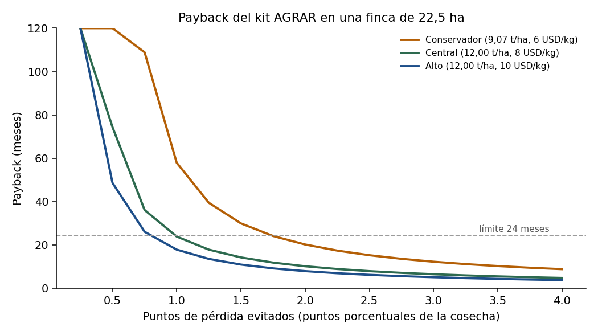

# AGRAR: economía del kit robot (D1 + PLC existente)

Sabana Hack 2026, reto "Berry Good Idea". Fecha de corte: 2026-10-23. TRM usada: **3.185,01 COP/USD** (FUENTE: datos.gov.co, vigente el 23-oct-2026; rango 12 meses 3.048-3.901). Todo sale de `agrar_roi.py` (`python3 -I agrar_roi.py`); los parámetros están en el dict `PAR` y en `parametros.csv` con su marca FUENTE / DERIVADO / SUPUESTO / NO VERIFICADO.

**Lectura rápida**

- El kit completo con D1 Ultra cuesta a AGRAR **60,2 M COP** puesto en Colombia y se vende a **100,4 M COP** con 40 % de margen: **cabe en 90-110 M** (con IVA al cliente serían 119,5 M). Con el D1 EDU baja a 91,5 M.
- **El colchón es corto**: cada factor adverso por separado (D1 a precio de tienda 9.600, IVA como costo o TRM 3.901) lleva el precio a 111-113 M, sobre el techo. En el escenario adverso combinado sale a 152,0 M; con EDU, horas -30 % y sin NRE/batería/garantía vuelve a ~99,6 M. Una segunda unidad también lo saca del rango (170,6 M).
- Con 10 proyectos al año AGRAR factura **1.004 M COP** y gana **402 M COP** de margen bruto; la suscripción de 17,0 M COP/finca/año suma 585 M COP en el año 5.
- Para el cliente (finca de 22,5 ha, caso central) el sistema paga en **~24 meses con 1 punto** de pérdida evitada (justo en el límite de 24) y en 10 meses con 2 puntos. En el caso conservador necesita ~1,8 puntos para cumplir menos de 24 meses.
- **Un robot recorre las 40 parcelas en ~7 noches** (rango 3-12), frente a 11-17 jornadas de una persona con papel; no cubre los 40 bloques cada noche, así que depende de que el PLC priorice.
- **Cifra unificada del híbrido para el cliente: ~867 USD/ha/año (~2,76 M COP/ha/año)**, 717 USD sin contar falsas alarmas (sección 6).

## 1. BOM del kit por finca

Un solo embarque consolidado desde México. Cadena de importación (igual a `finanzas/parametros.yaml`): flete 5 USD/kg + 150 fijo, seguro 1 %, arancel 5 % sobre CIF, IVA 19 % sobre CIF + arancel, agencia y transporte 350 USD. Factor de importación calculado: **1,349** con IVA y 1,140 sin IVA (previo: 1,35). Peso del embarque: 36 kg. El IVA se muestra aparte porque se supone recuperable por AGRAR (SUPUESTO; consultar contador).

| Categoría | Ítem | Cant. | Origen | FOB USD | Costo puesto M COP (sin IVA) | Marca |
|---|---|---|---|---|---|---|
| Robot | Robot AgiBot D1 Ultra | 1 | importado | 7.499 | 27,22 | NO VERIFICADO |
| Robot | Batería de repuesto (1 por robot) | 1 | importado | 450 | 1,63 | NO VERIFICADO |
| Visión | Cámara RGB 4K con iluminación | 1 | importado | 350 | 1,27 | SUPUESTO |
| Visión | Cómputo de borde tipo Jetson Orin Nano Super | 1 | importado | 249 | 0,90 | SUPUESTO |
| Visión | SSD, fuente DC-DC y caja del cómputo | 1 | importado | 150 | 0,54 | SUPUESTO |
| Sensado | Sensor T/HR a bordo | 1 | importado | 60 | 0,22 | SUPUESTO |
| Comunicación | Módulo LoRaWAN / Modbus RS485 | 1 | importado | 80 | 0,29 | SUPUESTO |
| Mecánica | Mástil y soporte de cámara (local) | 1 | local |  | 0,80 | SUPUESTO |
| Infraestructura | Base de carga (caseta, cargador, UPS, punto de acceso) | 1 | local |  | 2,20 | SUPUESTO |
| Infraestructura | Cableado, conectores y protección | 1 | local |  | 0,32 | SUPUESTO |
| Ingeniería | Levantamiento de finca y rutas (40 bloques) | 1 | horas AGRAR |  | 4,80 | SUPUESTO |
| Ingeniería | Integración con PLC/controlador (Modbus / LoRaWAN) | 1 | horas AGRAR |  | 3,20 | SUPUESTO |
| Ingeniería | Software: navegación por pasillo, captura, buffer | 1 | horas AGRAR |  | 4,00 | SUPUESTO |
| Ingeniería | Clasificador, panel y alertas | 1 | horas AGRAR |  | 3,20 | SUPUESTO |
| Ingeniería | Instalación, pruebas y capacitación en sitio | 1 | horas AGRAR |  | 3,84 | SUPUESTO |
| Ingeniería | Viáticos y transporte | 1 | AGRAR |  | 1,90 | SUPUESTO |
| Ingeniería | Amortización del desarrollo base (64 M COP / 30 proyectos) | 1 | AGRAR |  | 2,13 | SUPUESTO |
| Provisión | Garantía y contingencia (5 % del hardware) | 1 | AGRAR |  | 1,77 | SUPUESTO |
| **TOTAL** | **Costo de AGRAR** (238 h de ingeniería) |  |  | 8.838 | **60,24** |  |
| **TOTAL** | **Precio de venta (margen 40 %), antes de IVA** |  |  |  | **100,40** |  |

Hardware puesto: 35,40 M COP; servicios y provisión: 24,84 M COP (41 % del costo). **Las horas de ingeniería pesan casi tanto como el hardware**: el precio depende más de cuánto software y levantamiento se reutilice que del robot.

**Variante D1 EDU** (mismo kit, robot a 5.999 USD FOB; la ficha del EDU no declara IP y se supone IP54 según la guía SDK):

| Concepto | D1 Ultra | D1 EDU | Diferencia |
|---|---|---|---|
| FOB importado (USD) | 8.838 | 7.338 | -1.500 |
| Hardware puesto (M COP) | 35,40 | 30,33 | -5,07 |
| Costo de AGRAR (M COP) | 60,24 | 54,92 | -5,32 |
| Precio con 40 % (M COP) | 100,40 | 91,54 | -8,87 |

Nota: el EDU no trae ROS ni cómputo libre, igual que el Ultra (guía SDK); la diferencia es de velocidad máxima, control remoto y acabado, y el equipo debe confirmar que su autonomía y carga útil bastan para el mástil con cámara.

## 2. Economía de AGRAR

Margen = (precio − costo) / precio, es decir, margen bruto sobre el precio de venta (SUPUESTO de lectura del "40 %"). Precios antes de IVA.

| Escenario | Costo AGRAR (M COP) | Precio 40 % (M COP) | Con IVA 19 % (M COP) | ¿Cabe en 90-110 M? |
|---|---|---|---|---|
| Base (Ultra 7.499, IVA recuperable, TRM 3.185) | 60,2 | 100,4 | 119,5 | SÍ |
| Ultra a precio tienda 9.600 | 67,7 | 112,8 | 134,3 | NO (sobre 110 M) |
| IVA como costo | 66,8 | 111,3 | 132,4 | NO (sobre 110 M) |
| TRM 3.900 (máx. 12 m) | 67,8 | 113,0 | 134,5 | NO (sobre 110 M) |
| Horas +25 % | 65,0 | 108,3 | 128,9 | SÍ |
| ADVERSO: 9.600 + IVA costo + TRM 3.900 + horas +25 % | 91,2 | 152,0 | 180,9 | NO (sobre 110 M) |
| D1 EDU (5.999) | 54,9 | 91,5 | 108,9 | SÍ |
| D1 EDU, escenario ADVERSO (6.080) | 73,1 | 121,9 | 145,0 | NO (sobre 110 M) |
| 2 robots D1 Ultra (finca exigente) | 102,4 | 170,6 | 203,0 | NO (sobre 110 M) |

Para llegar a 110 M con margen del 40 %, el costo máximo es 66,0 M COP; el costo base es 60,2 M, así que el colchón es de 5,8 M COP de costo. Si los 90-110 M **incluyeran IVA**, el precio neto máximo sería 92,4 M y el kit base (100,4 M) ya no cabría sin recortes.

**Qué recortar si no cabe.** Desde el escenario adverso, recortes en orden:

| Paso (acumulado) | Costo (M COP) | Precio (M COP) | Ahorro del paso (M COP) | ¿≤ 110 M? |
|---|---|---|---|---|
| Punto de partida: escenario ADVERSO | 91,19 | 151,98 |  | no |
| 1. D1 EDU en vez de D1 Ultra (6.080 USD) | 73,13 | 121,88 | 30,09 | no |
| 2. Horas -30 % (plantilla reutilizable de rutas y de integración PLC) | 65,99 | 109,98 | 11,90 | sí |
| 3. Pasar la amortización del desarrollo (NRE) a la suscripción | 63,86 | 106,43 | 3,56 | sí |
| 4. Batería de repuesto como opcional (se factura aparte) | 61,47 | 102,45 | 3,97 | sí |
| 5. Garantía cubierta por la suscripción (sin provisión inicial) | 59,73 | 99,55 | 2,90 | sí |

Cuánto ahorra cada palanca desde el escenario **base** (en precio de venta):

| Palanca | Ahorro en precio (M COP) |
|---|---|
| D1 EDU en vez de Ultra | 8,9 |
| Horas -30 % | 9,5 |
| Sin NRE en el precio inicial | 3,6 |
| Batería de repuesto opcional | 2,7 |
| Sin provisión de garantía | 2,9 |
| Sin base de carga (usa un punto existente) | 3,9 |

Lo que **no** se recorta: sensor T/HR y módulo LoRa (requisito del mentor) ni la cámara y el cómputo (el robot "tiene que verlo"). Con dos robots el precio sale del rango; la alternativa es 1 robot + patrulla priorizada por el PLC (sección 4) y un segundo robot como adicional.

**Ingreso y margen anual con 10 proyectos.** Suscripción desde el año siguiente a la instalación (el primer año va en garantía), retención 90 % (SUPUESTO).

| Año | Proyectos nuevos | Suscripciones activas | Ingreso proyectos (M COP) | Ingreso suscripción (M COP) | Ingreso total (M COP) | Margen bruto (M COP) | Margen % |
|---|---|---|---|---|---|---|---|
| 1 | 10 | 0,0 | 1.004 | 0 | 1.004 | 402 | 40 % |
| 2 | 10 | 10,0 | 1.004 | 170 | 1.174 | 473 | 40 % |
| 3 | 10 | 19,0 | 1.004 | 323 | 1.327 | 537 | 40 % |
| 4 | 10 | 27,1 | 1.004 | 461 | 1.465 | 594 | 41 % |
| 5 | 10 | 34,4 | 1.004 | 585 | 1.589 | 646 | 41 % |

**Suscripción anual por finca** (ingreso recurrente, margen 42 % tras redondear al alza a múltiplos de 0,5 M COP):

| Plan | Qué incluye | Costo de servir (M COP/año) | Precio (M COP/año) |
|---|---|---|---|
| Software + soporte | Nube (240 USD), actualizaciones de modelo y soporte remoto (1 ingeniero por 25 fincas) | 4,12 | 7,0 |
| Consumibles | ~2,7 baterías/año (800 ciclos / 300) y repuestos 4 % del hardware | 5,77 | 10,0 |
| **Total** |  | 9,90 | **17,0** |

Por ha equivale a ~237 USD/ha/año para el cliente. El primer año va incluido (garantía). Es el ingreso que hace que el negocio no dependa de cerrar siempre proyectos nuevos; no incluye costos de estructura de AGRAR (solo margen bruto).

## 3. Economía del cliente final (finca de 20-25 ha)

Cálculo con 22,5 ha (también en 20 y 25 ha en `cliente_payback.csv`). **Pérdida** = fracción del valor cosechado que se pierde por fitosanitarios; el mentor da 10-25 % y 30-40 % sin prevención. Lectura SUPUESTO: se aplica sobre el valor de lo cosechado. Rendimiento y precio son rangos, no puntos:

| Escenario | t/ha | USD/kg | Valor de cosecha (M COP/año) | Pérdida 10-25 % (M COP) | Sin prevención 30-40 % (M COP) |
|---|---|---|---|---|---|
| Conservador | 9,07 | 6 | 3.900 | 390 - 975 | 1.170 - 1.560 |
| Central | 12,00 | 8 | 6.880 | 688 - 1.720 | 2.064 - 2.752 |
| Alto | 12,00 | 10 | 8.600 | 860 - 2.150 | 2.580 - 3.440 |

Fuentes: 9,07 t/ha = EVA 2025 (FUENTE); 12 t/ha = Forbes 2026 (FUENTE); 6 USD/kg = FOB implícito (SUPUESTO); 8-10 USD/kg = Planasa vía Forbes (fuente interesada, SUPUESTO).

**Ahorro de horas de monitoreo.** Hoy una persona hace 2,4-3,8 bloques por jornada; una vuelta de 40 bloques son 10,7-16,7 jornadas (medio: 13,3). Con 26 vueltas/año (quincenal, SUPUESTO), el robot sustituye el 50 % (SUPUESTO): 173 jornadas = **10,5 M COP/año** a 19 USD/jornal. Es un beneficio real pero pequeño (~0,15 % de la cosecha): **no justifica el sistema por sí solo**; lo justifica la pérdida evitada.

**Costos anuales del cliente:** suscripción 17,0 M + operario del robot (20 min/día) 0,92 M + falsas alarmas (5/ha x 30 USD) 10,7 M = **28,7 M COP/año**. Inversión inicial: 100,4 M COP (precio antes de IVA).

**Beneficio neto anual y payback (meses)** según los puntos de pérdida que el sistema evita (neto = pérdida evitada + horas − costos anuales):

| Pérdida evitada | Conservador: neto / payback | Central: neto / payback | Alto: neto / payback | Reducción relativa si L = 15 % |
|---|---|---|---|---|
| 0,5 pts | 1 M / **913** m | 16 M / **74** m | 25 M / **49** m | 3 % |
| 1,0 pts | 21 M / **58** m | 51 M / **24** m | 68 M / **18** m | 7 % |
| 2,0 pts | 60 M / **20** m | 119 M / **10** m | 154 M / **8** m | 13 % |
| 3,0 pts | 99 M / **12** m | 188 M / **6** m | 240 M / **5** m | 20 % |

**Puntos mínimos para cumplir payback < 2 años** (22,5 ha):

| Escenario | 24 meses | 18 meses | 12 meses | 24 meses sin falsas alarmas |
|---|---|---|---|---|
| Conservador | 1,75 | 2,18 | 3,04 | 1,48 |
| Central | 0,99 | 1,24 | 1,72 | 0,84 |
| Alto | 0,80 | 0,99 | 1,38 | 0,67 |

**Sensibilidad (caso central, 22,5 ha, payback en meses):**

| Caso | 1 punto | 2 puntos | Inversión (M COP) |
|---|---|---|---|
| Referencia (central, 22,5 ha, Ultra, jornal 19) | 24 | 10 | 100 |
| Sin falsas alarmas | 20 | 9 | 100 |
| Jornal formal 23,82 USD | 23 | 10 | 100 |
| Vueltas de monitoreo semanales (52/año) | 20 | 9 | 100 |
| Vueltas mensuales (12/año) | 27 | 11 | 100 |
| Cliente no recupera IVA (inversión +19 %) | 28 | 12 | 119 |
| D1 EDU | 22 | 9 | 92 |
| 2 robots D1 Ultra | 51 | 19 | 171 |
| Kit en escenario ADVERSO de AGRAR | 36 | 15 | 152 |
| TRM 3.900 (cosecha y kit se recalculan) | 21 | 9 | 113 |
| TRM 3.048 (cosecha y kit se recalculan) | 25 | 10 | 98 |

Por tamaño (central, 1 punto): 20 ha 27 meses; 22,5 ha 24; 25 ha 21.

**¿Se cumple < 2 años?** Sí, si el sistema evita al menos 0,8 puntos (alto), 1,0 (central) o 1,8 (conservador, 9,07 t/ha y 6 USD/kg). Con 0,5 puntos no se cumple en ningún escenario. Honestidad sobre el dato: AGRAR **ya tiene** un modelo predictivo en el PLC, así que parte de esos puntos ya los captura la red; lo incremental del robot (ver el arbusto, ubicar la cama, T/HR en el punto) es **SUPUESTO y debe medirse en piloto con camas testigo**. Con 3 puntos el payback baja a ~6 meses (central).

## 4. Capacidad: ¿un robot cubre 40 bloques?

**Geometría** (mentor: nave de 6,8 m x ~80 m, 2-3 camas por nave, camino central de 5-6 m). Una nave ocupa 544 m2; un bloque de 0,5 ha = 5.000 m2 / 544 = 9 naves (DERIVADO). El robot camina los pasillos entre camas (pasillos = camas − 1; con 2,5 camas son 1,5 por nave; las plantas crecen hacia el pasillo). Longitud de pasillo por bloque: 1.080 m (rango 720-1.440 m); con 30 % de sobrerrecorrido (giros, capturas) son 1.404 m por bloque, unos 2.160 m de pasillo por ha. Una vuelta de 40 bloques son 43,2 km de pasillo y ~31 h de caminata a 0,5 m/s. Si un bloque es de 1 ha el tiempo por ha es el mismo.

**Modelo de batería.** Autonomía 1,5 h (rango 1-2 h), reserva 20 % -> 72 min útiles; traslado base-bloque ida y vuelta 8,3 min (250 m a 1 m/s); ventana nocturna de 8 h. Modo A: el robot espera ~1 h de carga entre sesiones (requiere base con carga automática, NO VERIFICADO, o una persona); modo B: batería de repuesto y cambio manual de 5 min.

| Escenario | Velocidad; autonomía; carga | Min por bloque | Bloques por sesión | Sesiones por noche | Bloques por noche | Noches por vuelta de 40 | ha por semana |
|---|---|---|---|---|---|---|---|
| Pesimista | 0,4 m/s; 1,0 h; modo A | 58 | 0,68 | 5 | 3,4 | 11,8 | 12 |
| **Base** | 0,5 m/s; 1,5 h; modo A | 47 | 1,36 | 4 | 5,4 | 7,4 | 19 |
| Optimista | 0,8 m/s; 2,0 h; modo B | 29 | 3,00 | 4 | 12,0 | 3,3 | 42 |

Con menos autonomía caben más sesiones de menor duración en la ventana (por eso el escenario pesimista tiene 5 sesiones y el base 4), pero el traslado a la base se come una parte mayor de cada una.

Sensibilidad a la velocidad y al modo de carga (autonomía 1,5 h; bloques por noche / noches por vuelta):

| Velocidad | 1 sesión por noche | Modo A (carga 1 h) | Modo B (batería de repuesto) |
|---|---|---|---|
| 0,4 m/s | 1,1 / 37 | 4,4 / 9 | 6,5 / 6 |
| 0,5 m/s | 1,4 / 29 | 5,4 / 7 | 8,2 / 5 |
| 0,8 m/s | 2,2 / 18 | 8,7 / 5 | 13,1 / 3 |

**Frente a una persona:** 2,4-3,8 bloques por jornada, es decir 10,7-16,7 jornadas por vuelta de 40 bloques (en papel, digitado después). El robot base hace 5,4 bloques por noche: vuelta completa en ~7 noches, sin ocupar jornadas de operarios y con T/HR y posición en cada hallazgo. En 7 noches cubre ~19 ha/semana, dentro del rango de 16-36 ha por robot de ESCALABILIDAD §2.7.

**Respuesta:** un robot cubre una finca de 40 bloques **para una vuelta completa cada ~7 noches (3-12 según supuestos)** y para una ronda de riesgo de ~5 bloques por noche (14 % de la finca). No cubre los 40 bloques cada noche: si el cliente exige vuelta completa en ≤ 5 noches se necesitan 2 robots, y la alternativa es priorizar con el PLC (sección 5, híbrido). Pendientes: el manual del D1 pide línea de vista (¿quién acompaña de noche?) y la carga automática no está verificada.

## 5. Matriz de alternativas recalculada

Pesos del equipo: Anticipa 20, Ubica cama y ve arbusto 20, Costo 20, Encaje 15, Robustez 15, Registro 10. Total = Σ(puntaje x peso) / 5 (escala 0-100). Versión de 7 criterios: Escalabilidad 15 % y los seis anteriores x 0,85 (17 / 17 / 17 / 12,75 / 12,75 / 8,5). Los puntajes cambian respecto a la matriz verificada (73/75/68/42/69/83) por el contexto nuevo: la red ya existe (costo de B y de la parte de red de F ~0), AGRAR no asperja (C), y los kits de D y E pasan del presupuesto.

| Alternativa | Anti. | Ubica | Costo | Encaje | Robust. | Regist. | Escal. | Total 6 crit. | Total 7 crit. (esc. 15 %) | 6, costo 30 % | 7, costo 30 % |
|---|---|---|---|---|---|---|---|---|---|---|---|
| A D1 Ultra solo | 3 | 5 | 3 | 3 | 3 | 4 | 2 | 70,0 | 65,5 | 68,8 | 64,6 |
| B Red fija (ya existe en AGRAR) | 5 | 1 | 5 | 5 | 4 | 2 | 4 | 75,0 | 75,8 | 78,1 | 79,5 |
| C Kit en aspersora | 2 | 3 | 4 | 2 | 3 | 3 | 3 | 57,0 | 57,5 | 59,9 | 61,0 |
| D Humanoide X2 Ultra | 2 | 4 | 1 | 1 | 1 | 4 | 1 | 42,0 | 38,7 | 39,2 | 35,8 |
| E Ruedas | 3 | 4 | 2 | 2 | 2 | 4 | 2 | 56,0 | 53,6 | 54,0 | 51,5 |
| F Híbrido (PLC de AGRAR + D1) | 5 | 5 | 3 | 5 | 4 | 5 | 4 | 89,0 | 87,7 | 85,4 | 83,3 |

Sensibilidad "costo al 30 %": los demás pesos se reescalan proporcionalmente (6 criterios: 17,5, 17,5, 30,0, 13,1, 13,1, 8,8; 7 criterios: 14,3, 14,3, 30,0, 10,8, 10,8, 7,2, 12,7). Con los pesos de sensibilidad del documento (20/15/30/15/10/10): A 68,0; B 80,0; C 59,0; D 39,0; E 54,0; F 86,0.

**Lectura.** F queda primero (89,0 en 6 criterios, 87,7 en 7, 85,4 con costo al 30 %); B (la red existente) es segunda y por eso el híbrido se presenta como "la red que AGRAR ya tiene + los ojos del robot". Ojo: F incluye a B, así que casi siempre la supera; la matriz no prueba que el robot valga ~100 M, eso lo prueba el payback de la sección 3. Barrido de pesos (múltiplos de 5, mínimo 5): 6 criterios: F primero en 91 % de 11.628 combinaciones y B sobre F en 8 %; 7 criterios: F primero en 92 % de 27.132 y B sobre F en 7 %. B solo supera a F cuando casi todo el peso va a Costo y Encaje y casi nada a Ubica y Registro (en la matriz verificada anterior ocurría en el 25 %; ahora baja porque F gana en Encaje y Robustez por el contexto AGRAR y su red ya existe).

**Justificación de cada puntaje** (una línea por criterio):

**A D1 Ultra solo**

- Anticipa = 3: Visita por calendario; el T/HR a bordo solo mide en el instante de la ronda, sin vigilancia continua entre rondas.
- Ubica cama y ve arbusto = 5: Cámara a la altura del arbusto y posición nave/cama conocida; ve daño de trips y polvo/mildiu como pidió el mentor.
- Costo = 3: El kit cabe en 90-110 M, pero sin el PLC debe recorrer todo (vuelta de ~7 noches) y repite sensores que AGRAR ya tiene.
- Encaje con la operación = 3: Compatible con protocolos abiertos de AGRAR, pero ignora los PLC instalados: sin la red no sabe adónde ir primero.
- Robustez = 3: Sin ROS, IP54, batería de 1-2 h, línea de vista y reparación en fábrica (7 días hábiles); un solo punto de falla.
- Registro = 4: Guarda cama + T/HR + foto y reenvía por LoRa o al volver a base; sin serie continua entre rondas.
- Escalabilidad = 2: Un robot por finca, sin red para priorizar; logística de baterías y reparación; cuesta más por ha en fincas pequeñas.

**B Red fija (ya existe en AGRAR)**

- Anticipa = 5: El modelo predictivo de AGRAR corre en el PLC con T/HR continuos por bloque: anticipa Botrytis y Alternaria de noche.
- Ubica cama y ve arbusto = 1: Resuelve por bloque, no por cama, y no ve el arbusto: el mentor dijo que mildiu 'solo se sabe viéndolo'.
- Costo = 5: Costo incremental ~0: la red ya existe (PLC por bloque); es la línea base del cliente.
- Encaje con la operación = 5: Es el producto de AGRAR: mismos PLC, LoRaWAN/Modbus y base de datos; sin cambios operativos.
- Robustez = 4: Sensores fijos sin partes móviles y ya probados por AGRAR; sufren por calibración y deriva.
- Registro = 2: Serie T/HR continua por bloque, pero sin foto ni cama: no sirve de evidencia visual del daño.
- Escalabilidad = 4: Sirve a cualquier tamaño y cultivo con costo marginal bajo; AGRAR ya la vende (40-60 ventiladores/mes), pero no genera etiquetas visuales.

**C Kit en aspersora**

- Anticipa = 2: Solo ve cuando alguien asperja y AGRAR no asperja; llega después de la aplicación, no antes.
- Ubica cama y ve arbusto = 3: La aspersora pasa por las camas, pero a la hora de aplicación (6-14 h) y en invernaderos de 6,8 m puede ser bomba de espalda (NO VERIFICADO).
- Costo = 4: Kit barato (~5.700 USD en finanzas.md), aunque AGRAR tendría que integrarlo a equipos de terceros.
- Encaje con la operación = 2: AGRAR no hace aspersión: el manejo fitosanitario es del agrónomo de cada finca; no es su cliente ni su canal.
- Robustez = 3: Sin robot que falle, pero depende de que cada finca use el mismo tipo de aspersora (un soporte por modelo).
- Registro = 3: Registra cama si hay GPS/marcadores, pero solo en días de aplicación.
- Escalabilidad = 3: Bajo CAPEX y sin logística de robot, pero depende del equipo de aspersión de cada finca.

**D Humanoide X2 Ultra**

- Anticipa = 2: Misma función de patrulla que A con menor velocidad (0,4 m/s) y autonomía: cubre menos bloques por noche.
- Ubica cama y ve arbusto = 4: A altura de humanoide ve el arbusto, pero con racimos colgando en pasillos estrechos puede dañar el fruto.
- Costo = 1: X2 Ultra a 39.999 USD FOB: con la misma estructura de costo el proyecto saldría en ~294 M COP, muy fuera de 90-110 M.
- Encaje con la operación = 1: Plataforma de propósito general sin historial en invernadero; no encaja con el negocio de automatización de AGRAR.
- Robustez = 1: Sin historial en campo húmedo, baterías cortas y precio sin verificar; riesgo alto de caída.
- Registro = 4: Puede registrar cama y T/HR, pero sin ROS ni ruta validada para ello.
- Escalabilidad = 1: Alto costo por finca, plataforma de propósito general y precio sin verificar: no se puede vender a muchos productores.

**E Ruedas**

- Anticipa = 3: Patrulla sin red: misma limitación que A, con menor agilidad para cambiar de nave.
- Ubica cama y ve arbusto = 4: Con mástil ve el arbusto; solo si el pasillo admite el ancho de la plataforma (a veces hay que pasar de lado).
- Costo = 2: Amiga ~22.500 USD FOB: con la misma estructura de costo el proyecto saldría en ~196 M COP, sobre el presupuesto.
- Encaje con la operación = 2: Pasillos de 6,8 m con 2-3 camas y plantas hacia el pasillo; la plataforma de ~250 kg pisa maceta y fruto.
- Robustez = 2: Terreno firme necesario; pesa ~250 kg con embalaje y es difícil de reparar/mover entre naves.
- Registro = 4: Registra bien (cámara y T/HR fijos), pero la ruta por naves no está validada.
- Escalabilidad = 2: Plataforma pesada que exige terreno firme y pasillos anchos; costo por ha alto en fincas pequeñas.

**F Híbrido (PLC de AGRAR + D1)**

- Anticipa = 5: El PLC de AGRAR marca el riesgo (humedad/temperatura) y el robot patrulla primero los bloques en riesgo.
- Ubica cama y ve arbusto = 5: El robot confirma visualmente en la cama exacta, con posición y T/HR en el punto del hallazgo.
- Costo = 3: Mismo kit que A (~100 M COP, dentro de 90-110 M) y sin costo extra de red; el payback < 2 años exige evitar ~1 punto (caso central) a ~1,8 (conservador).
- Encaje con la operación = 5: Usa lo que AGRAR ya vende (PLC, LoRaWAN/Modbus), se vende a los mismos grupos y patrulla de noche/amanecer.
- Robustez = 4: Si el robot falla (reparación de ~7 días hábiles) la red de PLC sigue protegiendo; el robot sigue siendo sin ROS e IP54.
- Registro = 5: Cama + T/HR + foto del robot, más la serie continua del PLC: el registro más completo.
- Escalabilidad = 4: Menú: red en todas las fincas (ya instalada) y robot donde se paga; efecto de red de datos más fuerte. Baja a 2 si se vende como 'un robot por finca'.

Escalabilidad: puntajes de ESCALABILIDAD §10.2 (2/4/3/1/2/4), sin cambios.

## 6. Cifra unificada de costo por ha del híbrido

**Usar: ~867 USD/ha/año (~2,76 M COP/ha/año) para el cliente de AGRAR en 22,5 ha**, con vida de 3 años en línea recta. Incluye precio del proyecto (100,4 M COP), suscripción y consumibles (17,0 M/año), operario y falsas alarmas. Sin falsas alarmas: ~717 USD/ha/año. Por separado, el precio de pago único es ~1.401 USD/ha (~4,5 M COP/ha) y la parte recurrente ~237 USD/ha/año.

Cómo se relaciona con las cifras previas:

| Paso | USD/ha/año |
|---|---|
| F del modelo de finanzas (20 ha: 1 D1 + 20 nodos + gateway + mástil) | 722 |
| (-) Quitar la red nueva: en AGRAR el PLC por bloque ya existe | 487 |
| (+) Pagar el precio de AGRAR (integración, software, base de carga y margen 40 %) en vez del equipo puesto en finca | 826 |
| (+/-) Cambiar nube + mantenimiento del modelo por suscripción + consumibles y operario | 957 |
| (-) Diluir en 22,5 ha en vez de 20 ha (resultado final con falsas alarmas) | 867 |
| Mismo resultado sin falsas alarmas | 717 |

- **430:** cifra del documento anterior al modelo de finanzas (híbrido sin falsas alarmas ni mantenimiento completo; era un costo, no un beneficio ni un precio). Queda **obsoleta**.
- **722:** costo del híbrido en el modelo de finanzas (20 ha) para un productor que **compra y arma todo**: 1 D1 + 20 nodos + gateway + falsas alarmas. Sigue válido para un cliente sin infraestructura (no AGRAR).
- **820:** opción A (D1 Ultra con mástil **sin red**, 2 robots por la cobertura semanal de 20 ha en filas de campo); no aplica al invernadero con pasillos más cortos y no es la oferta de AGRAR.
- **~867:** el híbrido de AGRAR para el cliente. Se quita la red nueva (−236 USD/ha), pero entran la ingeniería de integración y el software (que el modelo de finanzas no contaba), la base de carga y el margen de 40 % dentro del precio, y la suscripción con consumibles reemplaza el mantenimiento genérico. El resultado queda ~20 % sobre 722. Las falsas alarmas (150 USD/ha) son la partida más incierta.
- **520 USD/ha:** precio de servicio (RaaS) del modelo de negocio; es otro modelo y no se mezcla con esta cifra.

## 7. Cinco frases para el pitch

1. "AGRAR ya tiene los ojos ambientales en cada bloque, con PLC y sensores; nuestro robot es el par de ojos que va a la cama exacta donde el modelo marca riesgo y trae temperatura y humedad del punto del hallazgo."
2. "El kit completo (D1 Ultra, cámara, cómputo, sensor T/HR, LoRa y base de carga) cuesta ~100 M COP, dentro de los 90-110 M del presupuesto, y deja a AGRAR el 40 % de margen que exige."
3. "Un robot recorre las 40 parcelas en ~7 noches, sin tocar la jornada de los operarios, frente a 11-17 jornadas de una persona con papel, y registra cada hallazgo digitalmente."
4. "En una finca de 22,5 ha que cosecha ~6.880 M COP al año, evitar 1 punto de pérdida paga el sistema en ~24 meses (el límite) y 2 puntos en ~10; la meta es menos de 24."
5. "Con 10 proyectos al año AGRAR factura ~1.004 M COP y suma una suscripción de ~17 M COP por finca al año, que llega a ~585 M COP en el año 5."

Cuidado en el pitch: los puntos de pérdida evitados y la sustitución de horas son SUPUESTOS a medir en piloto; la mejora que ya captura el modelo predictivo del PLC no es del robot.

## 8. Supuestos que más pesan y pendientes

- Cotización formal del D1 Ultra con entrega en Colombia (7.499 FOB hoja del equipo vs 9.600 en tienda) y de la batería de repuesto (450 USD NO VERIFICADO).
- Horas de ingeniería (238 h) y costo de la hora (80.000 COP): son la mitad del costo. Medir con el primer proyecto.
- IVA: confirmar con contador si AGRAR lo descuenta (base) y si los 90-110 M incluyen IVA.
- Puntos de pérdida evitados (0,5-3), pérdida base L (10-25 %), rendimiento y precio: piloto con camas testigo.
- Velocidad efectiva (0,4-0,8 m/s), autonomía con cámara y cómputo, carga automática en base, línea de vista del manual.
- Geometría: pasillos por nave (camas − 1) y distancia a la base se deben medir en el levantamiento de cada finca.
- Falsas alarmas toleradas por el cliente (pregunta abierta del mentor): 5/ha/año x 30 USD es el supuesto previo.
- Clasificación arancelaria (5 % vs 0 %) y vida útil de 3 años del robot.

## 9. Archivos

`agrar_roi.py` (modelo y generador de este documento), `parametros.csv`, `bom_d1_ultra.csv`, `bom_d1_edu.csv`, `agrar_precio_variantes.csv`, `agrar_recortes.csv`, `agrar_recortes_desde_base.csv`, `agrar_suscripcion.csv`, `agrar_anual_10proyectos.csv`, `cliente_payback.csv`, `cliente_sensibilidad.csv`, `cliente_puntos_equilibrio.csv`, `capacidad.csv`, `capacidad_sensibilidad.csv`, `capacidad_camas_por_nave.csv`, `matriz_puntajes.csv`, `matriz_totales.csv`, `matriz_justificaciones.csv`, `matriz_barrido_pesos.csv`, `costo_ha_puente.csv`, `payback_vs_puntos.png`.
