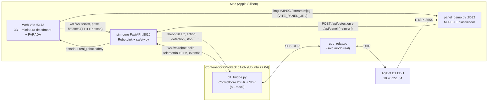

# Gemelo digital + AgiBot D1 + panel de cámara

Integración del simulador 3D (`berry-sim`), el puente del robot (`robot_d1 2/d1_bridge.py`) y el panel de cámara/clasificador (`datos/robot/panel_demo.py`), con barreras de seguridad. Contrato entre piezas: `robot_d1 2/PROTOCOLO.md` (v1 + secciones 4 y 5).

Ramas y respaldos: `berry-sim` está en la rama git `integracion-gemelo`. `robot_d1 2` no es repo: los archivos tocados tienen copia `*.orig` (`d1_bridge.py`, `d1/controller.py`, `d1/config.py`, `d1/bridge.py`, `d1/safety.py`, `PROTOCOLO.md`). En `datos/robot/`: `panel_demo.py.orig` y `Dockerfile.orig`; en `sim-core/`: `robot_link.py.orig`, `server.py.orig`, `tests/test_robot_link.py.orig`.

## 1. Arquitectura



Quién decide qué:

| Capa | Decide |
|---|---|
| sim-core (`safety.py`, `robot_link.py`) | geocerca, batería (sim), telemetría vieja, video perdido, tope 0,3 m/s, navegador caído |
| puente (`d1/controller.py`, `d1/config.py`) | TTL de teleop 0,3 s, cero al caer el WS, batería (< 25 % no se para, < 15 % se acuesta), `--speed-cap` |
| web | solo presentación: miniatura, botón PARADA (WS + HTTP), tecla X, teclas soltadas al perder foco |

Puertos reales de esta máquina: el 8000 del Mac lo ocupa `cfom-backend` (contenedor de OrbStack), por eso sim-core corre en **8010** (la web lo usa con `VITE_WS_URL=ws://localhost:8010/ws`). `abrir_puente.sh` usa 8010 por defecto (`SIM_PORT=...` para cambiarlo). sim-core debe escuchar en `0.0.0.0` (verificado: el contenedor llega a `http://host.docker.internal:<puerto>/health`; ahí `host.docker.internal` resuelve a 0.250.250.254).

## 2. Cómo arrancar (en este orden)

Siempre, en terminales distintas:

```bash
# 1) sim-core (0.0.0.0, puerto 8010). Reiniciarlo si estaba corriendo con código viejo.
cd ~/Downloads/BerryGoodIdea_demo_vivo_2026-10-23/berry-sim/sim-core
.venv/bin/uvicorn server:app --host 0.0.0.0 --port 8010

# 2) web (la miniatura toma el video de VITE_PANEL_URL, por defecto http://localhost:8092)
cd ~/Downloads/BerryGoodIdea_demo_vivo_2026-10-23/berry-sim
VITE_WS_URL=ws://localhost:8010/ws npm --prefix web run dev        # http://localhost:5173
#   panel en otro equipo:  VITE_PANEL_URL=http://<IP>:8092 ...

# 3) panel + clasificador, AHORA con --sim-url (sin él no manda latido ni detecciones)
cd ~/Downloads/SabanaHack/datos && HF_HUB_OFFLINE=1 .venv/bin/python -I robot/panel_demo.py \
  --robot-ip 10.90.251.84 --port 8092 --modelo resultados/ml/modelo_aug_B --sim-url http://localhost:8010
```

Paso 4, el puente (un solo puente a la vez; sim-core rechaza el segundo):

```bash
# MODO MOCK (sin robot, sin SDK, sin reenvío UDP): robot simulado del puente
bash ~/Downloads/SabanaHack/datos/robot/abrir_puente.sh mock
#   MOCK_BATTERY=20 ... para probar la barrera de batería; SPEED_CAP=0 quita el tope

# MODO REAL (red "Juanda": Mac 10.90.251.94, robot 10.90.251.84) — levanta el reenvío UDP y el SDK montado
bash ~/Downloads/SabanaHack/datos/robot/abrir_puente.sh juanda check   # solo prueba el enlace, no mueve
bash ~/Downloads/SabanaHack/datos/robot/abrir_puente.sh juanda
#   otra red:  MAC_IP=x ROBOT_IP=y bash abrir_puente.sh red
```

La imagen `d1sdk` ya trae `websockets` y `pyyaml` (más `pytest`/`pytest-asyncio`); se reconstruye con `docker build -t d1sdk ~/Downloads/SabanaHack/datos/robot` (solo con internet; el día de la demo no hace falta). `abrir_teleop.sh` (teclado en terminal, sin simulador) sigue igual.

En la web: pasar a **Manual** (botón o `M`), `U`/Pararse para que el D1 se pare, **WASD** para conducir, **X** o el botón grande PARADA para parar, Reanudar para soltar la parada. Para conducir el mock con el panel encendido pero sin cámara hay que apagar la barrera de video (ver 3d).

## 3. Qué hace cada barrera y cómo probarla

Todas generan un evento visible (toast rojo + registro del panel D1 real) y quedan contadas en `GET /api/robot` → `safety.trips`. Estado y ajustes: `GET/POST http://localhost:8010/api/safety`. Pruebas automáticas: `sim-core/tests/test_safety.py` (19), `test_ruta_real.py` y `test_ruta_cosim.py` y `robot_d1 2/tests/test_guardas.py` (8).

a) **Geocerca** (sim-core). Con la pose del gemelo (la web la manda a 10 Hz en Manual) se comprueba el área permitida: pasillos entre camas (±0,58 m del eje), pasillo principal de 5 m y cabecera norte. Entrar en una hilera fuera de un pasillo o a menos de 0,25 m del borde de una cama, o salir del bloque, dispara `estop` al puente y el toast "Fuera del pasillo: …: parada de emergencia". Es por flanco; mientras siga fuera, el teleop va en cero aunque se pulse Reanudar: hay que "Re-centrar el gemelo". Prueba: `curl` no sirve (la pose viene del WS); en la web con el mock, mover el gemelo contra una cama, o por código `{"cmd":"manual","value":true}` + `{"cmd":"pose","x":<bed_x[0]>,"z":0}` por `/ws`. Desactivar: `POST /api/safety {"geofence": false}`.

b) **Batería**. < 25 %: sim-core rechaza `stand` con aviso, y el puente también (`battery_low`). < 15 %: sim-core manda `lie` una vez y el puente se acuesta solo con cero sostenido antes de `lieDown` (`battery_critical`); el teleop va en cero. Se ignora la lectura 0 % cuando `sdk_ok` es falso. Prueba: `MOCK_BATTERY=20 bash abrir_puente.sh mock` y pulsar Pararse (verificado: rechazado con aviso).

c) **Pérdida de enlace**. Telemetría del puente más vieja de 1 s: sim-core deja de mandar teleop, alerta "Telemetría del D1 vieja", y al volver exige soltar y pulsar de nuevo. El puente ya pone cero al perder el WS (TTL 0,3 s + cero continuo; prueba existente `test_ws_drop_gives_continuous_zero_and_reconnects`). Prueba: `docker pause d1puente` (alerta a ~1 s) y `docker unpause d1puente` (verificado).

d) **Pérdida de video**. El panel manda latido cada 0,5 s (`cam_ok` = cuadros de menos de 2 s). Si el video falta más de 3 s con el robot en Manual: teleop en cero y "Sin video: robot detenido"; al volver el video hay que soltar y pulsar de nuevo. Un panel que deja de latir cuenta como sin video. La barrera se activa sola desde el primer latido (`video_guard: auto`); `on` la fuerza aunque el panel nunca haya latido, `off` la apaga (`POST /api/safety {"video_guard":"off"}` o `BERRY_VIDEO_GUARD=off`). Prueba: con el panel sin robot, Manual + `U` + W: el D1 no avanza (verificado).

e) **Tope de velocidad 0,3 m/s y hombre muerto**. Tope: el puente se lanza con `--speed-cap 0.3` (`abrir_puente.sh` lo pone; `SPEED_CAP=` lo cambia) y sim-core además escala los ejes contra los límites del `hello` y anula Shift (`speed_cap_mps`, `POST /api/safety`). Verificado: W + Shift da vx = 0,30. Hombre muerto: la web manda teleop a 20 Hz solo con la tecla apretada; sim-core lo da por viejo a 0,25 s y el puente a 0,3 s (`test_teleop_valid_then_expires_at_0_3s` y `test_deadman_teleop_expires_in_0_3_s`). Las teclas se sueltan al perder foco o cambiar de pestaña.

f) **Parada siempre disponible**. Botón grande PARADA (abajo a la derecha de la vista 3D, siempre visible) y X: mandan por WS y también por `POST /api/robot/action`, así que funciona con el WS del navegador caído o a medio reconectar. Si el navegador que conducía se cierra o su WS se cae, sim-core manda ceros explícitos 1 s y avisa ("Se cerró el navegador que conducía"); además el puente caduca el teleop a los 0,3 s.

### Detecciones y miniatura de cámara

- `panel_demo.py --sim-url`: manda `POST /api/detection` cuando la predicción estable tiene sospecha, o cuando pasa a sana estable tras una enfermedad; máximo 1 por segundo y sin repetir la misma etiqueta en 6 s; `truth_label` es la etiqueta de la hoja del visor si el robot lo mira (`/hoja?robot=1`), si no `null`. Sin `--sim-url` el panel funciona exactamente igual que antes. El sim crea la incidencia y manda `detection_stop` al puente (verificado con el mock: el puente registra `detection_stop` y pasa a `detection_hold`). Una misma hoja que siga a la vista tras 6 s se reporta de nuevo como incidencia nueva.
- Miniatura 220×124 sobre el robot (clic = 440×248): borde rojo con alerta, gris sin hoja o sin video, verde si no. Muestra la clase estable. Si el panel no responde dice "sin video", reintenta cada 3 s y no bloquea nada.

## 4. Qué falta probar con el robot real

- Todo `abrir_puente.sh juanda` con el D1: reenvío UDP, `connect success`, telemetría real y odometría (la parte del SDK se verificó solo hasta cargar la librería en el contenedor y fallar suave sin robot).
- Que el gemelo siga la odometría real y que la geocerca no dispare por deriva (margen de 0,25 m con odometría real).
- Latencia y recorte del tope de 0,3 m/s en el suelo real (rampa, zona muerta del SDK: |vx| < 0,05 se manda como 0).
- Lectura de batería real y el comportamiento del D1 por debajo del 20 % (el SDK puede dejar de aceptar control). `battery_critical` acuesta con `lieDown`; no se ha visto con el robot.
- Video real por RTSP: `cam_ok` con la cámara viva y el tiempo hasta que el video se considera perdido.
- `estop` durante marcha real y `detection_stop` con el robot caminando.
- Un puente `--mock` olvidado ocupa el enlace y sim-core rechaza al real: cerrar el mock antes.
- La web del demo (5173) y sim-core (8010) que ya estaban corriendo siguen con el código previo hasta reiniciar sim-core; el panel en 8092 hay que relanzarlo con `--sim-url`.

## 5. Ruta real: el D1 recorre solo la ruta del modo Auto

Archivos: `sim-core/ruta_real.py` (planificador + seguidor, puro), integración en `robot_link.py` y `server.py` (comando WS `ruta`), UI en `web/src/ui/RealRobot.tsx`, `web/src/scene/RutaReal.tsx`.

**Qué hace.** Toma el recorrido Auto (pasillos rectos en serpentina y vuelta en U por la cabecera; sin los tramos de ida y vuelta a la base), lo escala (`escala_ruta`, 0,05 a 1), lo corta a `largo_max_m` y lo ancla donde está el gemelo al pulsar (el robot mira a lo largo del pasillo). El seguidor es un pure-pursuit que genera teleop (`fwd`, `turn`, `strafe` 0) con la odometría del D1: recta a 0,2 m/s como máximo, arcos de vuelta a 0,1 m/s (radio 0,4 m) y, si la vuelta no cabe (cabecera más corta que 2 x tangente del arco, o giro mayor de 150 grados), gira en el sitio con wz de 0,3 rad/s como máximo. Antes de moverse manda 0,6 s de ceros (el puente pide neutro tras pararse).

**Cómo usarlo.**
1. Mock o real: el D1 de pie (Pararse), puente conectado. En el panel "D1 real" de la izquierda están "Escala de la ruta", "Largo máx." y "Deriva máx.".
2. "Ver ruta (simulación)" dibuja la ruta escalada en la escena (ámbar) sin mover el robot y dice tramos y metros. Revisar que cabe en la sala.
3. "Ruta real" (barra de abajo, junto a Reanudar) pasa a Manual si hace falta y arranca. La ruta va en verde; la barra y el panel muestran "Tramo i/n, quedan X m, desvío Y m". "Cancelar ruta" la detiene.
Por HTTP/WS: `{"cmd":"ruta","op":"dryrun|start|cancel","escala":0.3,"largo_max_m":10,"deriva_max_m":0.4}` por `/ws`.

**Seguridad.**
- Cero y cancelación (hay que volver a pulsar "Ruta real"): PARADA/X o estop, geocerca, batería crítica, telemetría vieja, sin video, salir de Manual o cerrar el navegador, tocar WASD, el D1 sin avanzar 3 s aunque se le ordena, o deriva mayor que el límite del camino previsto (avisa "se desvió X m").
- `detection_stop`: pausa en cero y reanuda sola al terminar.
- Con escala menor de 1 la ruta no coincide con las camas de la escena, así que la geocerca de la escena se suspende mientras dura la ruta y manda el límite de deriva (se avisa al iniciar). Con escala 1 la geocerca sigue activa: el gemelo debe estar al inicio de un pasillo.
- El tope de 0,3 m/s global sigue valiendo; el seguidor usa 0,2.

**Probado (mock).** Unitarias del seguidor (recta, U con arco, U con giro en el sitio, progreso, deriva, corrección de desvío, escala y largo, cancelaciones y pausa por detección) y co-simulación con el `ControlCore`/`MockRobot` reales del puente y reloj falso (llega al final con U, nunca pasa de 0,2 m/s; la parada la cancela). De punta a punta con `abrir_puente.sh mock` en el contenedor y la web: se dibuja, avanza en recta, hace la vuelta en el sitio, termina, y PARADA la cancela.

**Con el robot real (todavía no verificado).** Empezar con escala 0,2 a 0,3 y `largo_max_m` de 3 a 5 m, sala despejada de por lo menos 1,5 m alrededor de la ruta dibujada, una persona con el mando y el botón PARADA a mano, el D1 ya de pie un rato. No se ha comprobado: que la odometría real sea suficiente para la deriva de 0,4 m (si salta de más, subir el límite con cuidado), el giro en el sitio con wz de 0,3 rad/s en el suelo real (el mínimo del SDK es 0,02), ni el comportamiento con piso resbaloso o cables. Las pruebas con el mock integran la pose sin ruido ni deslizamiento.
